# Browsing your files

Every server you've saved opens as folders you can look through. This page covers finding your way around a server, changing how a folder looks, and working with the files in it.

## Open a server

You can open a server from Home, or from the **Servers** tab if you've turned it on (Settings → Home Screen → **Servers Tab**). The **Servers** tab lists every saved server in three groups: **Shares** (SMB shares, cloud storage and folders from Files), **Jellyfin** and **Catalogs** (book servers).

| iPhone Duo — front screen | iPhone Duo — unfolded | iPhone 17e | iPhone 18 Pro Max | iPad Air 11-inch (M4) |
|:---:|:---:|:---:|:---:|:---:|
| 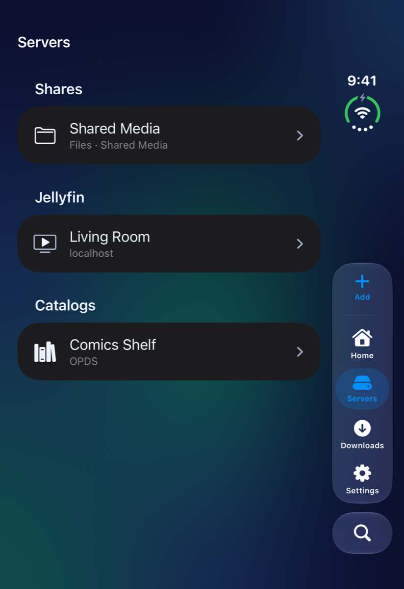 | 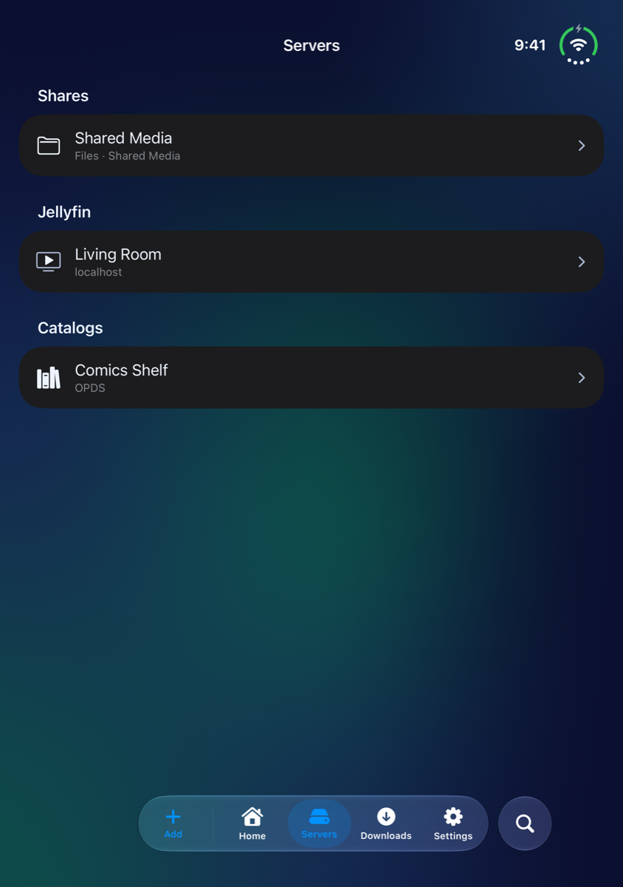 | 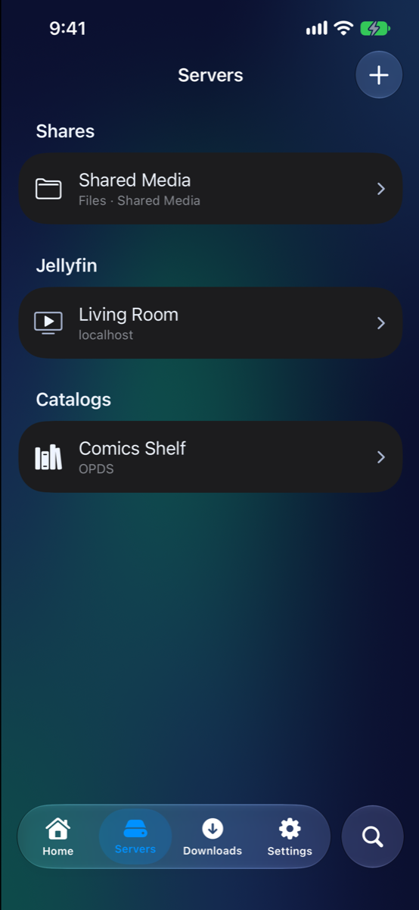 | 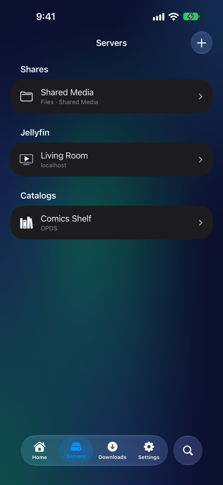 | 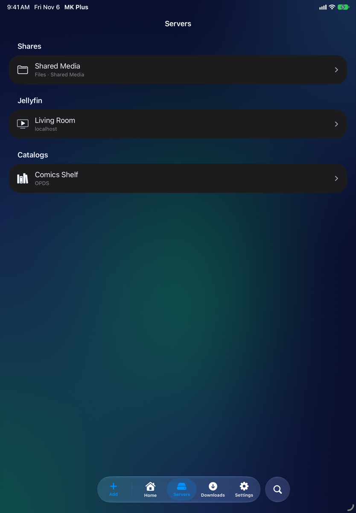 |

- Tap a server to open it.
- Swipe a server to **Edit** or **Delete** it. Settings → Server List → **Swap Swipe Directions** flips which way does which.
- Press and hold a server to put it on Home with **Add to Home**.

Folders open one inside the other, with a back button at the top left. Pull down in a folder to refresh it. Tap a video to play it in the video player. Comics, books and PDFs open in the reader, and pictures in the image viewer.

## A folder

| iPhone Duo — front screen | iPhone Duo — unfolded | iPhone 17e | iPhone 18 Pro Max | iPad Air 11-inch (M4) |
|:---:|:---:|:---:|:---:|:---:|
| 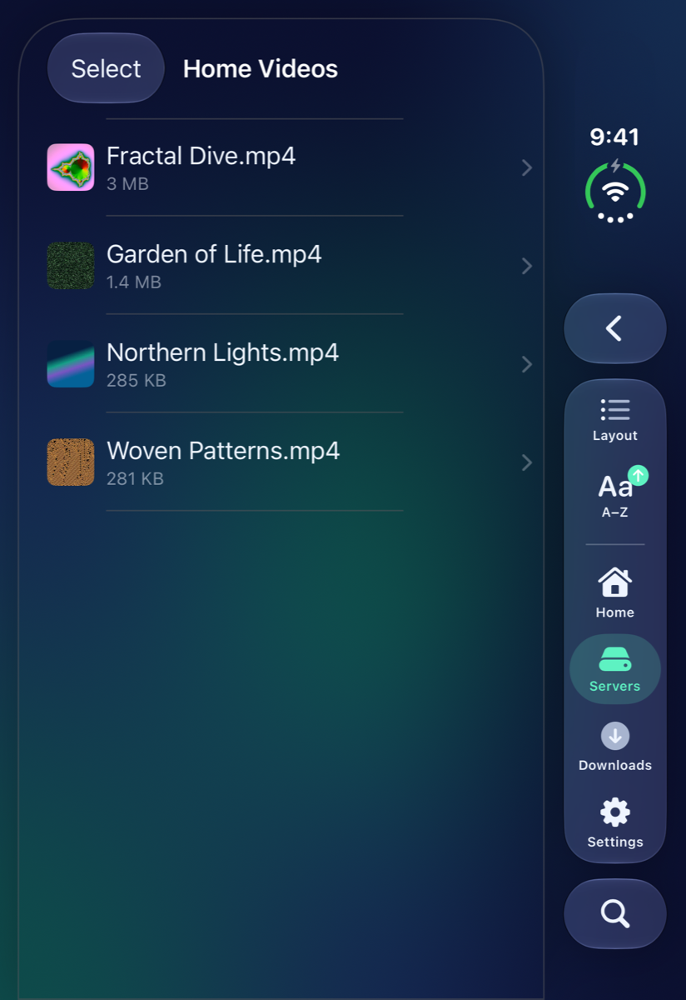 | 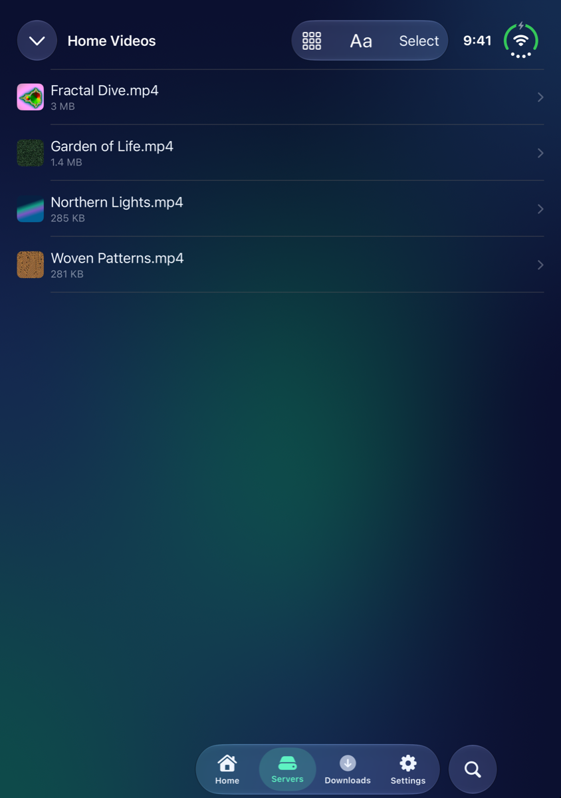 | 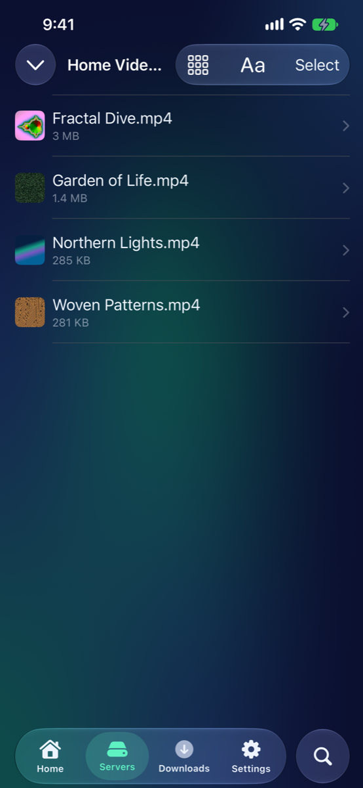 | 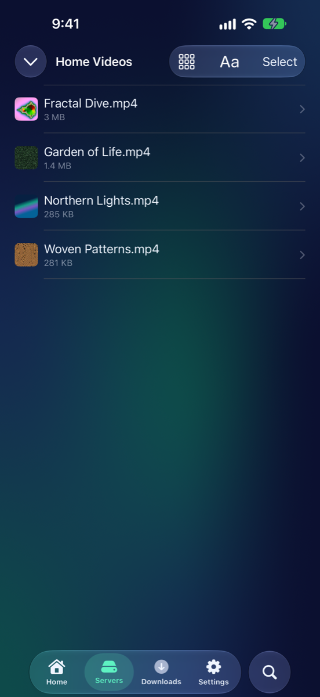 | 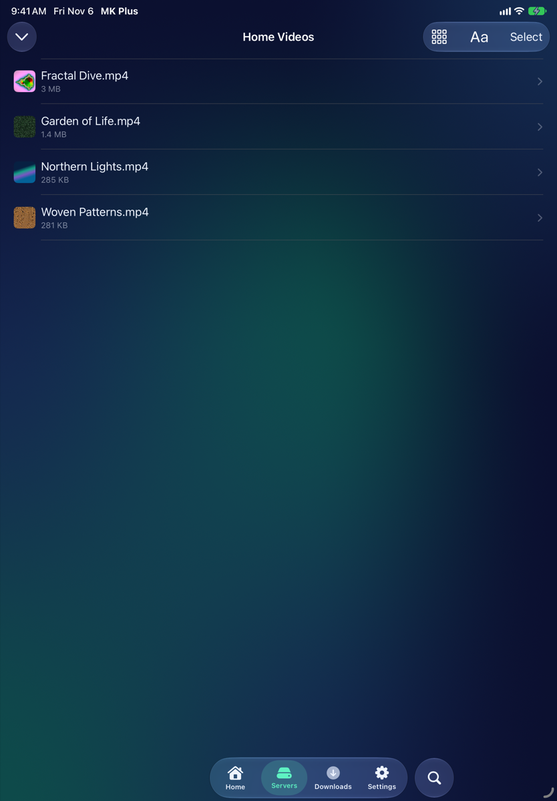 |

### Layout

The layout button changes how a folder looks. The choices are **List**, **Small Grid**, **Large Grid**, **Cards** and **Carousel**. Tap the button to go to the next layout, or, with Settings → File Browsing → **Layout Button Cycles** off, tap it to choose from a menu.

### Sort

The sort button orders a folder by **Name**, **Date** or **Size**. Choose the one that's already picked again to reverse it. Jellyfin adds **Episode**, and book catalogs add **Catalog**. In Settings → File Browsing, **Sort Button Reverses** makes a tap reverse the order and a hold open the menu.

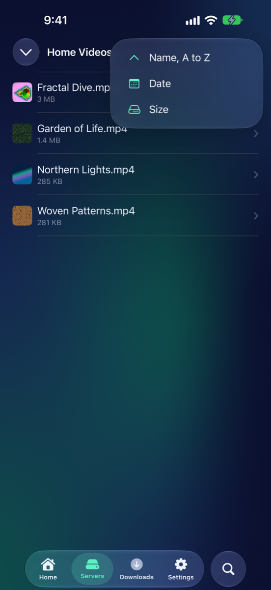
 iPhone 18 Pro Max

### Filter

Where a server has something to filter by, a **Filter** button appears. A book catalog offers its own groupings, such as genres, and **Show All** takes the filter off. In a Jellyfin search, **Show** narrows the results to one kind of thing and **Filter by Genre or Year** narrows them further.

### Search

The search bar searches the folder you're in. On a book server it searches the whole catalog. On Home, **Search All Servers** looks across every server: see [Your Home](Home-Screen.html).

### Thumbnails and the A–Z index

Settings → **File Browsing** has two switches for long folders:

- **Thumbnails** shows real previews of videos, images and comics in place of plain icons. It's on to start with.
- **A-Z Index** puts a strip of letters down the right edge, like Contacts, so you can jump straight to a letter. It's off to start with, and it works in the **List** layout when sorted by **Name**.

## The press-and-hold menu

Press and hold a file or folder to see what you can do with it. What's in the menu depends on the server and on what you've held.

- **Pin to Top** (folders) keeps a folder at the top of its list. **Unpin** puts it back.
- **Add to Home** (servers, libraries and folders) puts a widget on your Home.
- **Mark as Watched** and **Mark as Unwatched**, and **Add to Favorites** and **Remove from Favorites**, on Jellyfin.
- **Download** (Jellyfin movies and episodes) and **Download to Read Offline** (books on a book server). See Downloads below.
- **Select**, **Copy**, **Cut**, **Move**, **Rename**, **Show Info** and **Delete**, for files and folders on a share or in your cloud storage.

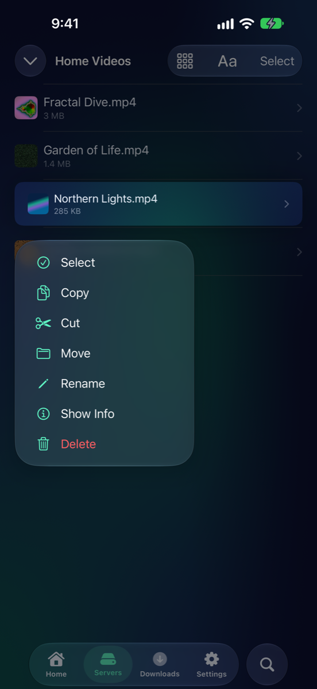
 iPhone 18 Pro Max

If you'd rather press and hold start selecting right away, turn off Settings → File Browsing → **Hold Shows File Menu**.

## Show Info

**Show Info** opens a sheet about the file: its **Name**, **Kind**, **Size**, **Where** it is, and when it was **Created** and **Modified**. For a video, picture or song it adds a **Media** section with things like **Duration**, **Resolution**, **Frame Rate**, **Video Codec**, **Video Bitrate** and **Audio**. Tap **Done** to close it.

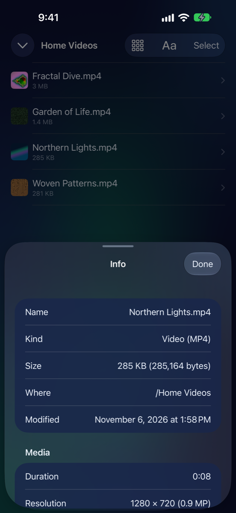
 iPhone 18 Pro Max

## Move, copy, rename and delete

These work on SMB shares, cloud storage, S3 buckets and folders from the Files app. They don't apply to Jellyfin or book servers.

**Rename**

1. Press and hold the file and choose **Rename**.
2. Type the new name and tap **Rename**.

**Move to another folder**

1. Press and hold the file and choose **Move**, or tap **Select**, tick several files and tap **Move**.
2. Open the folder you want. **Move Here** puts the files in it.

**Copy to another folder**

1. Press and hold the file and choose **Copy** (or **Cut**, to move it). With **Select**, tick several files first.
2. Open the folder you want.
3. Tap **Paste**. It shows up whenever there's something to paste.

**Delete**

1. Press and hold the file and choose **Delete**, or swipe it.
2. Confirm. Deleting removes the file from the server itself.

### Select several at once

Tap **Select**, then tap files to tick them. **Select All** ticks everything in the folder, and **Deselect All** clears it. The buttons at the bottom do the rest: **Copy**, **Paste**, **Move**, **Rename**, **Pin to Top** and **Delete**. Tap **Done** when you're finished.

## Downloads for offline

**Downloads** keeps things on your iPhone so you can use them without a connection. Press and hold a Jellyfin movie or episode and choose **Download**. For a book on a book server, choose **Download to Read Offline**.

The **Downloads** tab lists what's saved, in groups: **Downloading**, **Ready to Watch** and **Ready to Read**. A series set to download automatically appears under **Auto-Downloading**. Where you got to is sent back to the server the next time it can be reached. To get rid of one, press and hold it and choose **Remove Download**.

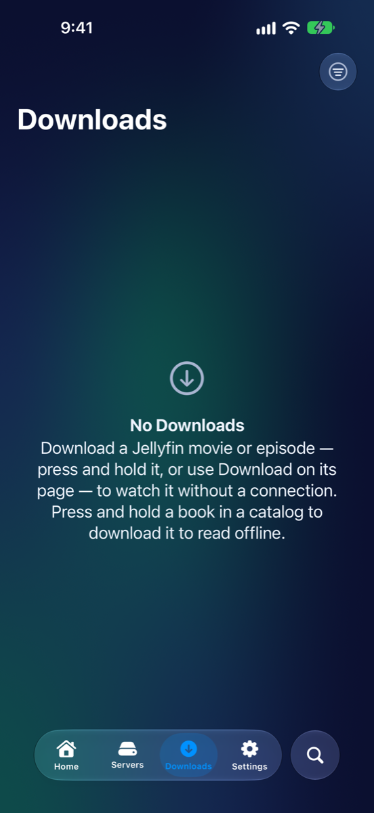
 iPhone 18 Pro Max

## Good to know

- Files on Jellyfin and book servers can't be moved, renamed or deleted from MK Plus. Do that on the server.
- Pull down in a folder to refresh it if it looks out of date.
- Settings → File Browsing also has switches for card titles, which side the selection mark is on, and where the sort and layout buttons sit.

---

Home · Previous: [← Your Home](Home-Screen.html) · Next: Watching video →
