# Getting Started

Pictures for
<button type="button" data-device="iphone-18-pro-max" aria-pressed="true">iPhone 18 Pro Max</button>
<button type="button" data-device="duo-front" aria-pressed="false">iPhone Duo — closed</button>
<button type="button" data-device="duo-open-side" aria-pressed="false">iPhone Duo — open, on its side</button>
<button type="button" data-device="iphone-17e" aria-pressed="false">iPhone 17e</button>
<button type="button" data-device="ipad-air-11" aria-pressed="false">iPad Air 11-inch</button>

MK Plus plays video and opens comics, books and PDFs from the places you keep them: a NAS or computer on your network, a Jellyfin server, a book server like Kavita or Komga, or cloud storage such as Dropbox. This page takes you from installing the app to browsing your first server.

## Install MK Plus

MK Plus is in testing, and you install it with Apple's **TestFlight** app.

1. On your iPhone or iPad, open **https://testflight.apple.com/join/P2bjt14B**.
2. If you don't have **TestFlight**, the page sends you to the App Store to get it. It's free.
3. Follow the prompts in **TestFlight** to accept the invitation, then tap **Install**.

New versions arrive through TestFlight. Open the TestFlight app to update, or turn on its automatic updates.

## The four tabs

A floating bar across the bottom of the screen switches between the tabs. On the iPhone Duo's front screen, and when you hold a Duo on its side, it stands up down the edge instead.

- **Home** is where you start: shelves and tiles for the things you watch and read. See [Your Home](Home-Screen.html).
- **Servers** lists every server you've saved. See [Browsing your files](Browsing.html).
- **Downloads** holds what you've saved to use offline.
- **Settings** is where everything can be changed.

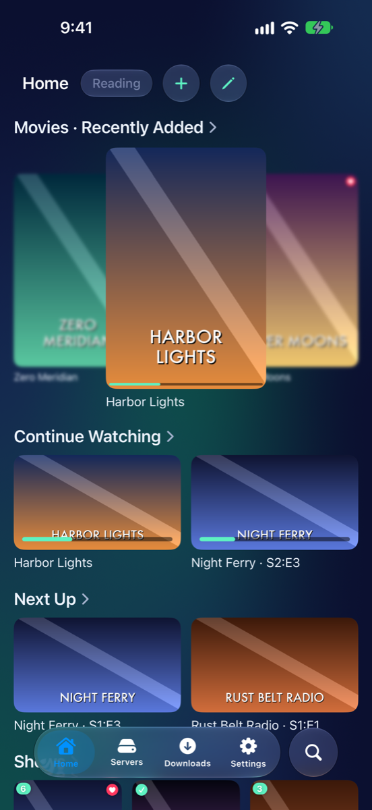
iPhone 18 Pro Max

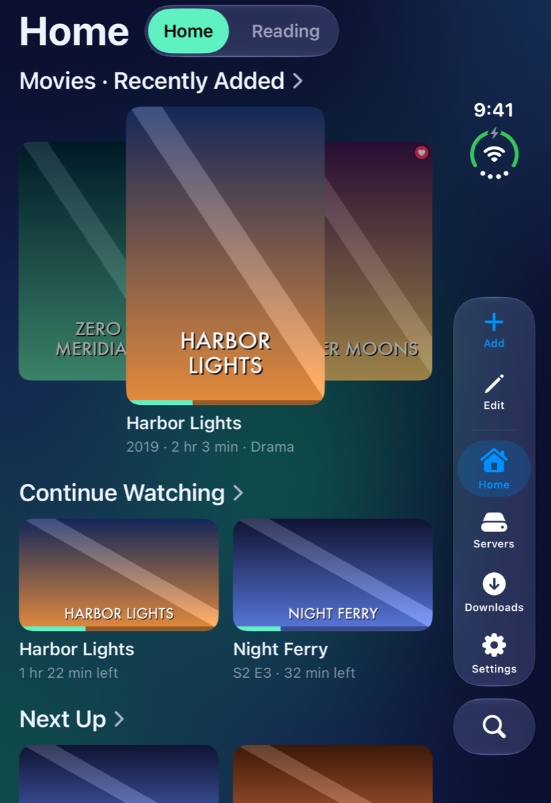
iPhone Duo — closed

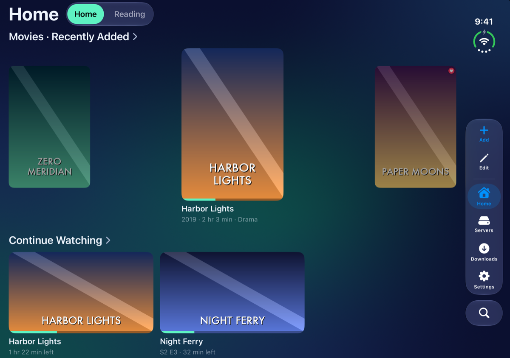
iPhone Duo — open, on its side

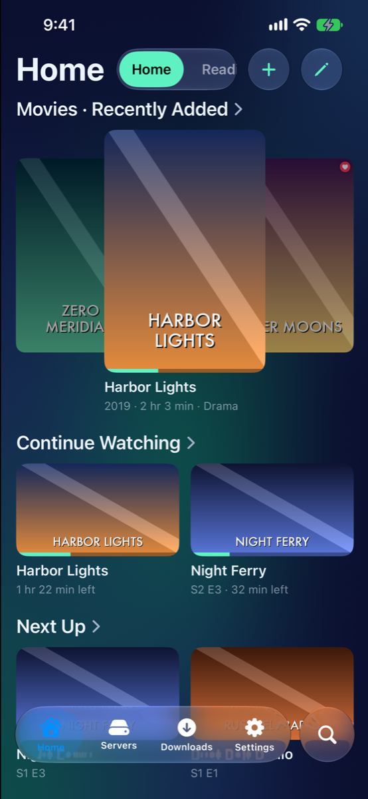
iPhone 17e

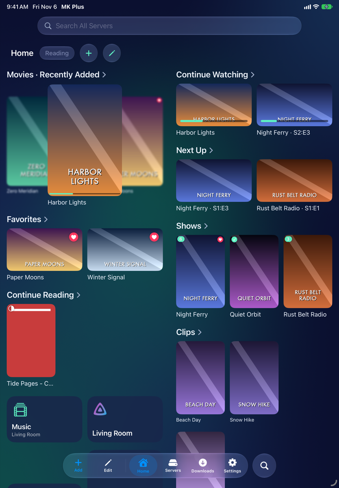
iPad Air 11-inch

The **Servers** tab is off to begin with, because your servers are also on Home and in Settings → Server List. To add it to the bar, turn on Settings → Home Screen → **Servers Tab**.

## Add your first server

A "server" here is any place MK Plus can read files from.

1. On Home, tap **+** (or **Add a Server**, if you have none yet). On the **Servers** tab, tap **+**.
2. Choose the kind of server from the list.
3. Fill in the form. Most forms ask for an address, a name, and a username and password or a sign-in.
4. Tap **Save**.

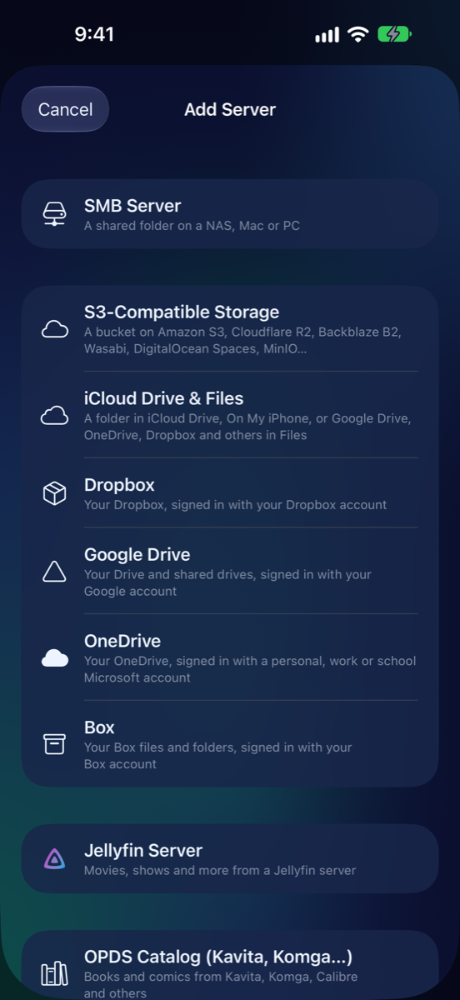
iPhone 18 Pro Max

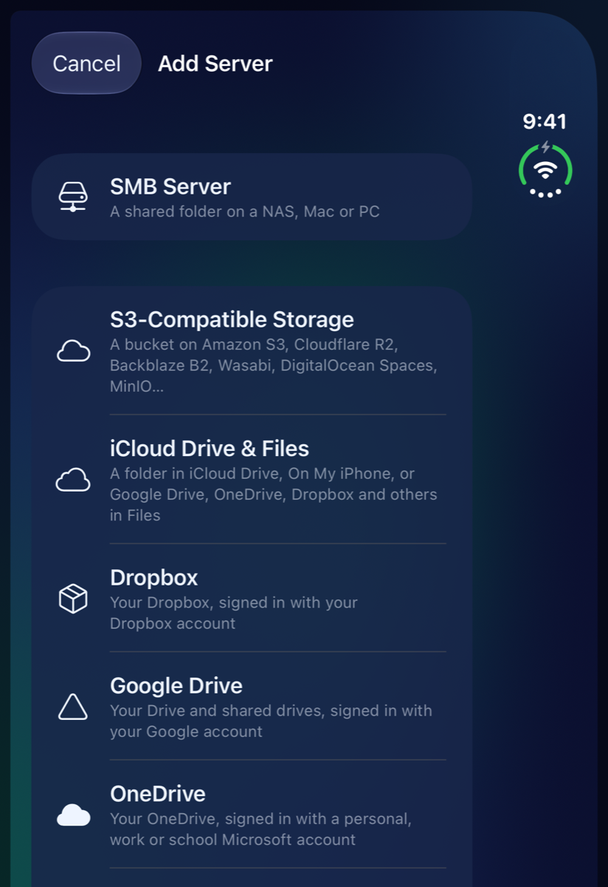
iPhone Duo — closed

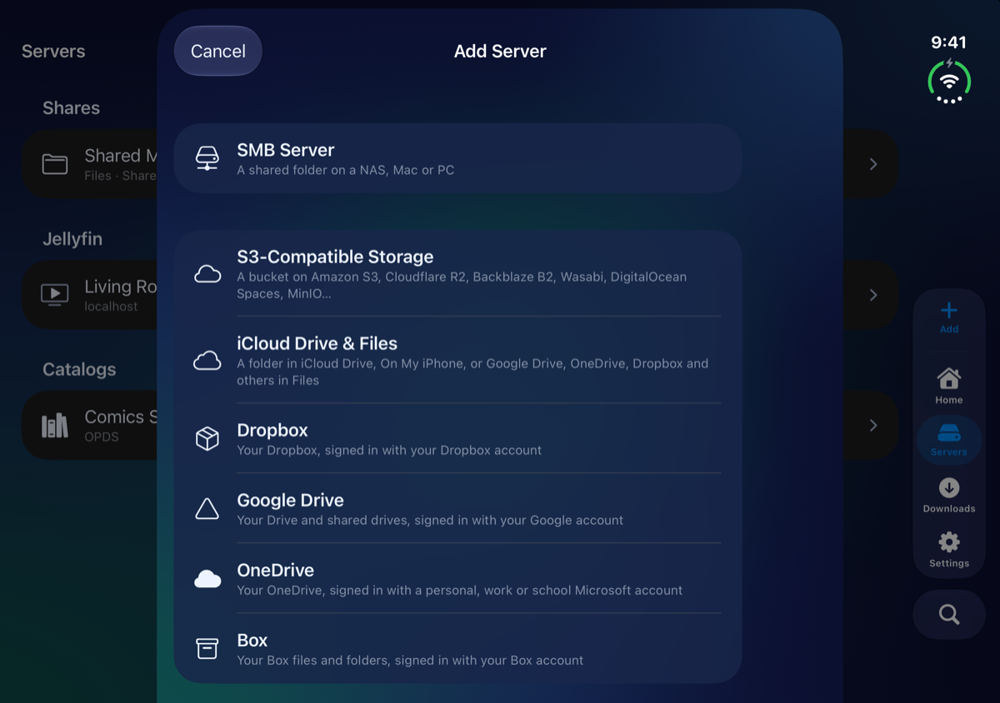
iPhone Duo — open, on its side

Pick the kind that matches where your files are:

- **SMB Server**: a shared folder on a NAS (Synology, unRAID, TrueNAS and so on), a Mac with File Sharing on, or a Windows PC. Enter its address, and a username and password if it needs them. **Browse Shares** lists the shares so you can pick one.
- **Jellyfin Server**: movies and shows from a Jellyfin server. Enter its address, then sign in with a username and password or with **Quick Connect**.
- **OPDS Catalog (Kavita, Komga…)**: books and comics from a book server. See [Book servers](OPDS-Catalogs.html).
- **iCloud Drive & Files**: a folder in iCloud Drive, On My iPhone, a USB drive, or another app's storage. See [Folders in the Files app](Setup-Files-Folders.html).
- **Dropbox**: see [Setting up Dropbox](Setup-Dropbox.html).
- **Google Drive**: see [Setting up Google Drive](Setup-Google-Drive.html).
- **OneDrive**: see [Setting up OneDrive](Setup-OneDrive.html).
- **Box**: see [Setting up Box](Setup-Box.html).
- **S3-Compatible Storage**: a bucket on Amazon S3, Cloudflare R2, Backblaze B2, Wasabi, DigitalOcean Spaces, MinIO and others. See [Setting up S3-compatible storage](Setup-S3.html).

Dropbox, Google Drive, OneDrive, Box and S3 each need a one-time setup on the service's side. The pages above go through it step by step. If your server sits behind Cloudflare, see [Cloudflare Access](Cloudflare-Access.html).

### Found on Your Network

MK Plus looks for servers on your Wi-Fi while Add Server is open. The ones it finds show a count in the list, such as "1 found on your network". Inside the SMB, Jellyfin and book-server forms, a **Found on Your Network** section lists them. Tap one to fill in its details, then add whatever it still needs, such as a password. **Search Again** looks once more.

It finds SMB shares and Jellyfin servers. With Settings → Server List → **Find Book Servers** on, it also finds Kavita, Komga, Calibre-Web, Stump and Calibre. That search can take up to half a minute.

### After you save

With Settings → Home Screen → **Add Widgets for New Servers** on, a new server lands on your first Home with its tiles and shelves already in place. A Jellyfin server also gets **Continue Watching** and **Next Up**, and a book server gets **Continue Reading**. You can change all of that later: see [Your Home](Home-Screen.html).

## Open something

Tap a server on Home or in the **Servers** tab and its folders open. Videos play in the [video player](Video-Player.html), and comics, books and PDFs open in the [reader](Reader.html). [Browsing your files](Browsing.html) covers folders, sorting and the press-and-hold menu.

## Use it offline

**Downloads** keeps Jellyfin movies and episodes, and books from a book server, on your iPhone so they work without a connection. Press and hold one and choose **Download**, or **Download to Read Offline** for a book.

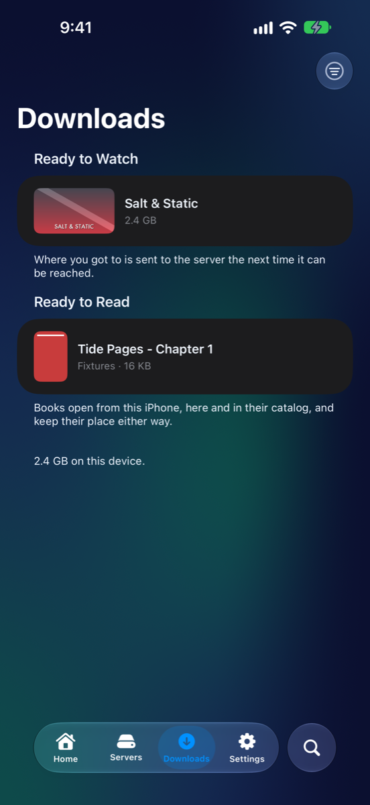
iPhone 18 Pro Max

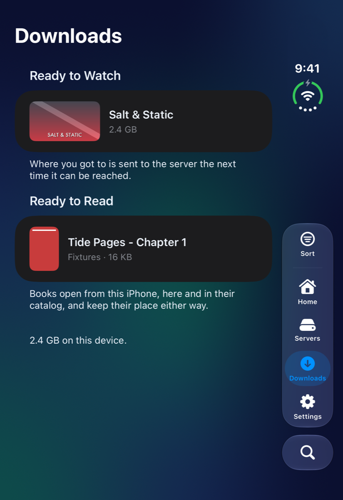
iPhone Duo — closed

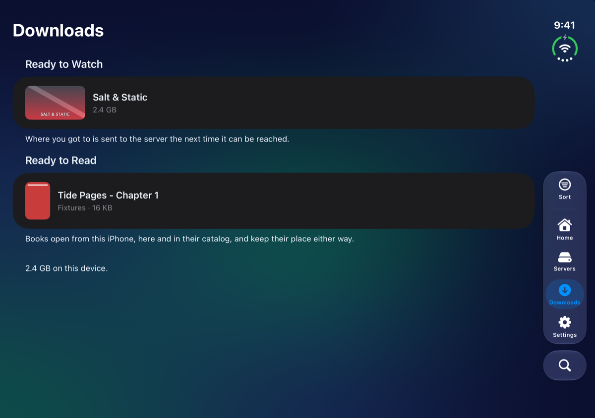
iPhone Duo — open, on its side

## Where to get help

- **The setup guide**: Settings → **Setup Guide** opens step-by-step pages for Dropbox, Google Drive, OneDrive, Box and S3 storage.
- **Provide Feedback**: at the bottom of Settings. Write what happened and it goes to the developer with your app version and phone model. You can also shake your phone, with Settings → **Shake to Provide Feedback** on. In TestFlight you can take a screenshot and tap **Share Beta Feedback**.
- **What's New**: after an update, a popup shows the highlights. Settings → **Changelog** lists what changed in every version, newest first.

## Good to know

- Passwords and sign-ins stay in your iPhone's Keychain.
- Swipe a saved server to **Edit** or **Delete** it. Settings → Server List → **Swap Swipe Directions** flips which way does which.
- Settings has a search at the top: type what you're looking for and it takes you there.

---

Home · Next: [Your Home →](Home-Screen.html)
