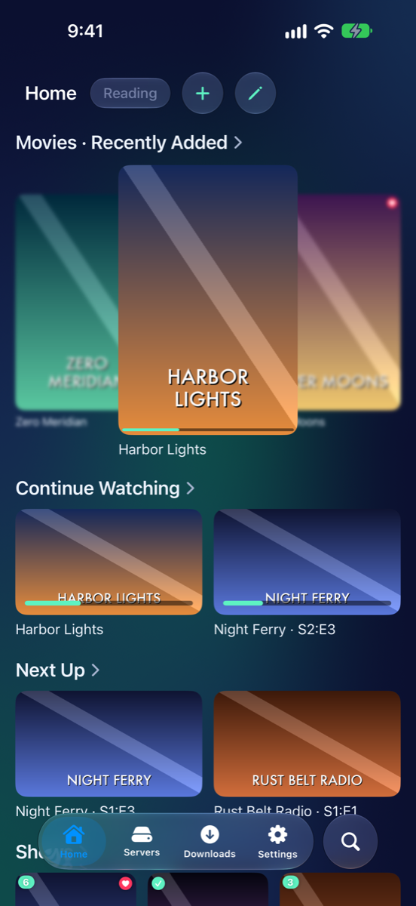
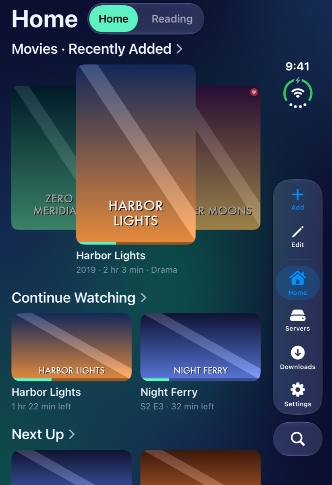
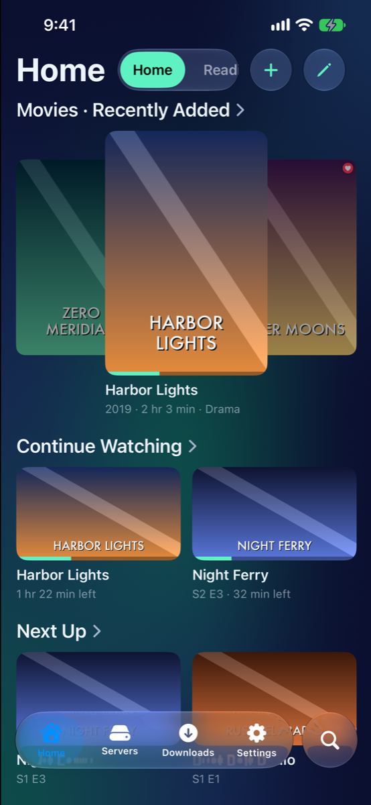
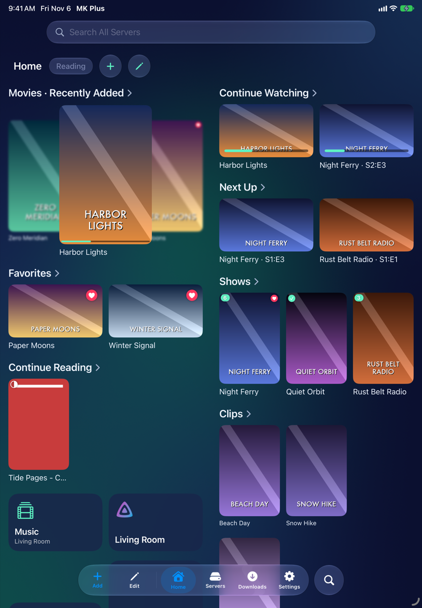
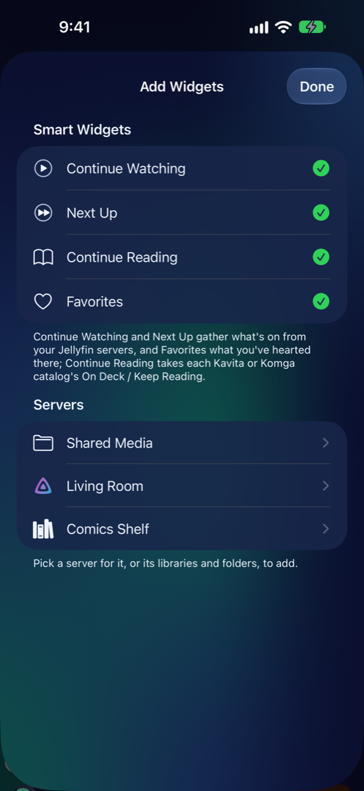
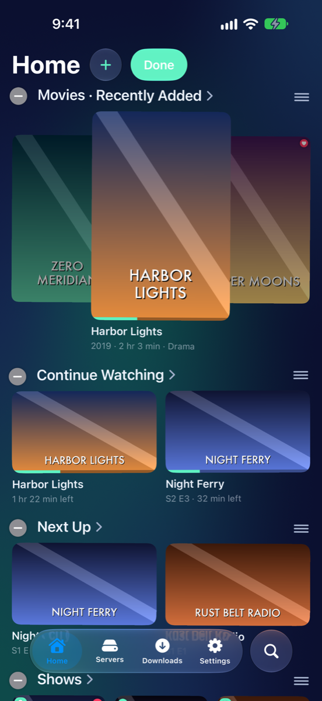
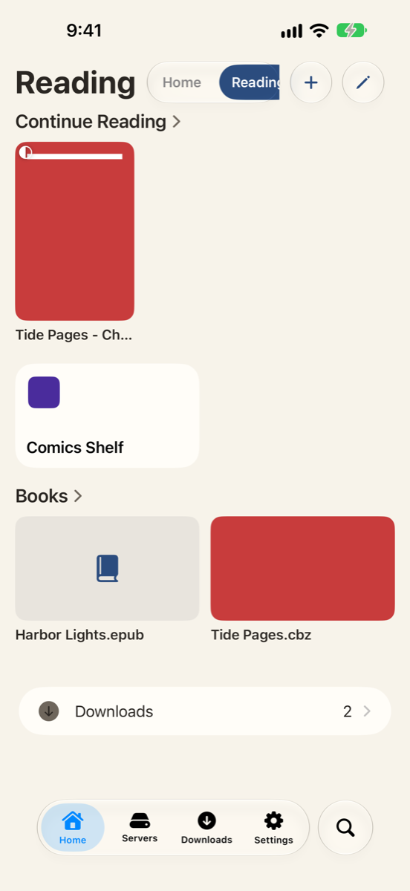

# Your Home

Pictures for
<button type="button" data-device="iphone-18-pro-max" aria-pressed="true">iPhone 18 Pro Max</button>
<button type="button" data-device="duo-front" aria-pressed="false">iPhone Duo — closed</button>
<button type="button" data-device="iphone-17e" aria-pressed="false">iPhone 17e</button>
<button type="button" data-device="ipad-air-11" aria-pressed="false">iPad Air 11-inch</button>

Home is the first tab, and the screen the app opens on. It holds **widgets**: shelves and tiles that put the things you watch and read one tap away. Make it yours, and make as many Homes as you like.

iPhone 18 Pro Max

iPhone Duo — closed

iPhone 17e

iPad Air 11-inch

## What a widget is

A widget is one of these:

- **A server's widget**: a tile that opens the server.
- **A folder's widget**: a shelf of what's in a folder, a Jellyfin library, or a section of a book server. Tapping a cover opens it.
- **A smart widget**: a shelf gathered from all your servers at once.

The smart widgets are:

- **Continue Watching**: what you've started on your Jellyfin servers, ready to resume.
- **Next Up**: the next episode of each show you're partway through on Jellyfin.
- **Favorites**: what you've marked as a favorite on Jellyfin.
- **Continue Reading**: where you left off in your Kavita and Komga catalogs (their "On Deck" or "Keep Reading" shelf).

A smart widget only shows if you have a server of that kind. In Add Widgets they sit at the top, under **Smart Widgets**.

**Recently Added** isn't a widget of its own. It's a way to order any folder's shelf: newest first. You'll find it in the widget's options, below.

## Put something on Home

There are two ways.

**From the thing itself**

1. Press and hold a server, a library or a folder.
2. Choose **Add to Home**. With more than one Home, pick which one.

To take it off again, press and hold it and choose **Remove from Home**.

**From Home**

1. Tap **Edit** (the pencil), then **+**. Or press and hold the **+** and choose **New Widget**.
2. Under **Add Widgets**, tap a smart widget to add it, or tap a server to see its libraries and folders.
3. Tap a library or folder to add it. A tick means it's on this Home; tap it again to take it off.
4. Tap **Done**.

iPhone 18 Pro Max

Private servers are left out unless the Home shows them. See Privacy and Face ID.

## Widget styles

Tap a widget while editing (see below) and choose **Style**. Each style is a different size:

- **Tile**: small, with a picture and a name, two to a row.
- **Posters**: a shelf of portrait covers.
- **Wide**: a shelf of landscape pictures.
- **Large**: a taller shelf, two rows of smaller posters.
- **Cover**: a small tile for one show or series, with a button that picks up where you left off.
- **Large Carousel**: big covers that turn sideways, one in the middle.
- **Small Carousel**: the same, smaller, with blurred covers on each side.

Smart widgets are always shelves, so they don't offer **Tile** or **Cover**.

A shelf also has two more choices:

- **Show**: **All** keeps the folder's own order. **Recently Added** puts the newest first.
- **How Many**: 12, 24, 48 or 96 items.

## Stacks

A stack puts several widgets in one spot, with a row of their names to switch between, like a Smart Stack on the iPhone's home screen. It's a good way to keep a Jellyfin shelf, a folder on a share and a book catalog together.

1. Tap a widget while editing.
2. Under **Stack**, choose **Stack with an Existing Widget**, **Stack with a New Widget** or **Stack with Next Widget**.
3. To take it out, open it again and choose **Remove from Stack**.

## Edit your Home

1. Tap **Edit** (the pencil), or press and hold anything on Home.
2. Tap a widget to change it: its name, style, how many it shows and, for a smart widget, which servers and libraries it takes from. **Remove from Home** is at the bottom.
3. Hold a widget and drag it to move it.
4. Tap **+** to add a widget.
5. Tap **Done**.

iPhone 18 Pro Max

You can also manage a Home's widgets from its settings: press and hold the Home's name, choose **Home Screen Settings**, and use **Reorder** or swipe a widget to remove it.

## More than one Home

Keep different things apart with separate Homes, such as one for video and one for books. Each Home has its own widgets, theme and backdrop.

- **Make one**: press and hold a Home's name and choose **New Home**, then give it a name.
- **Switch**: tap a Home's name along the top. With Settings → Home Screen → **Single Home Name** on, only the Home you're on shows its name: swipe sideways to go to the next one, or press and hold the name for the list.
- **Change or remove one**: press and hold its name for **Home Screen Settings**, **Theme**, **Lock with…** and **Delete**. Deleting a Home removes only its widgets. Your servers and folders stay as they are.
- **Order**: in Settings → Home Screen, drag Homes into the order you like. The top one opens first, unless **Open on Last Viewed Home** is on.

iPhone 18 Pro Max

## Themes and backdrops

Each Home can look different. Open its **Home Screen Settings**, and under **Look** you'll find:

- **Theme**: sets the background, the cards, the accent color, and whether the Home is light or dark. **Default** follows your iPhone. The dark themes are Midnight, Cinema, Aurora, Eclipse and Nebula. The light ones are Paper, Mist, Blossom and Daydream. Choose **Light & Dark** to give a Home one theme by day and another at night. **Make a Theme…** lets you build your own.
- **Backdrop**: blurred artwork or a picture behind the Home. In its editor, **Source** picks what to use (**Off**, **Home's Artwork**, **One Widget** or **Picture**), **Adjust** sets blur and dimming, **Motion** makes it change over time, and **Cards** sets how the widgets sit on top.

To change a Home's theme quickly, press and hold its name and use **Theme**.

## Search All Servers

The search bar on Home, **Search All Servers**, looks across your servers at once. Type a name and the results appear grouped by server. Tap **See All** under a server for the full list.

It searches Jellyfin servers and book catalogs that can search. Shares can't be searched this way: open one and use the search bar inside its folders.

## Your saved servers on Home

Home can also list your saved servers (**Shares**, **Jellyfin** and **Catalogs**) under the widgets. Each Home has its own **Saved Servers on Home** switch in its settings. A **Downloads** row appears too once something's been downloaded.

## Good to know

- A Home can be locked with Face ID, Touch ID or your passcode: press and hold its name and choose **Lock with…**. Private servers and locked Homes are covered in Privacy and Face ID.
- A new server adds its own widgets to your first Home, unless you turn off Settings → Home Screen → **Add Widgets for New Servers**.
- On the unfolded iPhone Duo and on iPad, Settings → Home Screen can show Home as **One Column**, **Two Columns**, **Two Homes Side by Side**, or **In a Card** down the middle.

---

Home · Previous: [← Getting Started](Getting-Started.html) · Next: [Browsing your files →](Browsing.html)
