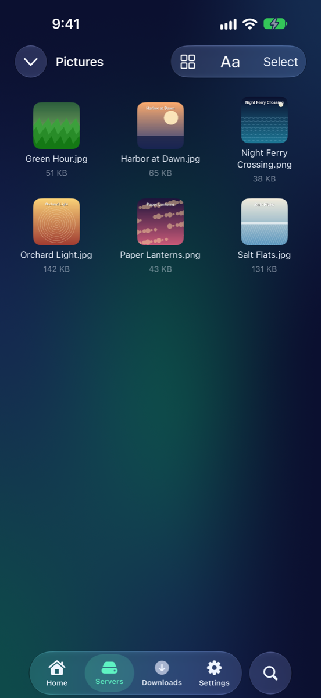
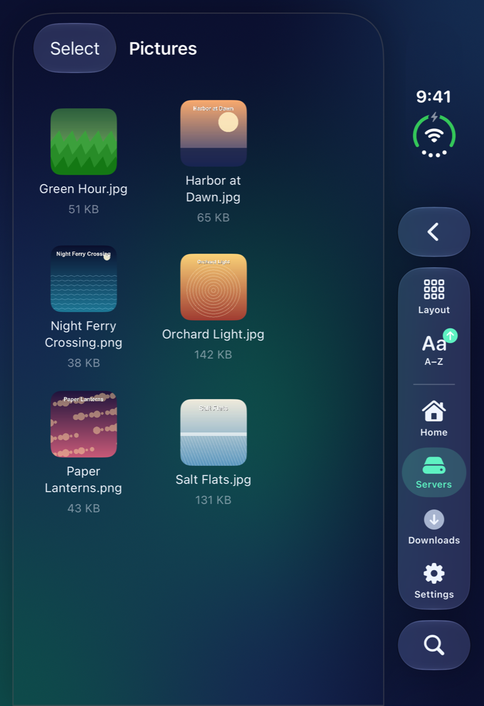
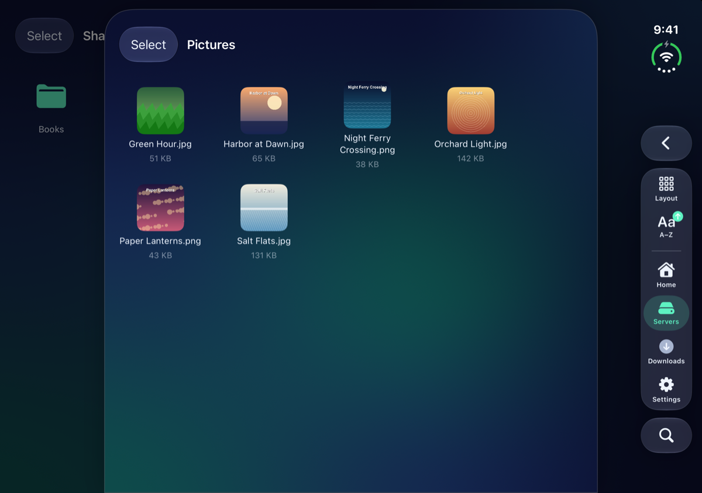
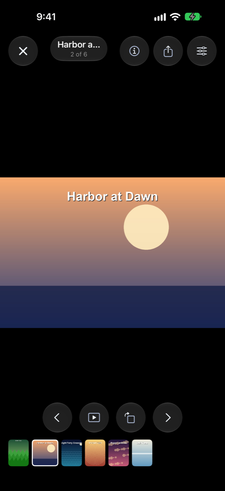
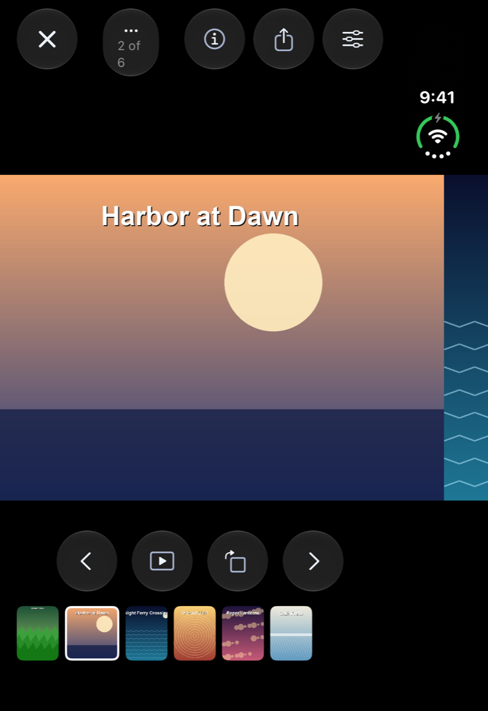
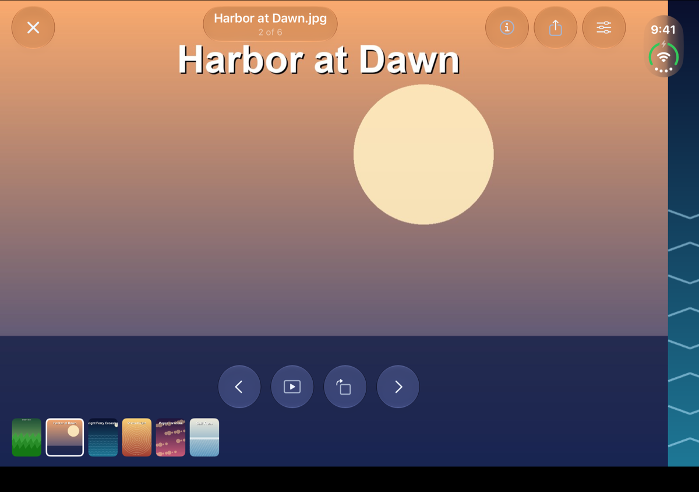
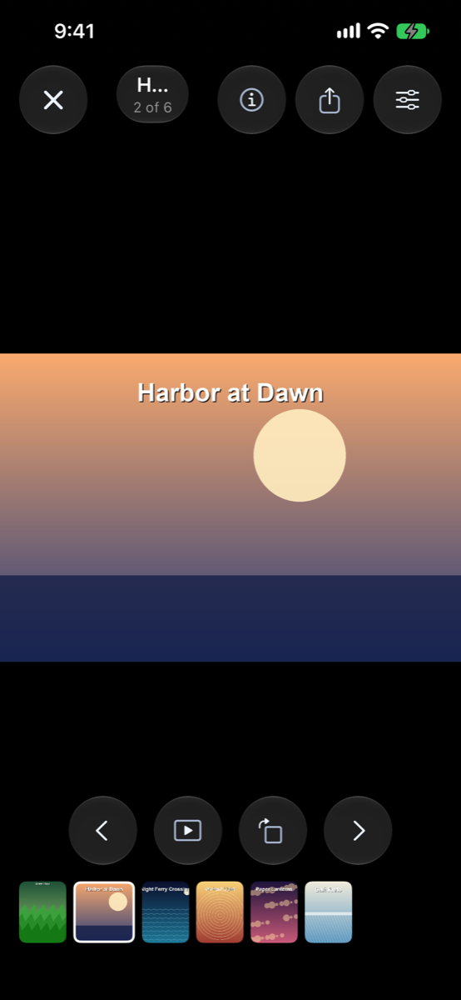
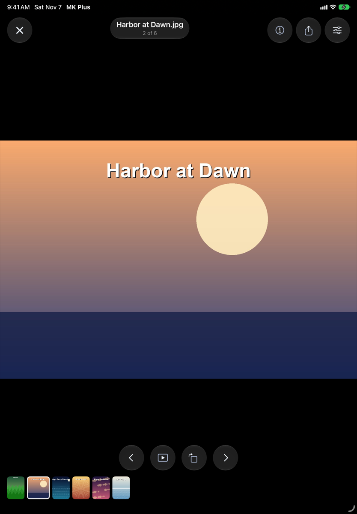

# Pictures

Pictures for
<button type="button" data-device="iphone-18-pro-max" aria-pressed="true">iPhone 18 Pro Max</button>
<button type="button" data-device="duo-front" aria-pressed="false">iPhone Duo — closed</button>
<button type="button" data-device="duo-open-side" aria-pressed="false">iPhone Duo — open, on its side</button>
<button type="button" data-device="iphone-17e" aria-pressed="false">iPhone 17e</button>
<button type="button" data-device="ipad-air-11" aria-pressed="false">iPad Air 11-inch</button>

Tap a picture in a folder and it opens full screen in the picture viewer. You can swipe on to the next one, zoom in, turn it round, run a slideshow and share it.

## Open a picture

iPhone 18 Pro Max

iPhone Duo — closed

iPhone Duo — open, on its side

Pictures in a folder show as thumbnails when **Thumbnails** is on in Settings → **File Browsing**. See [Browsing your files](Browsing.html). Tap one to open it. The viewer lines up every picture in that folder, starting from the one you tapped, so you can move through the whole folder without going back.

MK Plus opens JPEG, PNG, GIF, HEIC, HEIF, BMP, TIFF and WebP files, from any server or cloud folder it can read. A GIF opens as a still picture. If a file can't be read, the viewer says **Couldn't Open This Image** with its name.

## Moving around

iPhone 18 Pro Max

iPhone Duo — closed

iPhone Duo — open, on its side

iPhone 17e

iPad Air 11-inch

- **Swipe sideways** to go to the next or previous picture.
- **Pinch** to zoom in, and drag to look around. **Double tap** zooms in on the spot, and a second double tap zooms back out.
- **Tap** the middle to show or hide the controls. With **Tap Sides to Move** on (it is to start with), a tap near the left or right edge moves to the previous or next picture instead.
- **Swipe down** to close the viewer. It doesn't close while you're zoomed in.

On the iPhone Duo, with Settings → **Image Viewer** → **Two Side by Side When Folded** on, the Duo shows two pictures at once while it's on its side and partly folded like a book, one each side of the fold, and moves two at a time.

## The controls

With the controls showing, **Close** is at the top left, and the picture's name with how far through the folder you are (such as 3 of 24) sits at the top. To start with the top right holds three buttons and the bottom holds four:

- **Info** opens a sheet about the picture: its **Name**, **Kind**, **Size**, **Dimensions** and when it was **Modified**. Tap **Done** to close it.
- **Share** opens your iPhone's share sheet for the picture. From there you can send it, copy it, or save it to your Photos.
- **Viewer Settings** opens a short sheet (see below).
- **Previous Image** and **Next Image** move one picture back or on. They're greyed out at the ends of the folder.
- **Slideshow** moves to the next picture on its own and hides the controls. Tap the picture to bring them back, and press **Stop Slideshow** to stop. It also stops at the last picture, unless looping is on.
- **Rotate** turns the picture a quarter turn clockwise each time you tap it. Each picture keeps its own turn until you close the viewer. The file itself isn't changed.

Along the very bottom is a **Filmstrip** of small pictures, to jump to one, or a **Timeline** you drag to move through the folder, as in the video player.

## Viewer settings

**Viewer Settings** (or Settings → **Image Viewer**) holds:

- **Tap Sides to Move**, as above.
- **Slideshow Every** (shown as **Every** in the sheet) sets how long each picture stays up. **Loop Slideshow** (**Loop**) starts over after the last picture instead of stopping.
- **Show Title** hides or shows the name at the top, and **Along the Bottom** chooses **Filmstrip**, **Timeline** or **Off**.

## Lay the controls out your way

Settings → **Image Viewer Controls** opens the viewer itself, on sample pictures, so you see each change as you make it. It works like the editors for the [video player](Video-Player.html#lay-the-controls-out-your-way) and the [reader](Reader.html#lay-the-controls-out-your-way).

1. Tap one of the three spots at the top right, or the four along the bottom, and choose a button for it. **None** leaves it empty.
2. Tap the title to show or hide it. **Close** always stays at the top left.
3. Choose a **Filmstrip**, a **Timeline** or nothing along the bottom.
4. Tap **Try It** to put the card away and use the viewer with your layout. **Edit Controls** brings it back, and **Reset** goes back to the original layout.

## What went wrong

| What you see | Try this |
|---|---|
| A tap near the edge moves to another picture | Turn off **Tap Sides to Move** in Settings → **Image Viewer**. |
| **Couldn't Open This Image** | The file may be damaged, or a kind MK Plus can't show. |
| A button you want isn't there | Add it in Settings → **Image Viewer Controls**. |
| The slideshow stops at the end | Turn on **Loop Slideshow**. |

---

Home · Previous: [← Book servers](OPDS-Catalogs.html) · Back to: [Getting Started](Getting-Started.html)
