# Jellyfin

Pictures for
<button type="button" data-device="iphone-18-pro-max" aria-pressed="true">iPhone 18 Pro Max</button>
<button type="button" data-device="duo-front" aria-pressed="false">iPhone Duo — closed</button>
<button type="button" data-device="duo-open-side" aria-pressed="false">iPhone Duo — open, on its side</button>
<button type="button" data-device="iphone-17e" aria-pressed="false">iPhone 17e</button>
<button type="button" data-device="ipad-air-11" aria-pressed="false">iPad Air 11-inch</button>

A Jellyfin server gives MK Plus your movies and shows with posters, descriptions, seasons and a record of what you've watched. Adding a server is covered in [Getting Started](Getting-Started.html#add-your-first-server). This page is about using it afterwards.

## Open the server

Tap the server on Home, or in the **Servers** tab under **Jellyfin**. It opens on your libraries, with a few shelves above them when you have something to put in them.

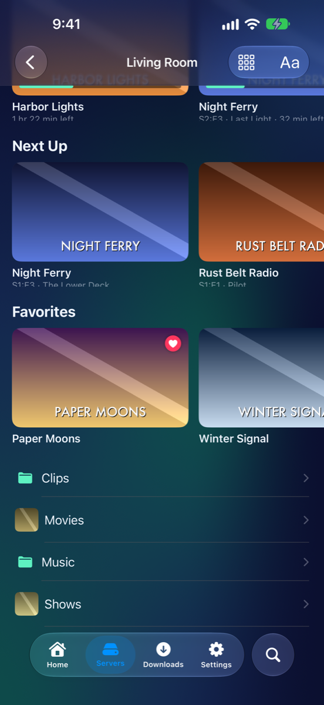
iPhone 18 Pro Max

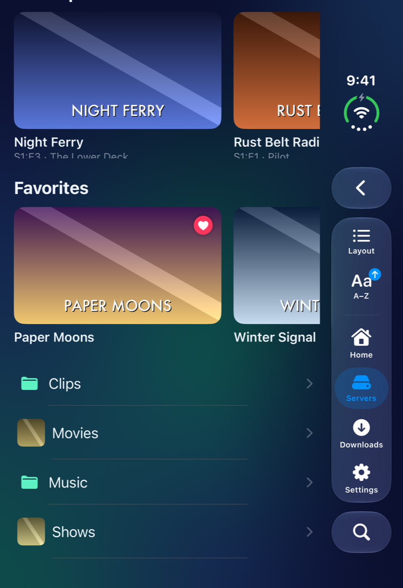
iPhone Duo — closed

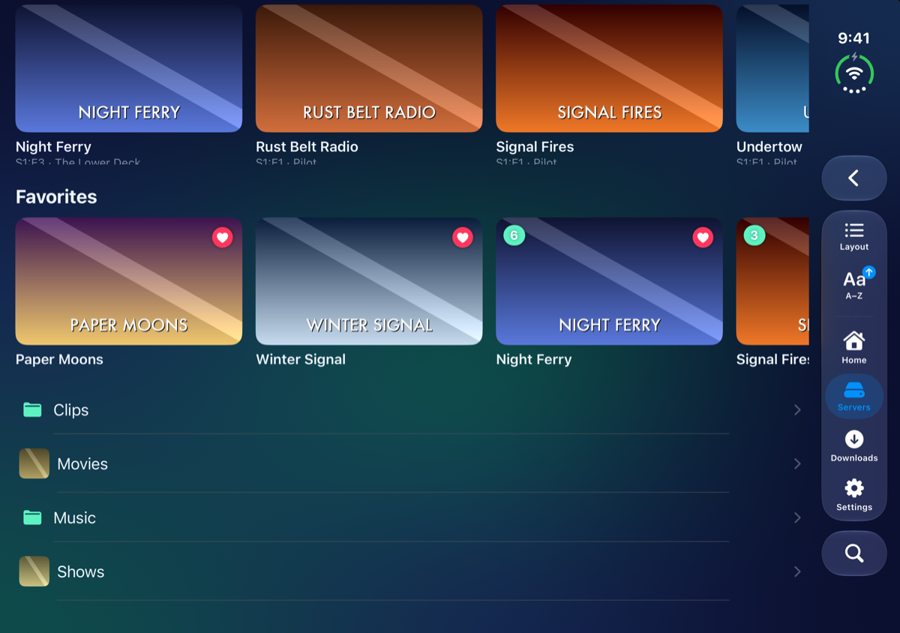
iPhone Duo — open, on its side

- **Continue Watching** lists movies and episodes you've started, most recent first.
- **Next Up** lists the next unwatched episode of each show you're in the middle of.
- **Favorites** lists what you've hearted.

Settings → **Jellyfin** → **Home Rows** turns each shelf on or off, chooses whether **Continue Watching** or **Next Up** comes first, and picks **Wide Thumbnails** or **Posters**.

Tap a library to open it.

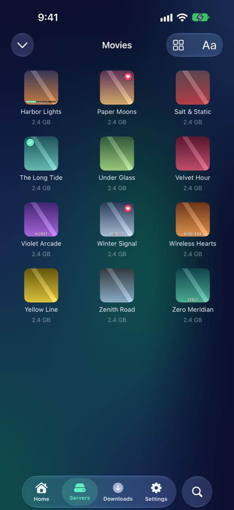
iPhone 18 Pro Max

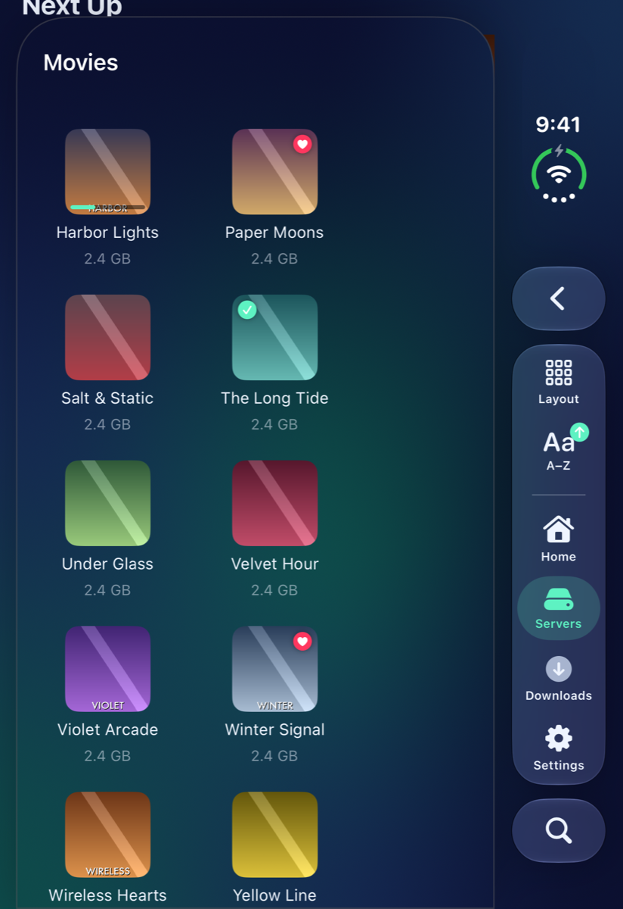
iPhone Duo — closed

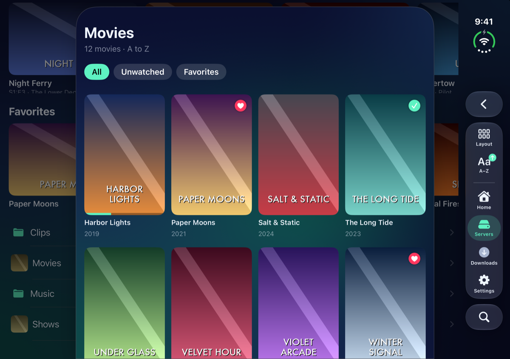
iPhone Duo — open, on its side

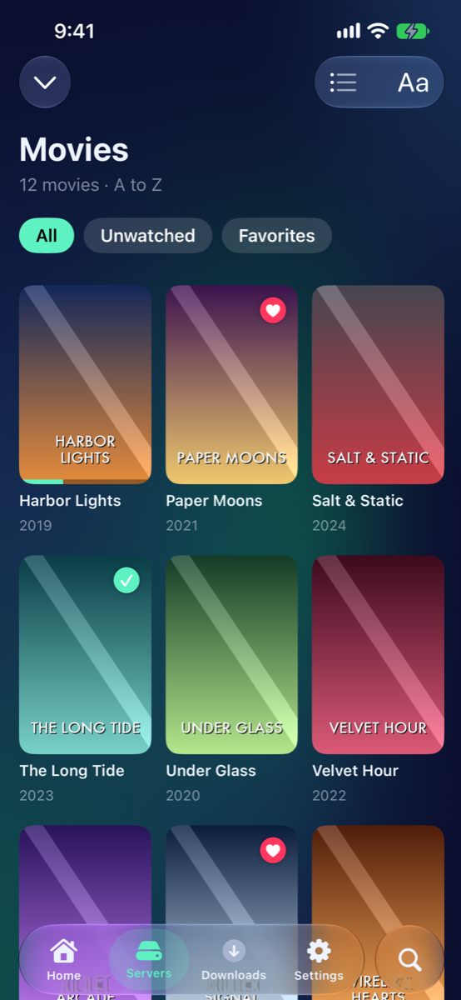
iPhone 17e

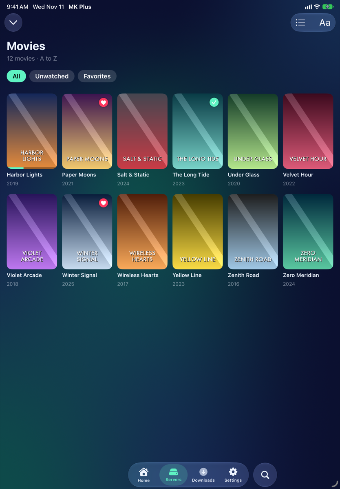
iPad Air 11-inch

A movie or show library opens as **Posters**: each film's poster with its name and year under it. A tick marks what you've watched, a heart your favorites, and a bar along a poster's foot shows how far in you are. Above the posters are the library's name, how many there are and their order, and three buttons: **All**, **Unwatched** and **Favorites**.

The layout button changes a library to a list or one of the other layouts, and sort and the press-and-hold menu work as described in [Browsing your files](Browsing.html). Settings → **Jellyfin** → **Movie and Show Libraries** picks the layout these libraries open in. A Jellyfin library can also be sorted by **Episode**.

## A movie's page

Tap a movie to open its page: its picture with the title and the year, rating and running time on it, the buttons, a summary (tap **More** for the whole text), **More Like This** and the cast.

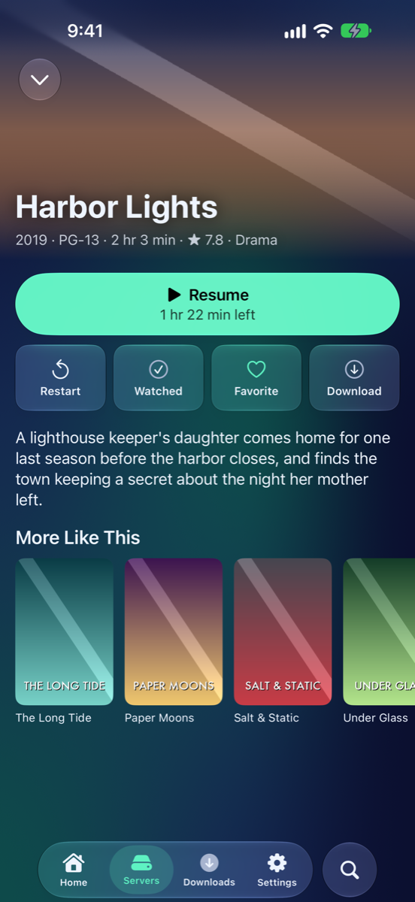
iPhone 18 Pro Max

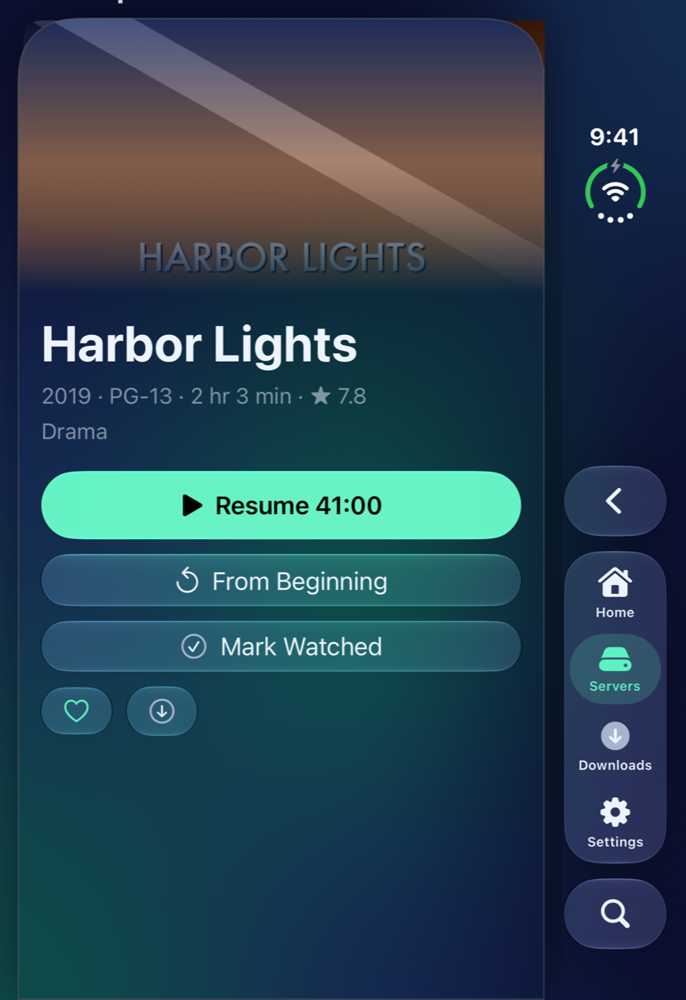
iPhone Duo — closed

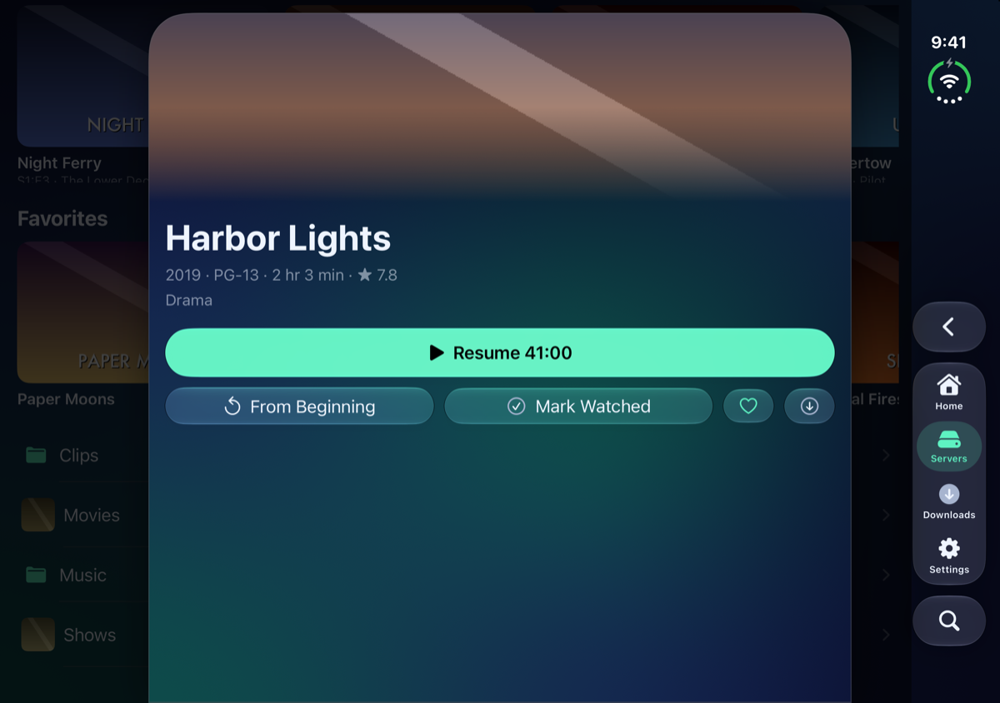
iPhone Duo — open, on its side

- **Play** starts the movie, with its running time under it. If you've watched part of it, the button says **Resume** with the time left under it, such as **1 hr 22 min left**.
- Under it, buttons of one size, each with its name:
  - **Restart** starts over, when you've watched part of it.
  - **Watched** flags it as seen, and its check mark fills in. Tap it again to clear it.
  - **Favorite** adds it to your favorites, and its heart fills in. Tap it again to take it out.
  - **Home** puts the movie on a Home. See [Your Home](Home-Screen.html).
  - **Download** saves the movie on your iPhone for offline watching. While it downloads it shows a progress ring, and tapping it gives you a menu to cancel or remove it. Everything you've saved is in the **Downloads** tab: see [Browsing your files](Browsing.html#downloads-for-offline).
- **More Like This**, under the summary, shows what your server finds is like it. Tap one for its page. Settings → File Browsing → **More Like This** turns the row off.
- **Cast & Crew** runs along the bottom.

On the iPhone Duo open on its side, the page runs across the whole screen: the picture fills both halves, the title sits on the left, and the buttons and the rest are on the right, lower down where your thumb is. Nothing sits across the fold. Settings → File Browsing → **Movie Pages Across the Fold** turns it off, and the page is a card down the middle.

When you tap a movie or episode you've started, Settings → **Jellyfin** → **Partly Watched Videos** decides what happens. **Ask** offers **Resume from** the time you got to or **Start Over**, and **Resume** and **Start Over** do that every time. A movie's own page has **Resume** and **Restart** buttons either way.

## A show's page

A show's page works the same way, with seasons and episodes added.

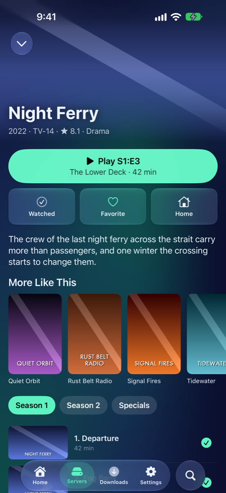
iPhone 18 Pro Max

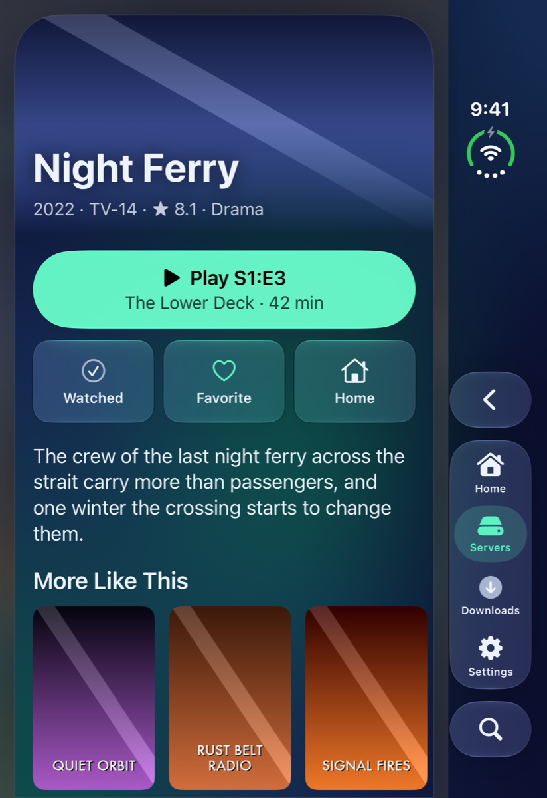
iPhone Duo — closed

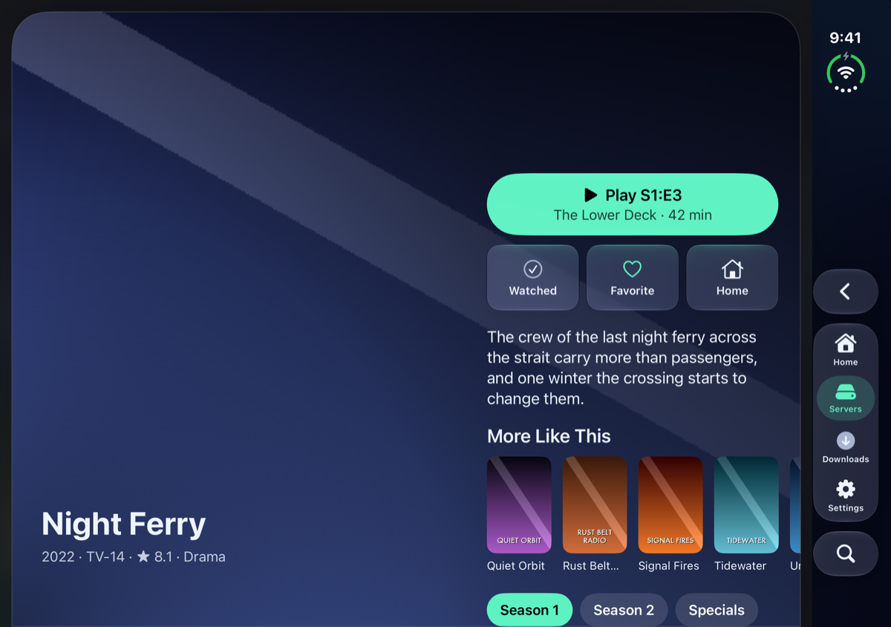
iPhone Duo — open, on its side

- The big button plays the next episode for you and says which one: **Play S2:E5** with the episode's name and length under it, or **Resume S2:E5** with the time left. It's the same episode that appears under **Next Up**.
- A show with more than one season has a row of seasons under the summary, such as **Season 1**, **Season 2** and **Specials**. Tap one to list its episodes. If there are more than fit, swipe the row sideways.
- Each episode is one row: its number and name, and its length under that. The next one to watch says **up next**, and one you've started says **Resume** and a time. Tap an episode to play it.
- At the end of the row, a tick means you've watched it. Otherwise there's a download button. Tap it to keep the episode on your iPhone.
- Press and hold an episode for **Mark Watched** or **Mark Unwatched** and **Download** or **Remove Download**.
- **Watched** and **Favorite** apply to the whole show.

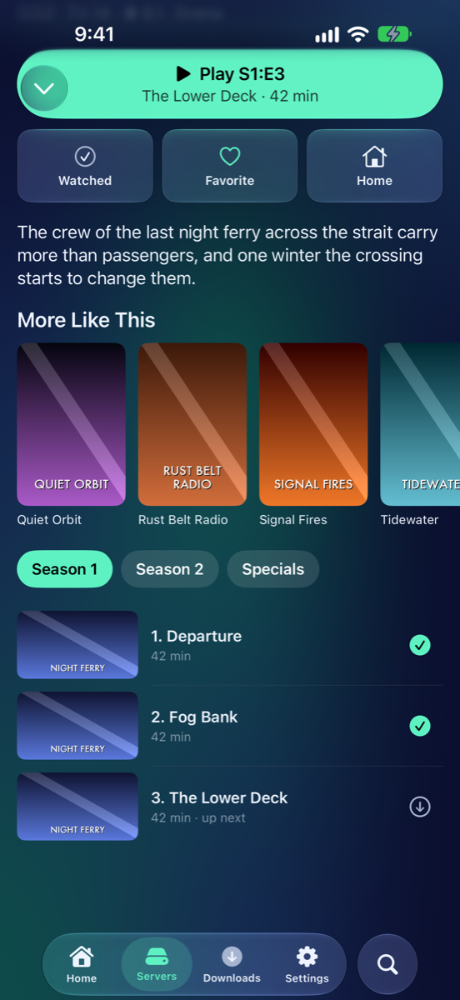
iPhone 18 Pro Max

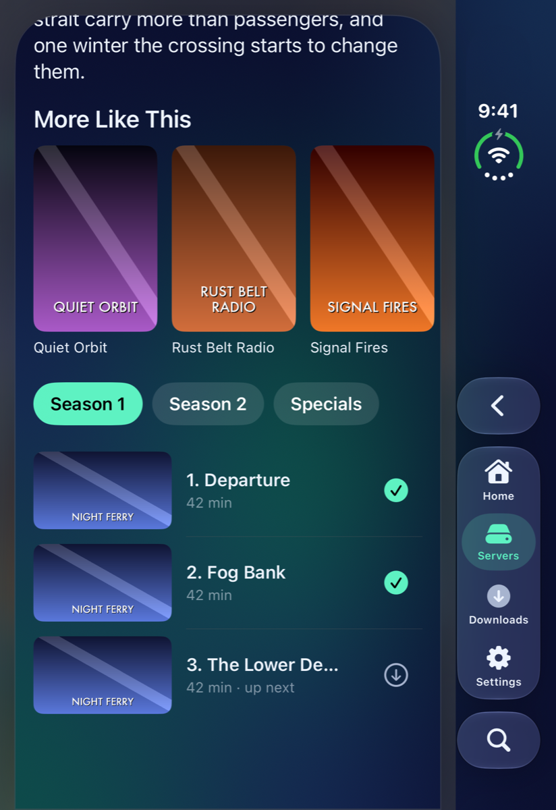
iPhone Duo — closed

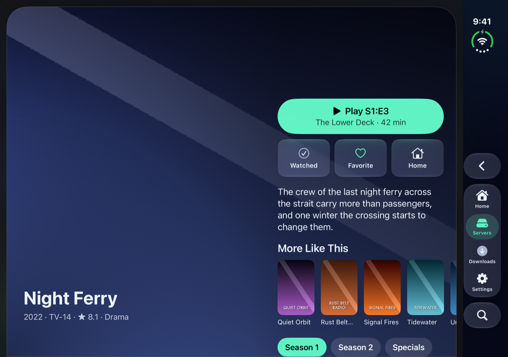
iPhone Duo — open, on its side

Three settings change how a show looks. In Settings → File Browsing, **Episodes on Show Pages** lists episodes right on the page (off, the page has just its season covers), **Specials Last** puts specials after the last season and **Seasons as a Carousel** turns the season covers into big covers to page through. In Settings → **Jellyfin**, **Artwork Backgrounds** puts a show's artwork behind its list.

## Mark things watched

Anywhere you see a movie or an episode, press and hold it and choose **Mark as Watched** or **Mark as Unwatched**. The mark is kept on the server, so it follows your account.

## Search

Use the search bar in a Jellyfin server or library, and run the search. Searching at the top of the server looks through everything. Searching inside a library looks only in that library. From Home, **Search All Servers** looks across every server you've added: see [Your Home](Home-Screen.html).

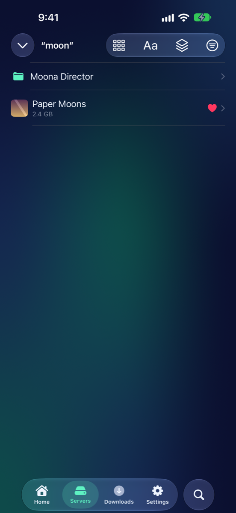
iPhone 18 Pro Max

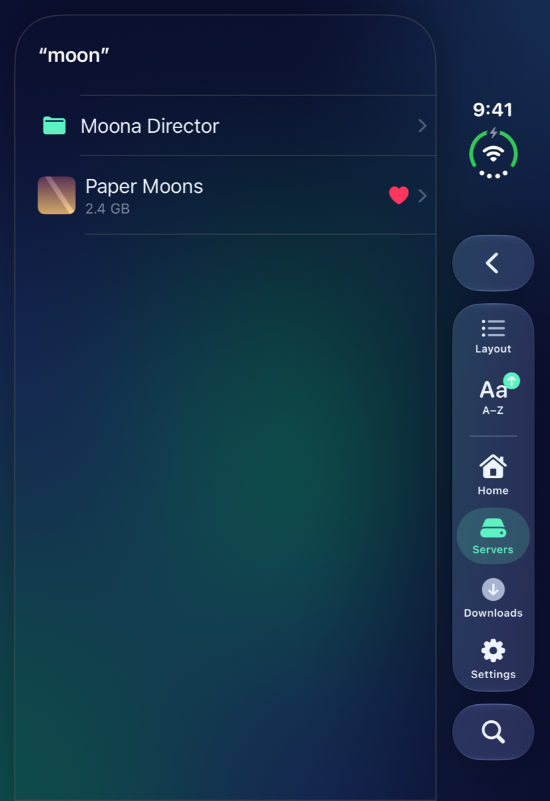
iPhone Duo — closed

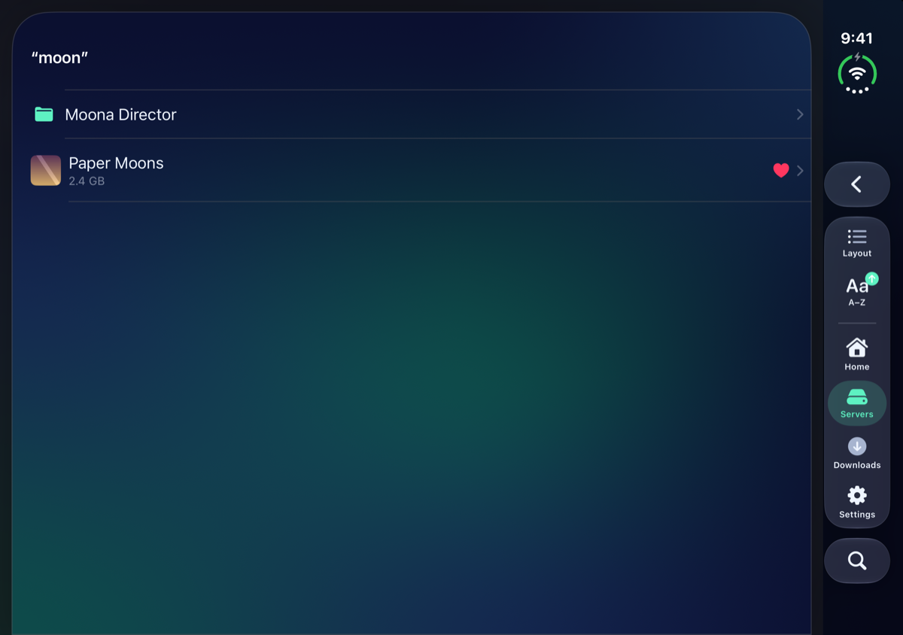
iPhone Duo — open, on its side

The results page has two buttons that narrow them down.

- **Show** picks the kind of thing: **Everything**, **Movies**, **Shows**, **Episodes**, **Collections**, **Videos**, **Books**, **Music** or **People**. **People** finds actors and crew by name, and their films and shows.
- **Filter by Genre or Year** has a **Genre** list and a **Year** list. Pick one, or both, and the results shrink to match. Choose **Any genre** or **Any year** to take a filter off. The button doesn't show for **People**.

## Streaming Quality

A Jellyfin video streams from your server, so away from home you may want it lighter. Settings → **Jellyfin** → **Streaming Quality** chooses between **Original**, **1080p – 20 Mbps**, **1080p – 10 Mbps**, **720p – 4 Mbps** and **480p – 1.5 Mbps**. **Original** plays the file exactly as it is, which is best at home. A lower choice has the server convert anything above that rate while it plays.

- **Apply to Playing Video**: when on, a quality you pick while watching reopens the video at that quality, from the same spot. When off, it starts with the next video.
- **Lower Quality When Stalling**: a video that keeps stopping to load is turned down a step, for that video only, and carries on from where it was.
- You can also change the quality during a video, in **Playback Options**. See [Watching video](Video-Player.html).

## Sign in with Quick Connect

**Quick Connect** adds a server without typing a password. It's the way in when your Jellyfin signs in with Google or a passkey.

1. In Add Server, choose **Jellyfin Server** and enter the server's address.
2. Tap **Sign In with Quick Connect**. A code appears.
3. Tap **Approve in Safari**. Safari opens Jellyfin's approval page with the code filled in, and uses your passkeys and whatever Safari is already signed in to. Approve it there.
4. The sheet closes by itself once the server has approved. Until then it says **Waiting for approval…**. **Cancel Quick Connect** stops it.

The code is also copied, in case signing in lands you somewhere else in Jellyfin. You can approve it from another device that's already signed in instead.

## What went wrong

| What you see | Try this |
|---|---|
| **Couldn't Sign In** with Quick Connect, saying it's turned off | An administrator turns it on in the Jellyfin dashboard under General. Or sign in with your password instead. |
| The Quick Connect code expired | It wasn't approved in time. Start again to get a new code. |
| A video keeps stopping to load | Lower **Streaming Quality**. |
| A watch mark doesn't show right away | Pull down to refresh the page. |

## Related pages

- [Get started](Getting-Started.html): adding a server
- [Watching video](Video-Player.html): Playback Options and the controls
- [Browsing your files](Browsing.html): sort, layout and downloads
- [Your Home](Home-Screen.html): Search All Servers and the house button
- [Media](Settings-Media.html): the Jellyfin settings

---

Previous: [← Watching video](Video-Player.html) · Next: [Listening to music →](Music.html)
