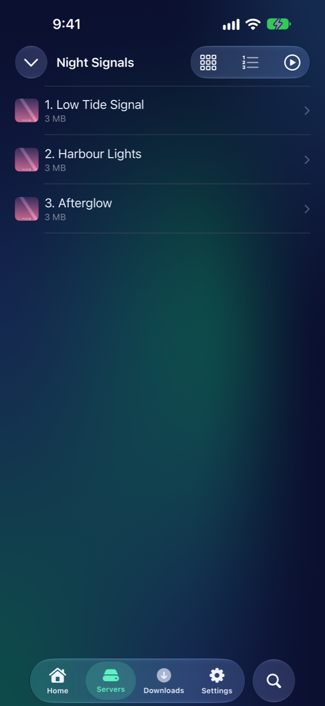
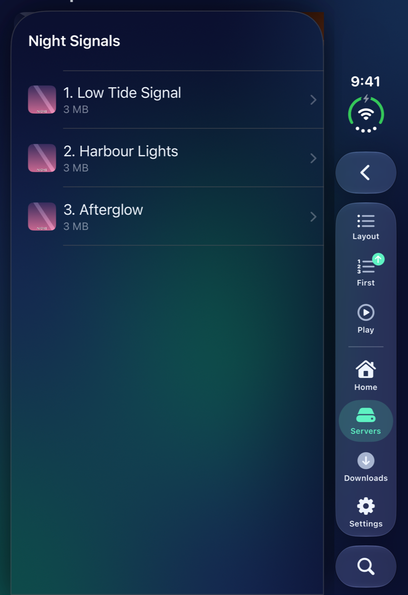
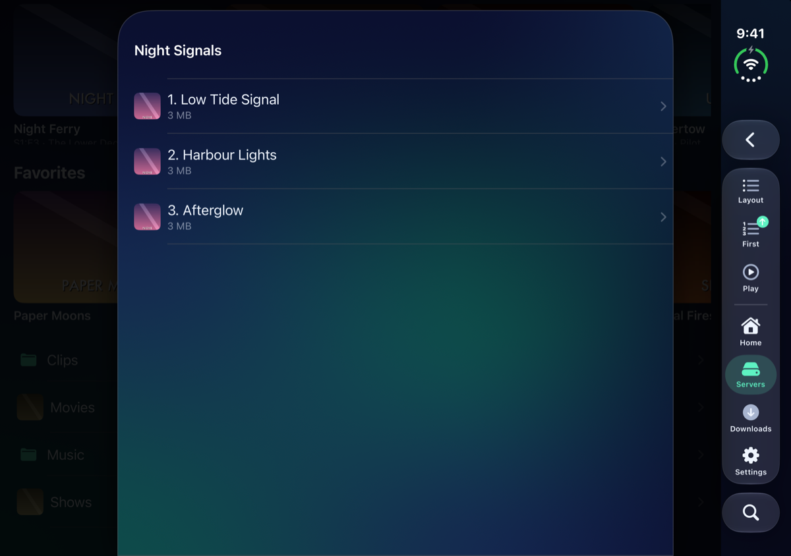
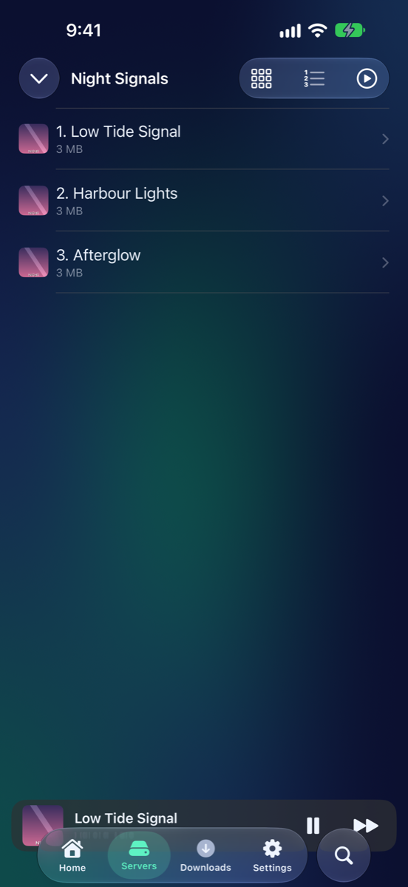
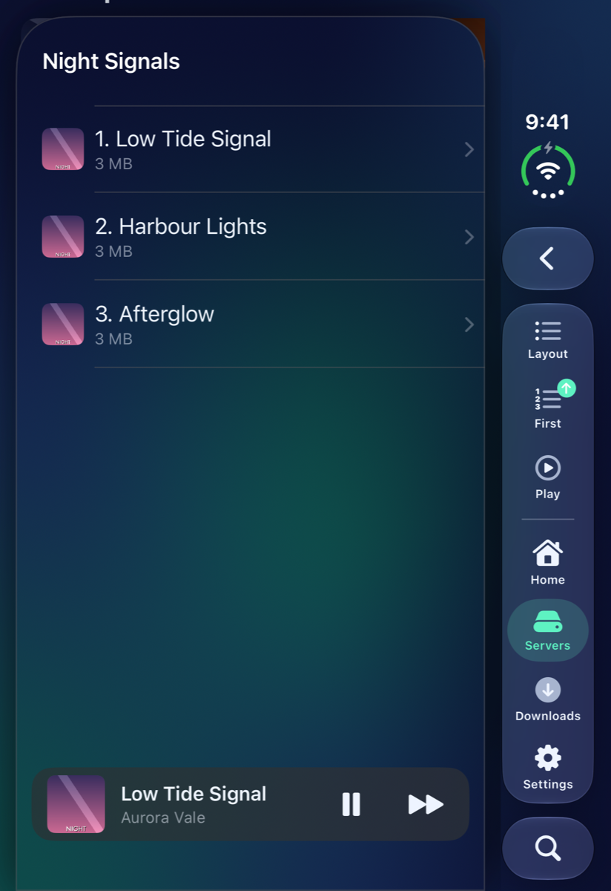
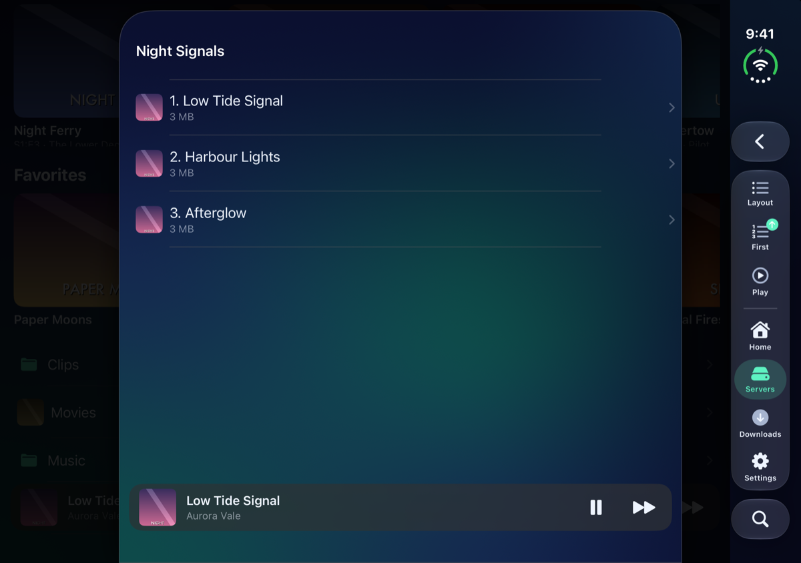
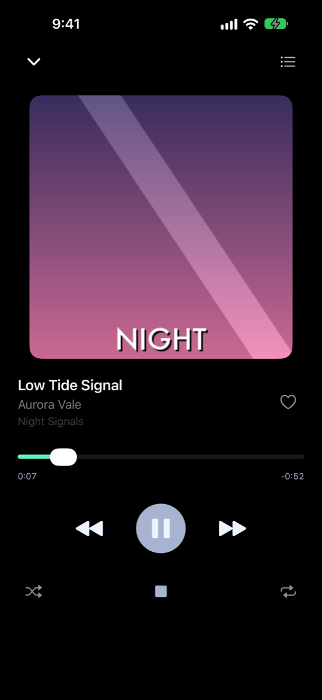
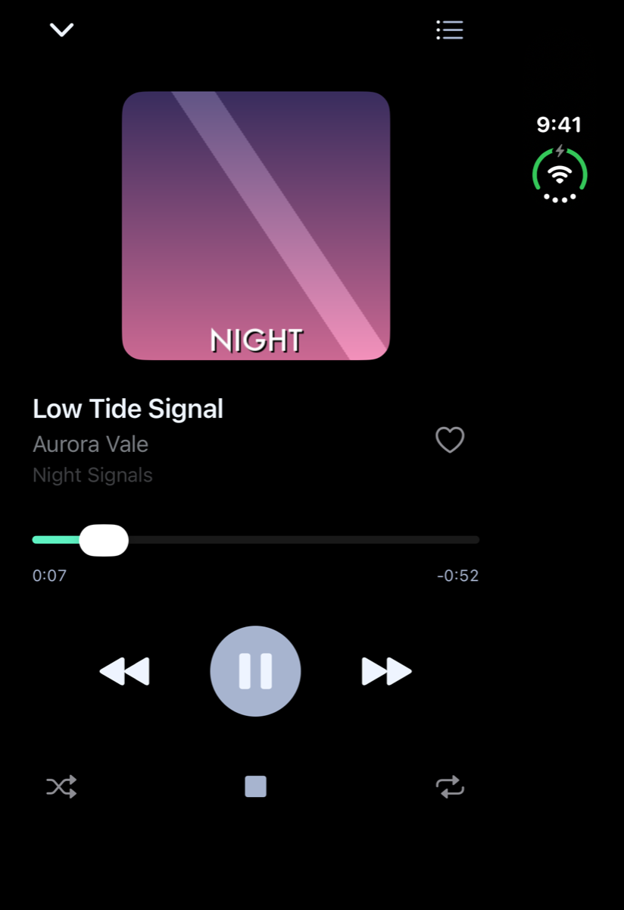
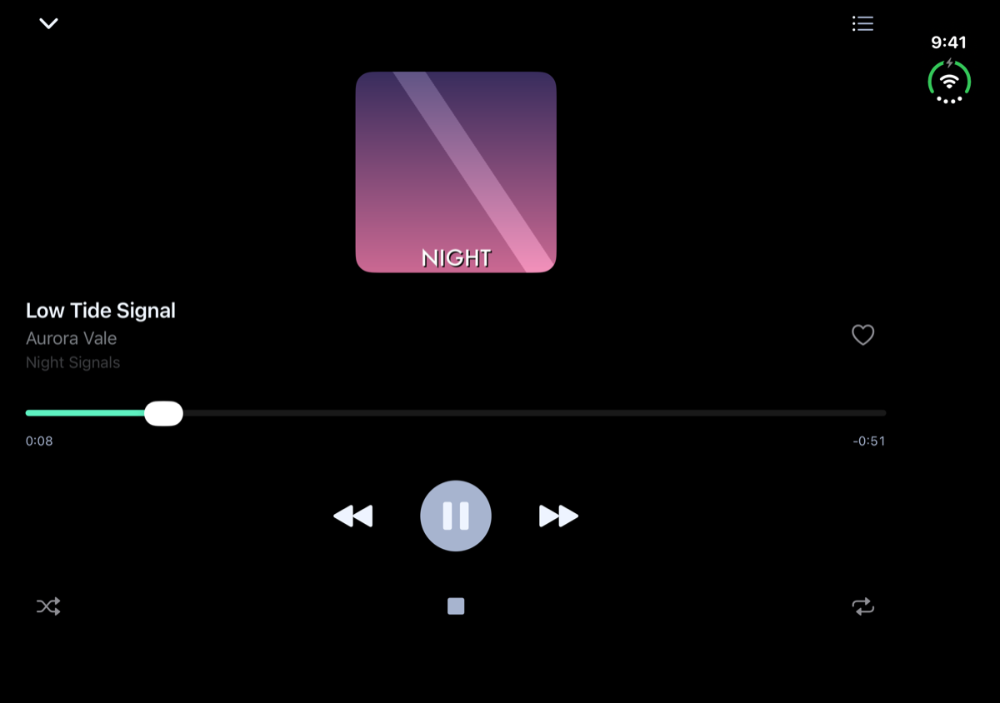

# Listening to music

Pictures for
<button type="button" data-device="iphone-18-pro-max" aria-pressed="true">iPhone 18 Pro Max</button>
<button type="button" data-device="duo-front" aria-pressed="false">iPhone Duo — closed</button>
<button type="button" data-device="duo-open-side" aria-pressed="false">iPhone Duo — open, on its side</button>

MK Plus plays music from a Jellyfin music library, or from any folder that has songs in it, on a share or in your cloud storage. It keeps playing when you leave the app or lock your iPhone.

## Start some music

iPhone 18 Pro Max

iPhone Duo — closed

iPhone Duo — open, on its side

- **Tap a song** to play it. The rest of the songs in that folder or album line up behind it, in order.
- **Play All** (a button at the top of a folder that has songs) opens a menu: **Play** starts at the first song, and **Shuffle** plays them in a random order. On the iPhone Duo's front screen these are in the **Options** menu.

Folders of songs work like any other folder: see [Browsing your files](Browsing.html). MK Plus plays the common formats, including MP3, AAC, FLAC, WAV, OGG and Opus. On Jellyfin, Settings → **Jellyfin** → **Streaming Quality** applies to music too. See [Jellyfin](Jellyfin.html).

Starting a queue replaces whatever was playing. If you start a video, the music pauses.

## The mini player

While music is loaded, a small bar sits at the bottom of the app, over whatever you're looking at.

iPhone 18 Pro Max

iPhone Duo — closed

iPhone Duo — open, on its side

It shows the cover, the song's title and the artist. The buttons on it are **Play** or **Pause**, and **Next Track**. Tap the rest of the bar to open Now Playing.

## Now Playing

iPhone 18 Pro Max

iPhone Duo — closed

iPhone Duo — open, on its side

The full screen has everything about the song and the controls for it:

- The **cover**, the **title**, the artist and the album. If a song won't play, a red line says **Couldn't play** and its name, and the player moves on.
- The heart, **Add to Favorites** and **Remove from Favorites**, on a Jellyfin song. A file on a share has nowhere to keep favorites, so it has no heart.
- The **scrubber**. Drag it to jump around the song. The time played is on the left and the time left is on the right.
- **Previous Track**, **Play** or **Pause**, and **Next Track**.
- **Shuffle** plays the queue in a random order, and lights up while it's on.
- **Stop** stops the music and takes the mini player away.
- **Repeat** goes round three choices each time you tap it: off, repeat the whole queue, and repeat the one song (the symbol shows a small 1).
- **Close** (the arrow at the top left) puts Now Playing away and leaves the mini player.

### The queue

Tap **Queue** at the top right to see what's playing and what's next, in the order it will play. The song playing now has a speaker beside it. Tap any song to jump to it, and tap **Done** to go back.

## In the background and on the Lock Screen

Music carries on when you switch to another app or lock your iPhone. Its title, cover and play, pause, next and previous buttons show on the Lock Screen and in Control Center. Settings → Video Playback → **Up Next & Playback** → **Lock Screen Controls** is the switch for them.

## Related pages

- [Jellyfin](Jellyfin.html): music libraries and Streaming Quality
- [Browsing your files](Browsing.html): folders of songs
- [Watching video](Video-Player.html): Lock Screen Controls and playing while locked
- [Media](Settings-Media.html): the Up Next & Playback settings

---

Previous: [← Jellyfin](Jellyfin.html) · Next: [Reading →](Reader.html)
