# Book servers

Pictures for
<button type="button" data-device="iphone-18-pro-max" aria-pressed="true">iPhone 18 Pro Max</button>
<button type="button" data-device="duo-front" aria-pressed="false">iPhone Duo — closed</button>
<button type="button" data-device="duo-open-side" aria-pressed="false">iPhone Duo — open, on its side</button>
<button type="button" data-device="iphone-17e" aria-pressed="false">iPhone 17e</button>
<button type="button" data-device="ipad-air-11" aria-pressed="false">iPad Air 11-inch</button>

A book server keeps your comics and books and shows them as a library. Kavita, Komga, Calibre-Web, Stump and Calibre all do. They share a catalog format called **OPDS**, so MK Plus can browse any of them like a folder, open their books in the [reader](Reader.html), and keep your place in step with the server.

## Add a book server

1. Tap **+** on Home or on the **Servers** tab, and choose **OPDS Catalog (Kavita, Komga…)**. [Getting Started](Getting-Started.html) goes through Add Server.
2. Under **Catalog**, enter the server's address in **OPDS URL**. Its web address (the one you use in a browser) is enough: MK Plus works out which server it is and finds the catalog when you save. **Name (optional)** is for your own label, and the catalog's own title is used otherwise.
3. Sign in. Komga and most others want a username and password. See below for Kavita.
4. Tap **Save**.

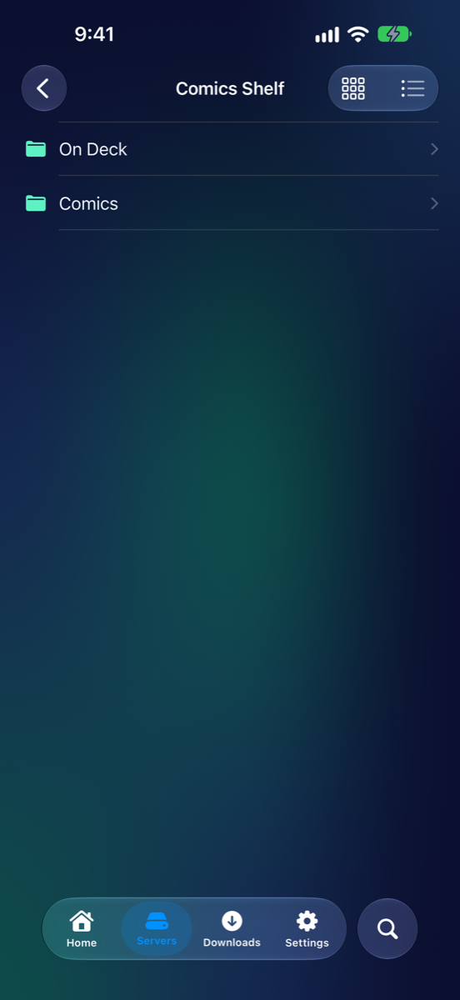
iPhone 18 Pro Max

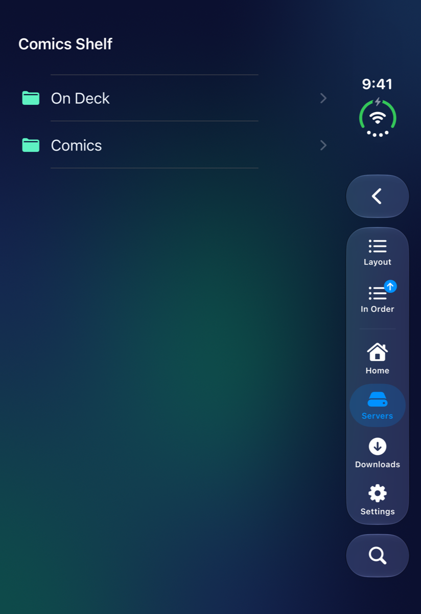
iPhone Duo — closed

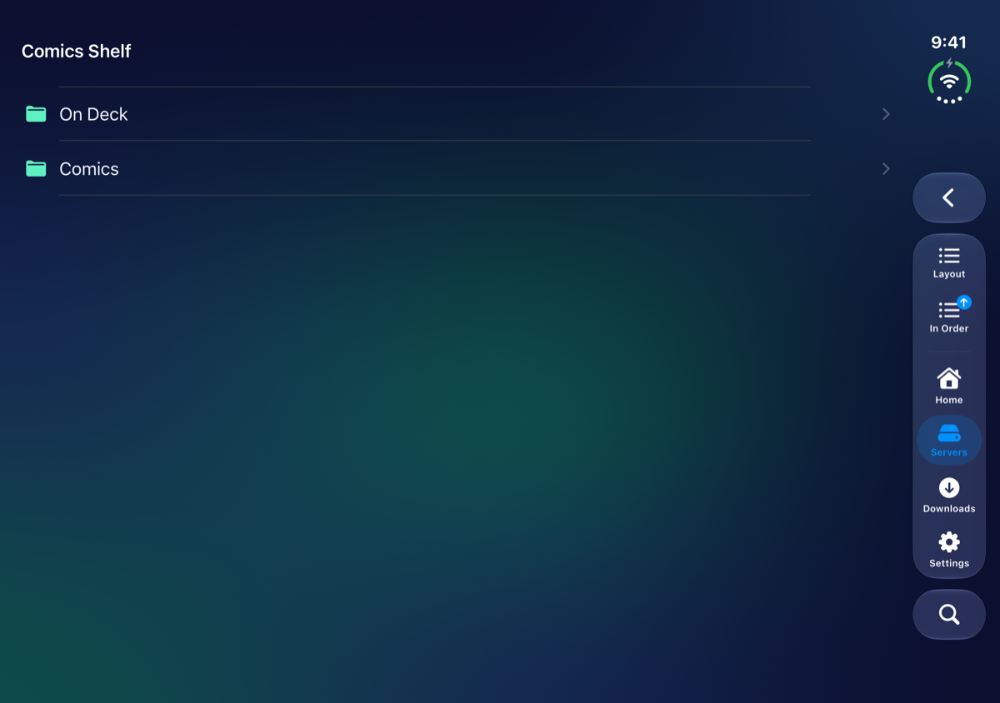
iPhone Duo — open, on its side

With Settings → Server List → **Find Book Servers** on, book servers on your Wi-Fi turn up under **Found on Your Network** in the form, ready to fill in.

### Kavita

Kavita keeps an API key inside its OPDS address. If you paste that address, MK Plus shows **Kavita API key found** and keeps the key safe on your iPhone. If you'd rather not, sign in with your Kavita username and password and MK Plus fetches the key itself.

A Kavita that signs in with Google or another OpenID login has no password to type. The form then offers two ways in:

- **Sign In with … in Safari** (the name of your login goes where the dots are) opens Safari's sign-in sheet, which can use your passkeys and whatever Safari is already signed in to. Kavita then shows your OPDS address on a page: tap **Copy** beside it, come back, and tap **Paste** where the form says **Paste It Here**. The catalog saves. You only do this once. MK Plus uses only the key from what you paste, and clears your clipboard straight away.
- **Sign In on a Page in the App Instead** opens Kavita's page inside MK Plus. It fetches the key by itself, but passkeys can't work there, so you need a password or a code.

Settings → Server List → **Sign In with Safari First** swaps which of the two comes first. If your server sits behind Cloudflare, see [Cloudflare Access](Cloudflare-Access.html).

## Browse a library

A catalog opens like a folder, with cover art. Tap a library to see its series, and a series to see its volumes and chapters.

A library's series show as covers, three across or more. The library's name is at the top, with how many series it has and how many you're partway through. Under each cover is how far you've read, such as **25% read** or **Read**, or how many chapters it has if you haven't started. On a Kavita server, **All**, **Reading** and **Unread** under the name narrow the covers to the series you've started or the ones you haven't.

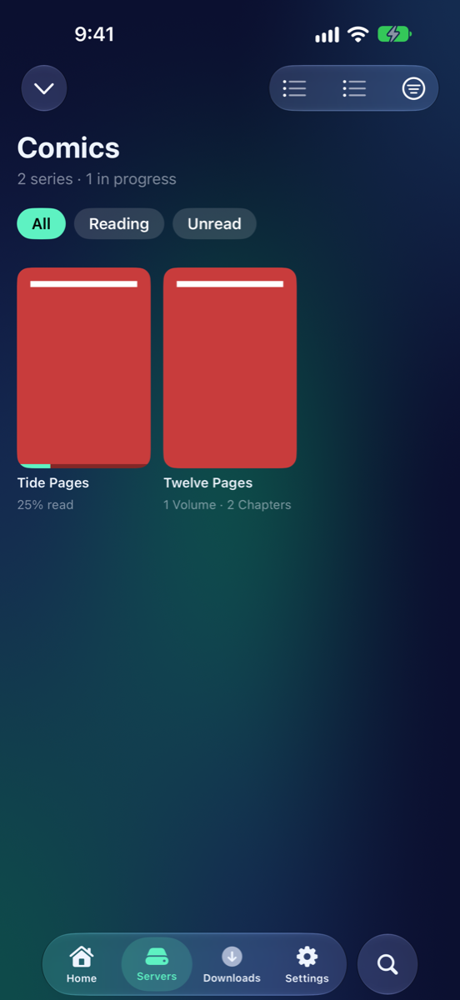
iPhone 18 Pro Max

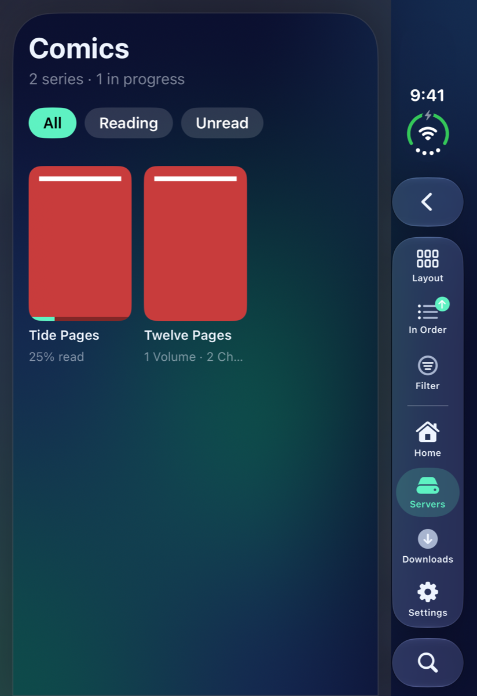
iPhone Duo — closed

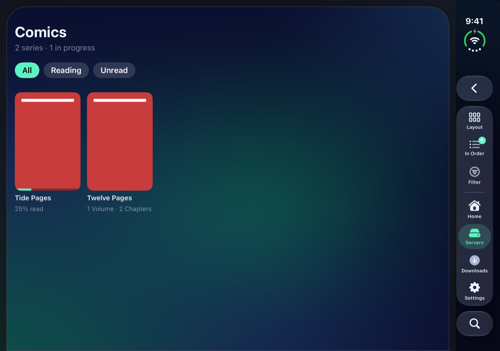
iPhone Duo — open, on its side

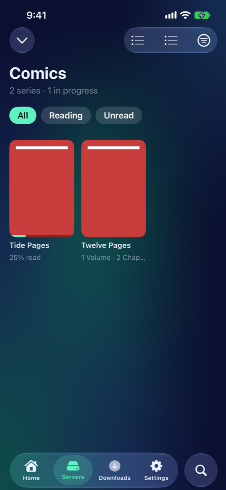
iPhone 17e

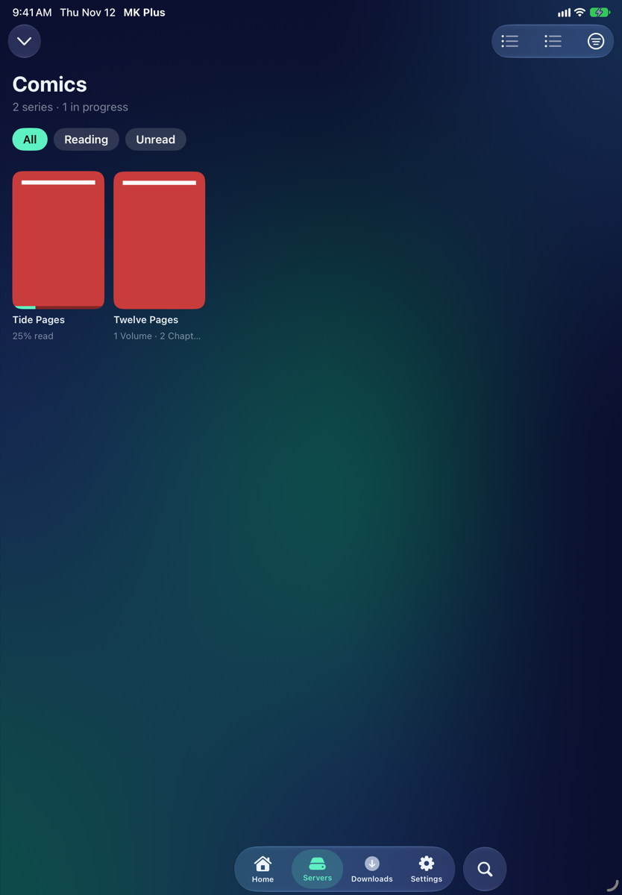
iPad Air 11-inch

- Long lists load more as you scroll.
- Search looks through the whole catalog, not only the list on screen.
- **Filter** offers whatever the catalog has to filter by, such as genre or status. **Show All** clears it.
- Settings → **Catalogs** changes the layout of a catalog's sections and libraries (**Exploring**), a library's series (**A Library's Series**, covers to start with) and the inside of a series (**Inside a Series**), and what each series card shows.

### A series

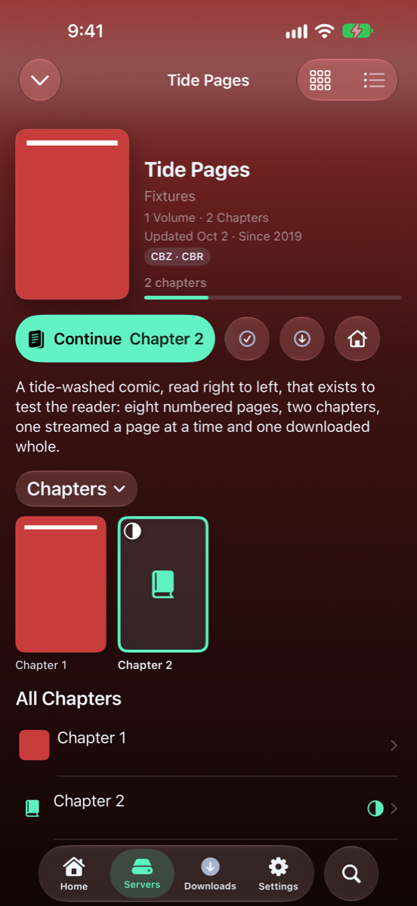
iPhone 18 Pro Max

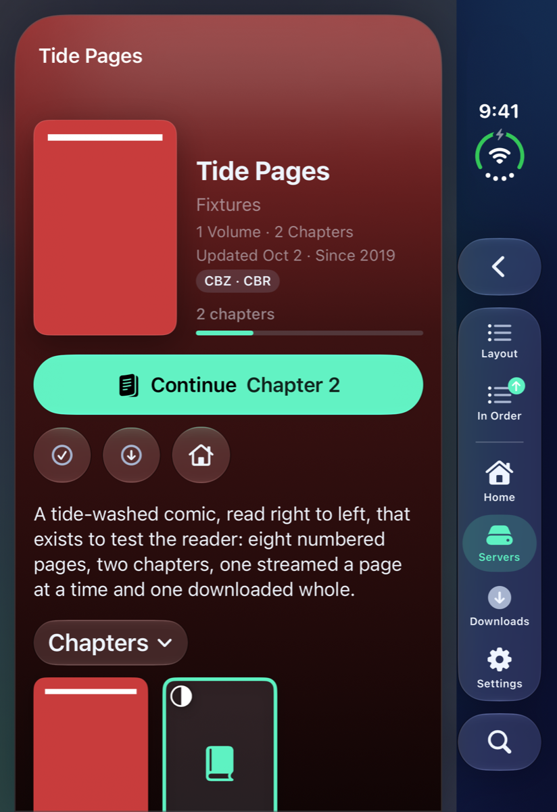
iPhone Duo — closed

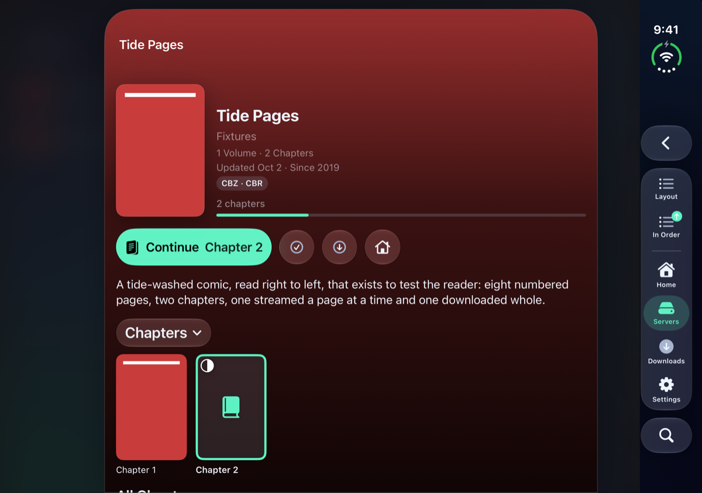
iPhone Duo — open, on its side

A series page shows its cover, summary and progress, and a button for what to read next. The button says **Start Reading**, **Continue**, **Read Next** or **Read Again**, whichever fits where you are. **Volumes** and **Chapters** switch between the two when a series has both.

A book you've finished carries a check mark in a circle. A book you've started carries a half-filled circle. The check-mark button next to the next-up button marks every book in the series as read in one go (or unread, once it's all read): it asks first, and **Mark as Read** (or **Mark as Unread**) confirms.

If you'd rather not have series pages, turn off Settings → **Catalogs** → **Series Pages**.

## Read, and keep your place

Tap a book to open it. With Settings → **Catalogs** → **Stream Comic Pages** on, a Kavita or Komga comic opens straight away and its pages load as you read. With it off, the whole comic downloads first, which reads more smoothly on a slow connection.

With **Sync Reading Progress** on (also in Settings → **Catalogs**), your page goes back to Kavita or Komga as you read and reaching the last page marks the book read. A book you haven't opened on this iPhone starts where the server says you left off, even if you last read it on another device. The books you're partway through also appear in the **Continue Reading** widget on Home.

## Download for offline

Press and hold a book and choose **Download to Read Offline**. It's saved on your iPhone under **Downloads**, in **Ready to Read**, and the catalog opens that copy from then on. Your place is kept either way and sent back to the server when it can be reached.

On a series page, **Auto-Download New Chapters** downloads new volumes and chapters by itself as they appear, when MK Plus opens. Press and hold a download in **Downloads** and choose **Remove Download** to get rid of it. See [Browsing your files](Browsing.html#downloads-for-offline).

## What went wrong

| What you see | Try this |
|---|---|
| The catalog won't save | Check the address opens in a browser on the same network, and the username and password are right. |
| A Kavita that signs in with Google has no password box | Use **Sign In with … in Safari**, then **Copy** and **Paste** as above. |
| The Safari sheet stays open after **Copy** | Close it yourself and tap **Paste** in MK Plus. |
| A book opens at the wrong page | Make sure **Sync Reading Progress** is on in Settings → **Catalogs**. |
| A comic is slow to open | With **Stream Comic Pages** off the whole comic downloads first. Turn it on. |

## Related pages

- [Reading](Reader.html): opening and turning pages
- [Get started](Getting-Started.html): adding a server
- [Cloudflare Access](Cloudflare-Access.html): a book server behind Cloudflare
- [Browsing your files](Browsing.html): downloads for offline
- [Media](Settings-Media.html): the Catalogs settings

---

Previous: [← Reading](Reader.html) · Next: [Pictures →](Image-Viewer.html)
