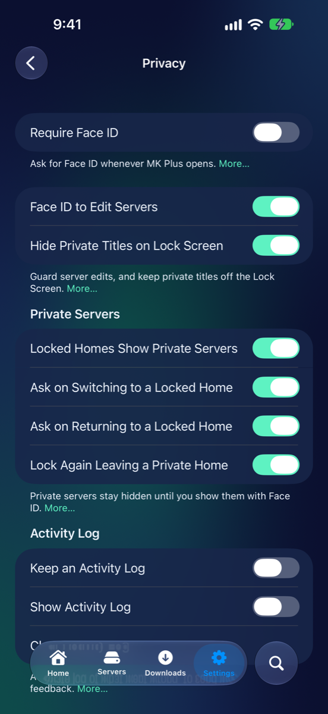
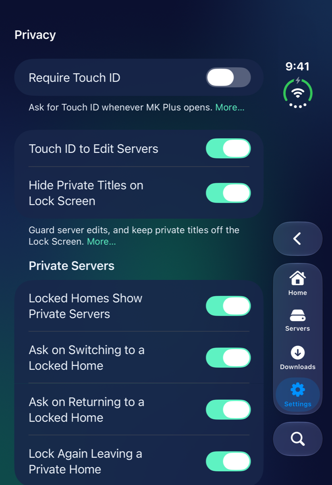
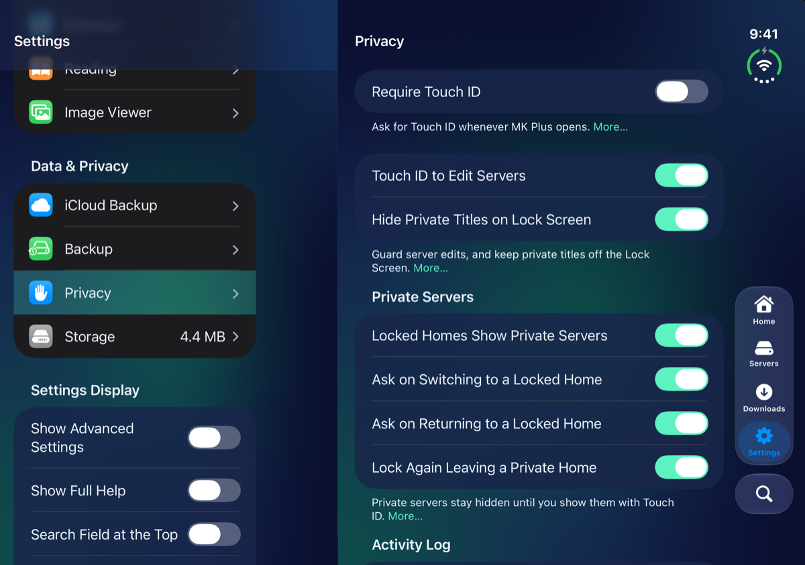
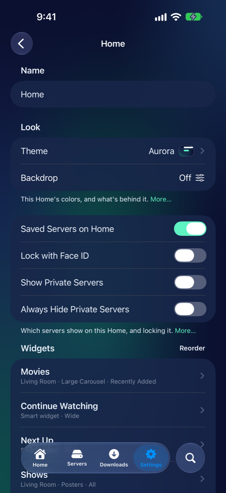
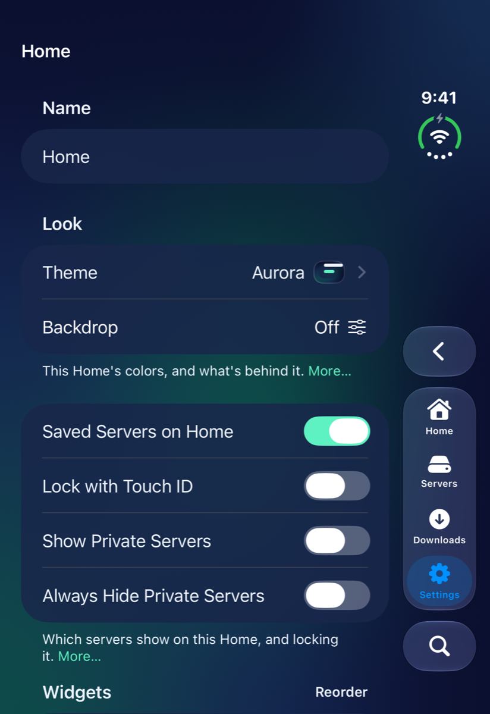
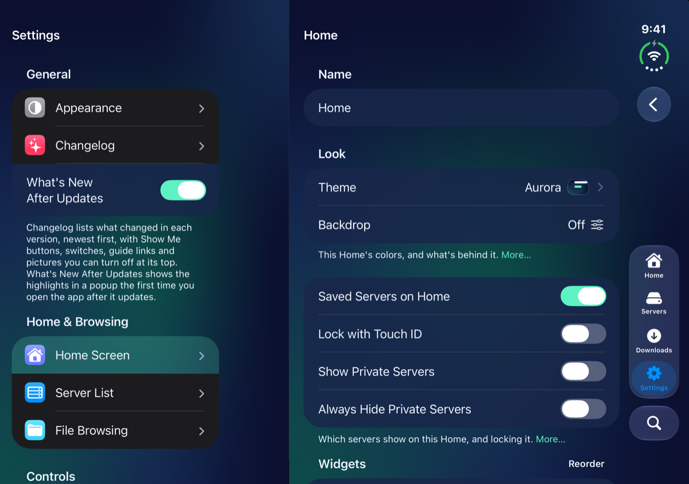

# Privacy and Face ID

Pictures for
<button type="button" data-device="iphone-18-pro-max" aria-pressed="true">iPhone 18 Pro Max</button>
<button type="button" data-device="duo-front" aria-pressed="false">iPhone Duo — closed</button>
<button type="button" data-device="duo-open-side" aria-pressed="false">iPhone Duo — open, on its side</button>

MK Plus can keep things to itself. Face ID can lock the whole app, guard your servers' sign-ins, and keep some servers out of sight until you ask for them. Most of it is in Settings → **Privacy**, with a little more in each Home's page and each server's page.

On an iPhone without Face ID, everything here uses Touch ID or your passcode instead, and the switches say so. If your iPhone has no passcode, MK Plus says **Set a Passcode First**: set one in your iPhone's own Settings app.

iPhone 18 Pro Max

iPhone Duo — closed

iPhone Duo — open, on its side

## Lock the whole app

1. Open Settings → **Privacy**.
2. Turn on **Require Face ID**. It asks for Face ID first.
3. Choose when it locks again under **Lock**: **Immediately**, **After 1 Minute**, **After 5 Minutes** or **After 15 Minutes** away from the app.

MK Plus then asks for Face ID whenever it opens, and when you come back to it after that time. While it's locked, and in the app switcher, nothing in the app shows. Turning it off asks for Face ID too, so nobody else can. It's off to start with.

## Guard your servers

Two switches in Settings → **Privacy**, both on to start with:

- **Face ID to Edit Servers** asks for Face ID before anyone can change a server's address, username or password. Turning it off asks too.
- **Hide Private Titles on Lock Screen** shows a private server's video as **Private Video** on the Lock Screen and in Control Center, without its name or picture.

## Private servers

A private server stays out of sight until you show it with Face ID. Nothing from it shows on Home: not its widgets, not its share of **Continue Watching**, **Next Up**, **Favorites** and **Continue Reading**, and not its row under the widgets. It's left out of **Add Widgets**, Settings → **Server List**, the **Servers** tab and **Add Server**'s saved servers, and its downloads stay out of **Downloads**.

### Make a server private

1. Open Settings → **Server List** and tap the server.
2. Turn on **Private**. It asks for Face ID.
3. Choose **While Hidden, on Home**: **Hide** takes its widgets off Home, and **Titles Only** keeps them in place as just their titles, without pictures.

You can also turn on **Private** in the **Privacy** section while you add a server. Either way it shows until you put the app away, then hides.

### Show them

- On the **Servers** tab, tap **Show Private Servers** (the eye at the top left). **Hide Private Servers** hides them again.
- In Settings → **Server List**, tap **Show Private Servers**. It's only there while some are hidden.
- Tap a widget showing **Titles Only**.

Each asks for Face ID. Private servers then show everywhere, on every Home, until you put the app away. The one exception is a Home with **Always Hide Private Servers** on (below).

## Private servers on each Home

Each Home decides for itself. Open Settings → **Home Screen** and tap a Home, or press and hold the Home's name and choose **Home Screen Settings**.

iPhone 18 Pro Max

iPhone Duo — closed

iPhone Duo — open, on its side

- **Show Private Servers** puts your private servers' widgets, rows and entries in the smart widgets on this Home, without asking each time. Turning it on asks for Face ID. While you're on a Home that shows them, Server List, the Servers tab, Add Server and Downloads show them too.
- **Always Hide Private Servers** keeps them off this Home completely: even after you've shown them with Face ID somewhere else, even when the Home is locked, and **Titles Only** widgets too. **Show Private Servers** is off and greyed out while it's on. Turning it off asks for Face ID.

**Add Widgets**, and the servers a widget gathers from, only offer a private server on a Home that shows private servers. Showing them with Face ID on the Servers tab or in Server List doesn't change that: to put a private server's widget on a Home, turn on that Home's **Show Private Servers**, or lock it (below).

## Locked Homes

A Home can be locked on its own. Its widgets hide behind Face ID once you've put the app away, and it shows **Unlock with Face ID** until you do.

- To lock one, press and hold its name on Home and choose **Lock with Face ID…**, or turn on **Lock with Face ID** in its page in Settings → Home Screen. **Remove Lock…**, in the same menu, takes it off. Both ask for Face ID.
- A locked Home is a private one. Once you've unlocked it, it shows private servers and offers them in **Add Widgets**, and so do Server List, the Servers tab, Add Server and Downloads while you're on it. A Home with **Always Hide Private Servers** on never is.

Four switches in the **Private Servers** section of Settings → **Privacy** fine-tune this. All four are on to start with.

- **Locked Homes Show Private Servers** makes every locked Home a private one, as above. Off, a locked Home only shows private servers if its own **Show Private Servers** is on. Turning it back on asks for Face ID.
- **Ask on Switching to a Locked Home** asks for Face ID as soon as you go to a locked Home, then opens it. Cancel, and it stays locked with its **Unlock with Face ID** button.
- **Ask on Returning to a Locked Home** does the same when you come back to the app on a locked Home, after putting it away.
- **Lock Again Leaving a Private Home** hides private servers again, and locks the locked Homes, as soon as you go to a Home that doesn't show them. Turning it off asks for Face ID.

## The Activity Log

The **Activity Log** section of Settings → **Privacy** keeps a private record of what went wrong, so that a problem you report can be found.

- **Keep an Activity Log** notes what goes wrong and what the app did about it, such as a video that wouldn't open and what it tried next. It keeps the last 1,500 lines, on this iPhone only.
- Names, web and IP addresses, paths, file names and email addresses each become a short code, and server sign-in tokens are blanked out.
- Nothing leaves your iPhone unless you attach it to **Provide Feedback**, at the bottom of Settings, or share it yourself. You can see what's attached, and take it off, before you send.
- **Show Activity Log** adds an **Activity Log** page to read it, and copy or share it. **Clear Activity Log** empties it.

## What stays on your iPhone

MK Plus has no accounts, no analytics and no ads. Your servers, Homes, settings and where you are in each video and book stay on your iPhone, with passwords, tokens and keys in the iOS Keychain. The developer only receives what you choose to send with **Provide Feedback**. The [privacy policy](https://mkolakowski.github.io/mkplus-guide/privacy/) has the details, including iCloud Backup and who the app talks to.

## What went wrong

| What you see | Try this |
|---|---|
| **Set a Passcode First** | Set a passcode in your iPhone's Settings app, then try again. |
| A private server isn't offered in **Add Widgets** | That Home doesn't show private servers. Turn on its **Show Private Servers**, or lock it. |
| Private servers show on a Home you didn't expect | You showed them with Face ID, so they show until you put the app away. Tap **Hide Private Servers** on the Servers tab, or turn on that Home's **Always Hide Private Servers**. |
| **Show Private Servers** is greyed out on a Home | **Always Hide Private Servers** is on for that Home. |
| A Home's widgets are gone | The Home is locked. Tap **Unlock with Face ID**. |
| A private server's download isn't in **Downloads** | Show private servers first. |
| A server's address can't be changed without Face ID | **Face ID to Edit Servers** is on. |

---

Previous: [← Pictures](Image-Viewer.html) · Next: [On your device →](Devices.html)
