# Reading

Pictures for
<button type="button" data-device="iphone-18-pro-max" aria-pressed="true">iPhone 18 Pro Max</button>
<button type="button" data-device="duo-front" aria-pressed="false">iPhone Duo — closed</button>
<button type="button" data-device="duo-open-side" aria-pressed="false">iPhone Duo — open, on its side</button>
<button type="button" data-device="iphone-17e" aria-pressed="false">iPhone 17e</button>
<button type="button" data-device="ipad-air-11" aria-pressed="false">iPad Air 11-inch</button>

Comics (CBZ and CBR files), PDFs and EPUBs open in MK Plus's own reader. Tap a book in a folder, on a [book server](OPDS-Catalogs.html) or in **Downloads** and it opens full screen, at the page you left it on.

## Turning pages

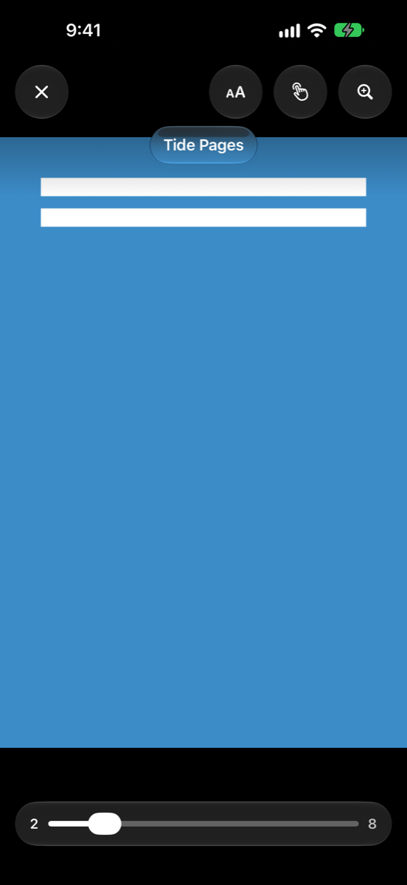
iPhone 18 Pro Max

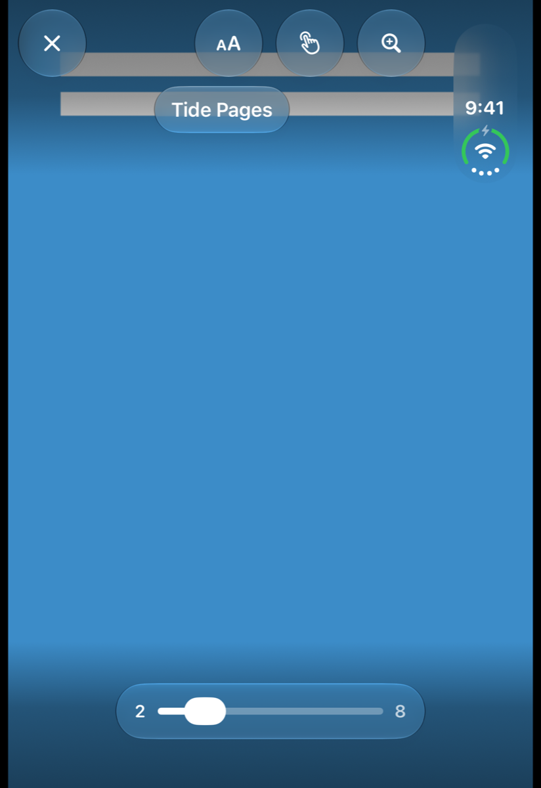
iPhone Duo — closed

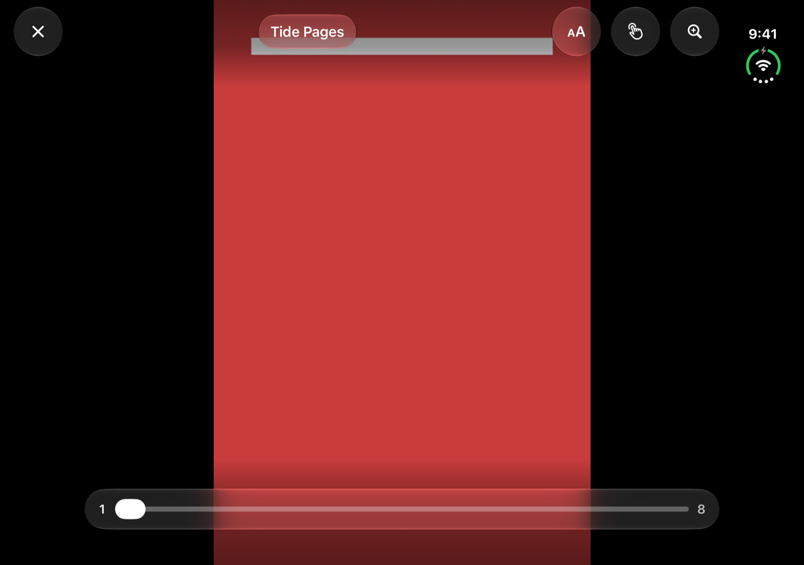
iPhone Duo — open, on its side

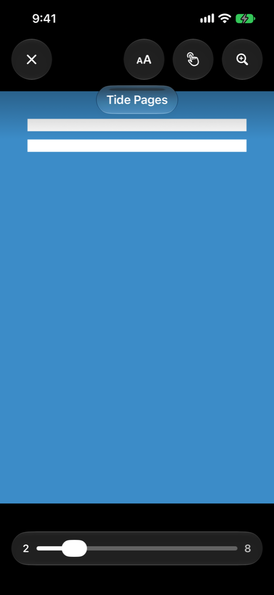
iPhone 17e

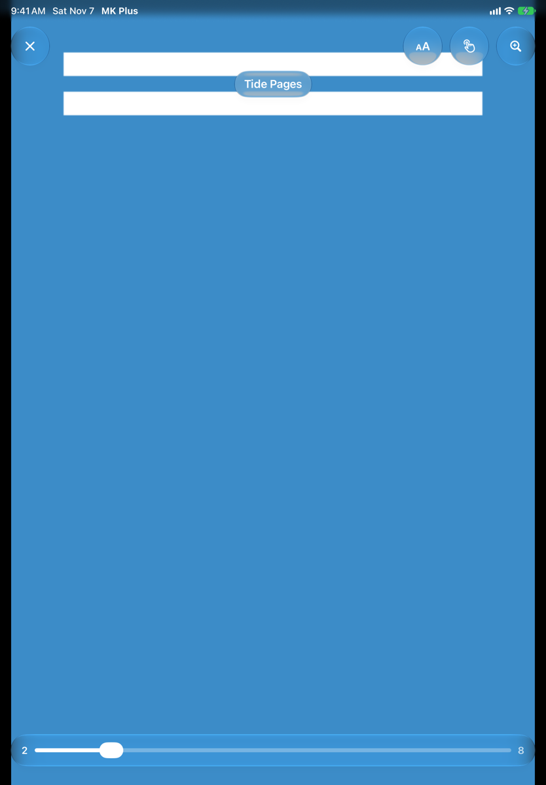
iPad Air 11-inch

Tap the middle of a page to show or hide the controls. Everything else is a gesture:

- **Tap** near the left or right edge to go back or forward. Where exactly is up to the tap zones, below.
- **Swipe** sideways to turn the page. How the page moves is the **Turn Style**: **Slide**, **Curl** (like paper), **Instant**, **Fade**, **Vertical Paged** or **Vertical Scroll** (one long column, like a webtoon).
- **Pinch** to zoom, and drag to look around. **Double tap** zooms in and a second double tap zooms back out. A zoomed page pans before it turns.
- **Pull a page down** and the book follows your finger and closes. It doesn't apply in the vertical turn styles, or while you're zoomed in. Switch it off with Settings → Reading → **Controls & Closing** → **Swipe Down to Close**.

A manga or other right-to-left comic reads from the right: taps, swipes and the curl all follow its direction.

Past the last page the reader offers the next book in the folder, or the next chapter on a book server, with **Read Next**. Going back past the first page offers **Read Previous**. Settings → Reading → **Controls & Closing** → **At the End** can close the book instead (**Close the Book**) or do nothing (**Nothing**).

## The controls

With the controls showing:

- **Close** and the book's title are at the top left.
- At the top right are your buttons. To start with they are **Reading Options**, **Show Tap Zones** and **Zoom**. You choose them yourself: see [Lay the controls out your way](#lay-the-controls-out-your-way).
- The scrubber runs along the bottom. In its **Timeline** style it shows the page you're on at one end and the page count at the other, with a pill to drag between them. **Classic** is the page number over a plain slider. After a big jump, **Back to page 12** (or whichever page you came from) takes you back.
- A soft dark shade sits behind the buttons at the top and the scrubber at the bottom, so they're easy to see on a white page. The middle of the page stays clear. To turn it off, go to Settings → Reading → **Controls & Closing** → **Shade Behind Controls**.
- **Page Number on Page** keeps a small page number showing while the controls are hidden. It's off to start with.

Turn your iPhone on its side and the book shows two pages side by side, as below.

## Two pages at once

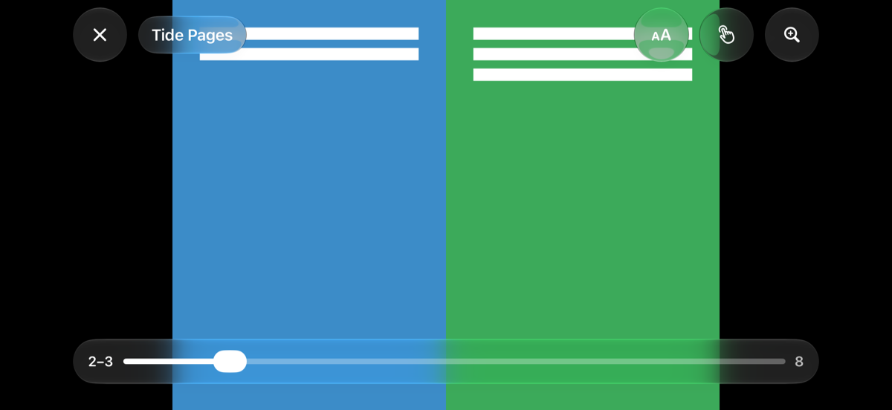
iPhone 18 Pro Max

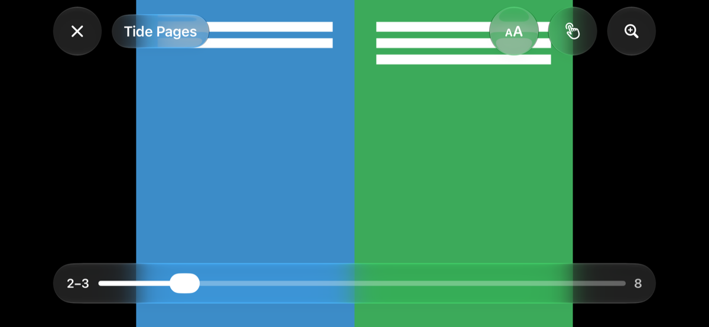
iPhone 17e

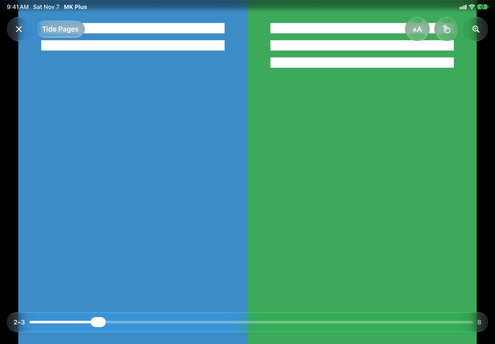
iPad Air 11-inch

**Two-Page Spreads** can be **Automatic**, **Always Single** or **Always Two Pages**. On **Automatic**, a book shows two pages side by side when your iPhone is on its side. An iPad or an unfolded iPhone Duo does it upright too, when **Two Pages When Upright** is on. A picture that is already a double page shows by itself, and **Cover Alone** keeps the first page on its own so the rest pair up as they would in print. The Duo's front screen, and any phone held upright, shows one page.

Change them in Settings → Reading → **Page Layout**, or for the book in front of you in Reading Options.

## Trim the blank paper

Scanned comics and manga often have blank paper round the art. **Trim Borders** cuts it off as each page opens, so the art fills more of the screen. Both pages of a spread are cut alike, so they still line up. A page with its art right to the edges isn't cut, and neither is a page that's mostly empty, like a title page. **Vertical Scroll** is left as it is. **Trim Borders** is on to start with. Turn it off in Settings → Reading → **Page Layout**, or for one book in Reading Options.

## Reading Options

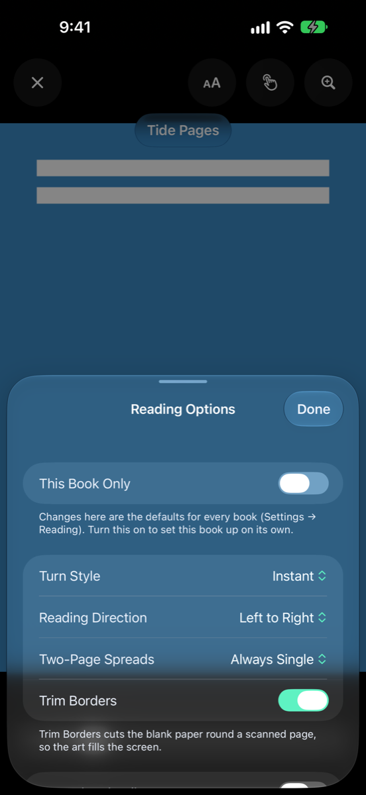
iPhone 18 Pro Max

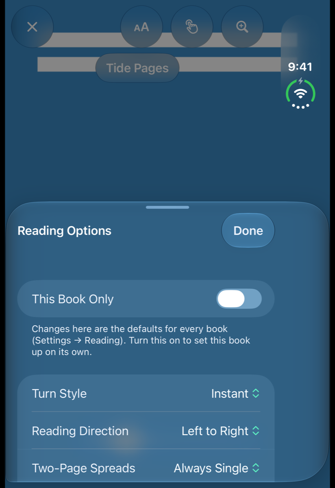
iPhone Duo — closed

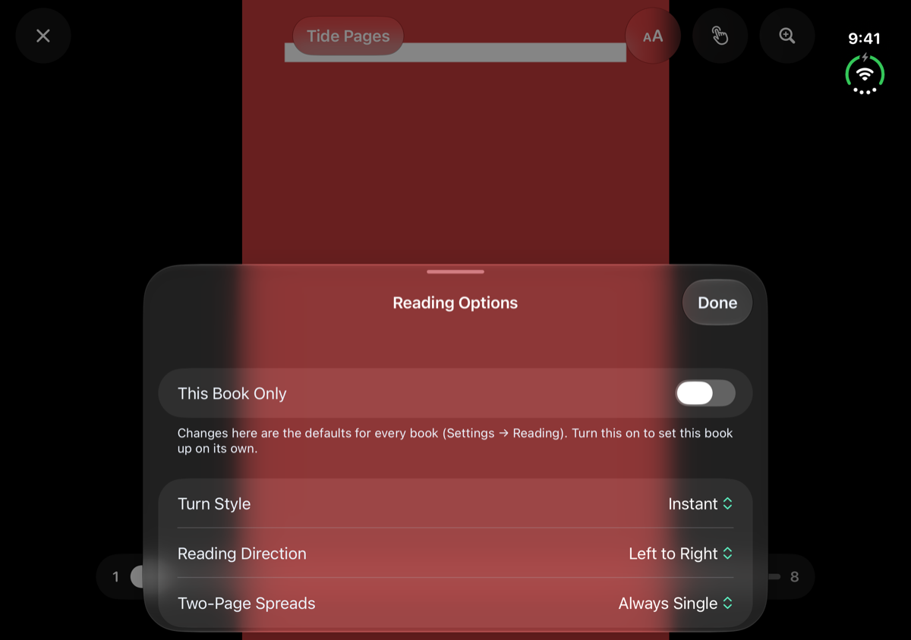
iPhone Duo — open, on its side

Tap **Reading Options** in the controls to change how this kind of book reads, without leaving it. It opens as a solid sheet, so a bright page doesn't show through it. On the iPhone Duo on its side it opens to the right of the fold, and a tap on the page to its left closes it.

- **Turn Style**, **Reading Direction** (**Automatic**, **Left to Right** or **Right to Left**), **Two-Page Spreads** and **Trim Borders**.
- **Page Thumbnails** adds a row of the book's pages, small, by the timeline: scroll along it and tap one to jump there.
- **Keep Controls When Turning** leaves the controls up as you turn.
- **Profile** switches your whole reading setup in one tap. See below.
- **Tap Zones**, **Show Tap Zones**, **Haptic on Page Turn**, **Volume Buttons**, **Auto Turn Every** and **Double-Tap to Zoom**.

Turn on **This Book Only** and what you change here belongs to that one book, so a manga can read right to left while everything else doesn't. Turn it off again to go back to the defaults. Tap **Done** to close the sheet. The same settings live in Settings → **Reading**, which opens as four pages: **Book Types**, **Page Layout**, **Turning Pages** and **Controls & Closing**.

### Reading Profiles

A profile saves your whole reading setup under a name, such as Manga. In Settings → **Reading**, tap **Save Current Setup…**, give it a name and tap **Save**. After that, choose it in Reading Options under **Profile**, or from Settings → Reading. Saving under a name you've used already updates that profile.

## Tap zones

iPhone 18 Pro Max

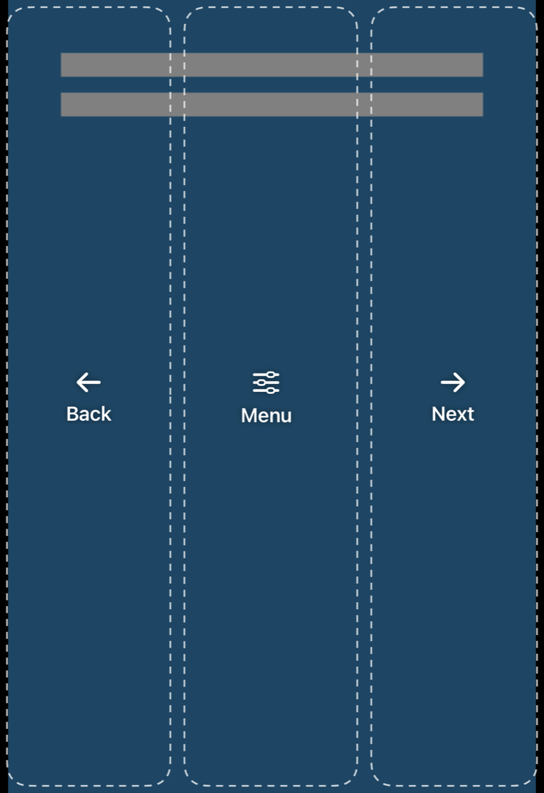
iPhone Duo — closed

iPhone Duo — open, on its side

Where you tap decides what happens. Pick a layout under **Tap Zones** in Reading Options, or in Settings → Reading → **Turning Pages**:

| Layout | What it does |
|---|---|
| **Sides** | The left third goes back, the right third forward, and the middle shows the controls. It's the one you start with. |
| **Kindle** | A narrow strip down the left goes back, the top shows the controls, and everywhere else goes forward. |
| **Edges Only** | Only narrow strips down each edge turn the page. |
| **One-Handed (Right)** | Most of the screen goes forward, and a strip down the left goes back. |
| **One-Handed (Left)** | The same, the other way round. |
| **Forward Anywhere** | Every tap goes forward except the middle. Swipe to go back. |
| **Off** | Taps only show and hide the controls. Swipe to turn. |
| **Custom** | Your own grid of nine zones. |

**Show Tap Zones** dims the page for a moment and outlines each zone, with what it does written in the middle, so you can see where each one is. **Custom Zones** opens a grid where you choose what each of the nine zones does. **Follow Reading Direction** swaps left and right for right-to-left books.

## Keyboards, page turners and volume buttons

- A keyboard works: Space, Return, the down arrow and Page Down go forward, the up arrow and Page Up go back, and Escape closes the book.
- Bluetooth page turners, clickers, foot pedals and game controllers work too. Settings → Reading → **Turning Pages** → **Page Turners** lets you choose what each of their buttons does: tap an action, then **Add Button** and press the button on your device.
- **Volume Buttons** turns the page with your iPhone's volume buttons while a book is open. **Down Turns Forward** is how most reading apps do it.
- **Auto Turn Every** turns pages on its own. Put the **Auto Turn** button in the controls to start and stop it.

## PDFs

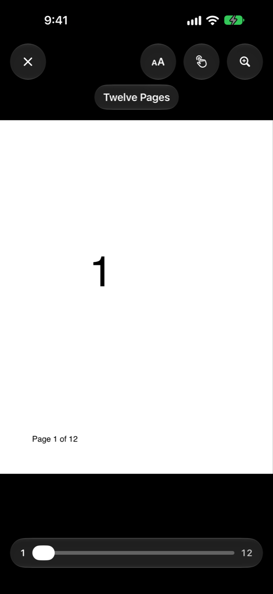
iPhone 18 Pro Max

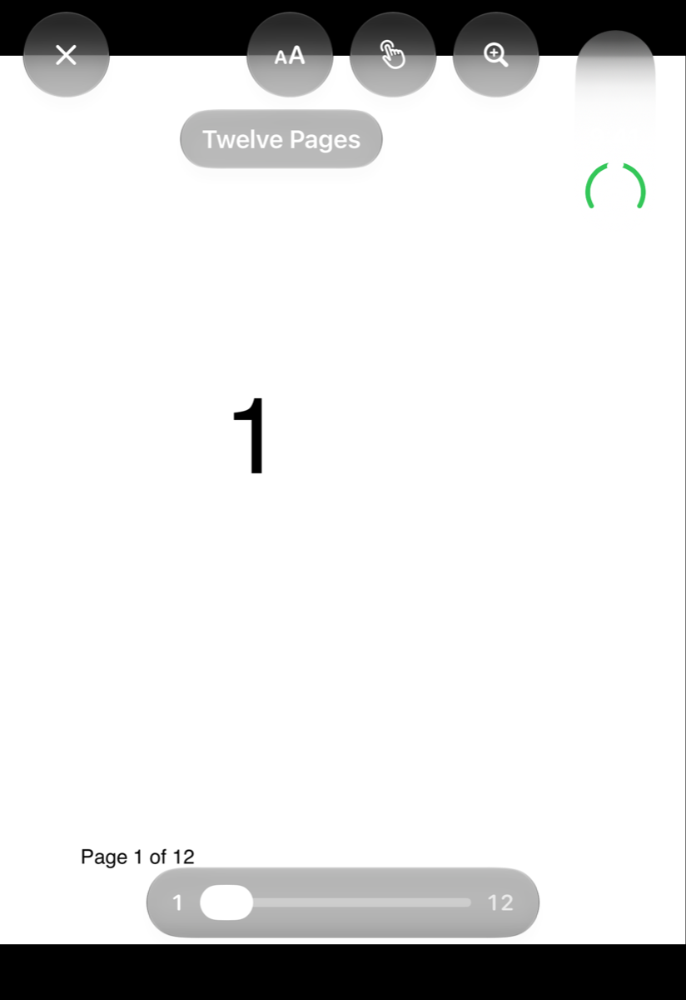
iPhone Duo — closed

PDFs use the same controls, tap zones and turn styles as comics. **Vertical Scroll** scrolls through the pages like most PDF viewers. Choose the PDF **Turn Style** in Settings → Reading → **Book Types**.

## EPUBs

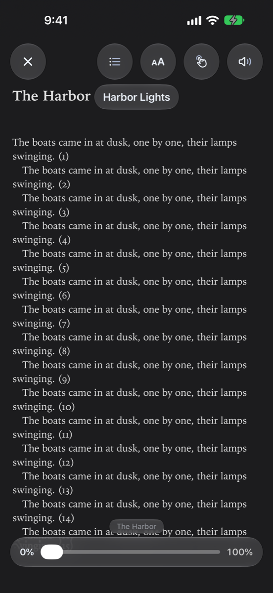
iPhone 18 Pro Max

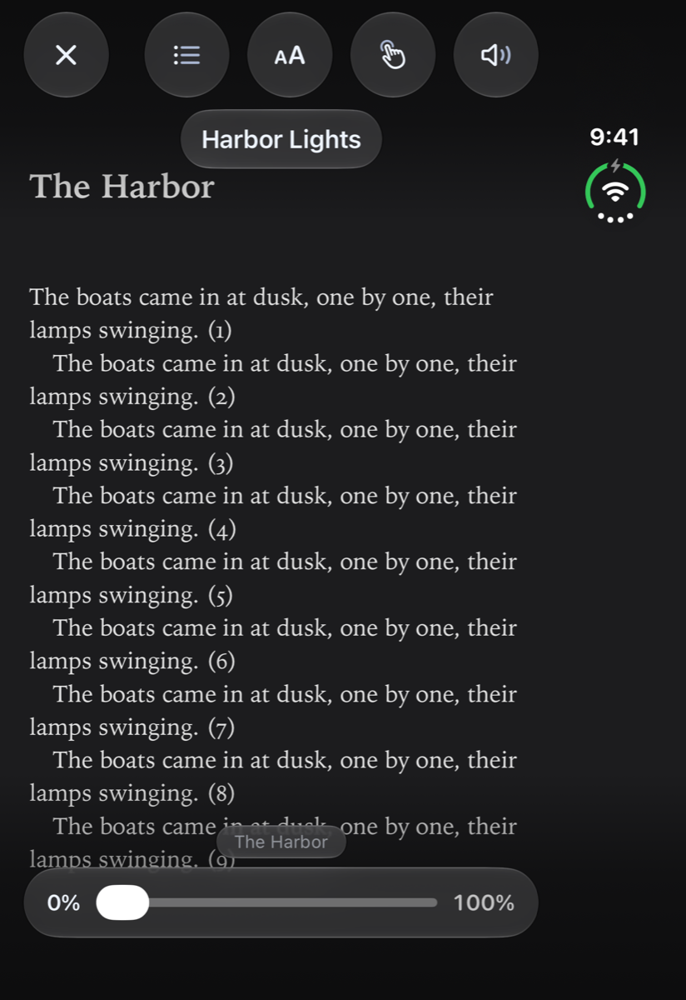
iPhone Duo — closed

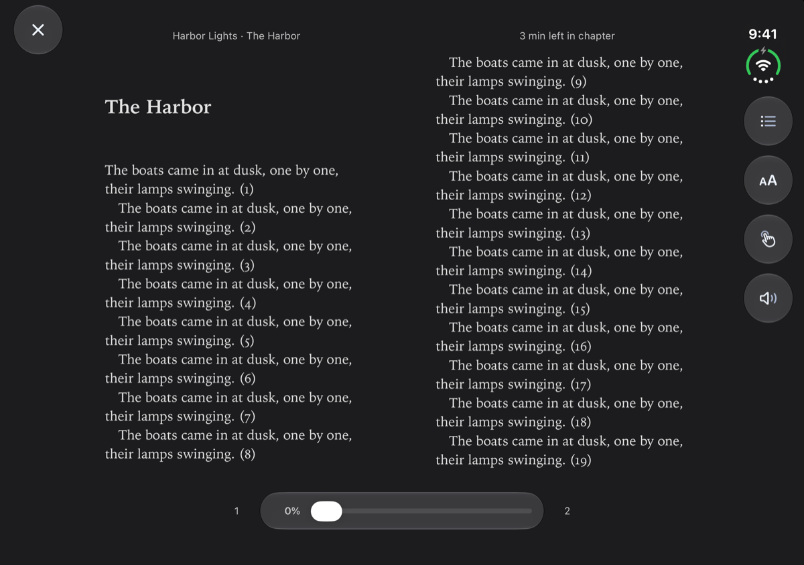
iPhone Duo — open, on its side

An EPUB's text reflows to fit your screen. Its controls are a little different:

- **Contents, Bookmarks and Search** (the list button) opens a sheet with three tabs. **Contents** jumps to a chapter, **Bookmarks** keeps places you've marked with **Bookmark This Place**, and **Search** looks through the book.
- **Reading Options** opens **Appearance** here, with:
  - **Theme**: **Light**, **Sepia**, **Dark**, **Black** or **Auto** (follows your iPhone).
  - **Text Size**, **Font** (the book's own, or one of several, including OpenDyslexic), **Margins**, **Columns** (**Automatic**, **One Column** or **Two Columns**), **Line Spacing**, **Paragraph Spacing**, **Justify** and **Hyphenation**.
  - **Book's Layout** keeps the layout the book was made with.
  - **Turn Style**: **Slide**, **Curl**, **Instant** or **Vertical Scroll**.
- **Read Aloud** (the speaker) reads the book to you from the page you're on. Its speed and whether it turns pages for you are in Settings → Reading → **Turning Pages**.

The scrubber moves through the book by position. Tap zones, keys and page turners work as they do for comics. As with comics, **This Book Only** gives one book its own look.

As in a printed book, the chapter's name and the time left in it sit above the text, and a page number sits under each page, counted from the start of the chapter. They show while the controls are hidden. Turn each off in Settings → Reading → **Book Types** → **Around the Text**.

 iPhone Duo, open on its side

On the iPhone Duo open on its side, the two columns sit either side of the fold, flat or bent. With **Controls in the Margins** on, the controls stay off the words: **Close** in the top corner, the other buttons down the edge under the clock, and a small scrubber under the text between the page numbers.

## Lay the controls out your way

Settings → **Reader Controls** opens the real reader, with a sample comic, so every change shows as you make it.

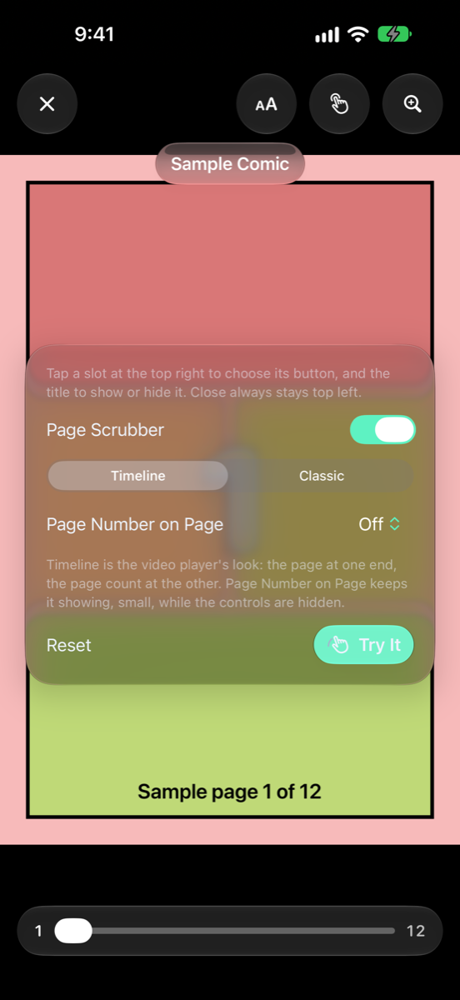
iPhone 18 Pro Max

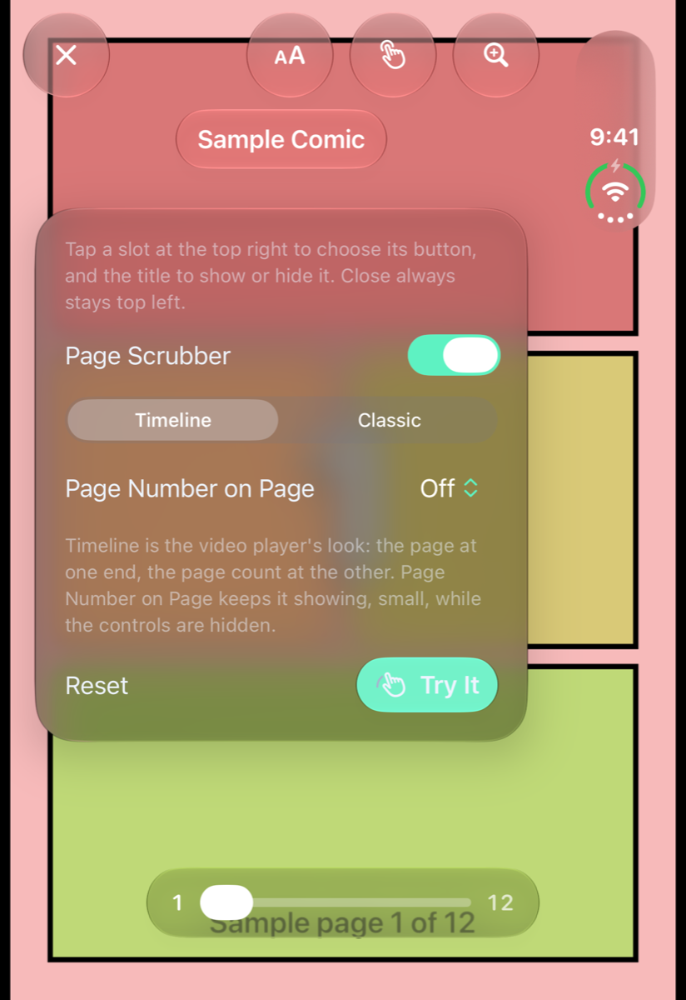
iPhone Duo — closed

1. Tap a slot at the top right and choose a button for it: **Reading Options**, **Show Tap Zones**, **Next Book**, **Previous Page**, **Next Page**, **Auto Turn**, **Zoom** or **Read Aloud**. **None** leaves it empty.
2. Tap the title to show or hide it. **Close** always stays at the top left.
3. In the card in the middle, turn **Page Scrubber** on or off, pick the **Scrubber Style** (**Timeline** or **Classic**) and choose where **Page Number on Page** goes: **Off**, **Top**, **Bottom**, **Top Corner** or **Bottom Corner**.
4. Tap **Try It** to put the card away and read the sample with your controls, tap zones and swipes. **Edit Controls** brings it back. **Reset** goes back to the original layout.

Your layout is saved in your Reading Profiles.

## Where you left off

Every book opens at the page you were last on. For books on a book server, your place also goes back to the server as you read. See [Book servers](OPDS-Catalogs.html).

## What went wrong

| What you see | Try this |
|---|---|
| A tap turns the page when you wanted the controls | Change **Tap Zones** to **Sides**, or to **Off** and swipe. |
| A swipe closes the book by accident | Turn off **Swipe Down to Close** in Settings → Reading → **Controls & Closing**. |
| Pages show two at a time and you don't want that | Set **Two-Page Spreads** to **Always Single** in Reading Options. |
| A manga reads the wrong way | Set **Reading Direction** to **Right to Left** in Reading Options, with **This Book Only** on to keep it to that book. |
| A button you want isn't in the controls | Add it in Settings → **Reader Controls**. |

## Related pages

- [Book servers](OPDS-Catalogs.html): reading from Kavita or Komga and keeping your place
- [Media](Settings-Media.html): every Reading setting
- [Settings](Settings.html): where Reader Controls lives
- [On your device](Devices.html): two pages at once on the Duo and iPad

---

Previous: [← Listening to music](Music.html) · Next: [Book servers →](OPDS-Catalogs.html)
