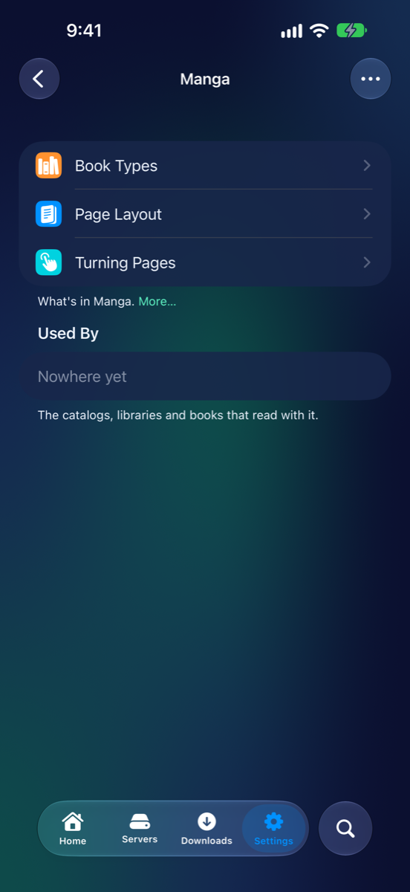
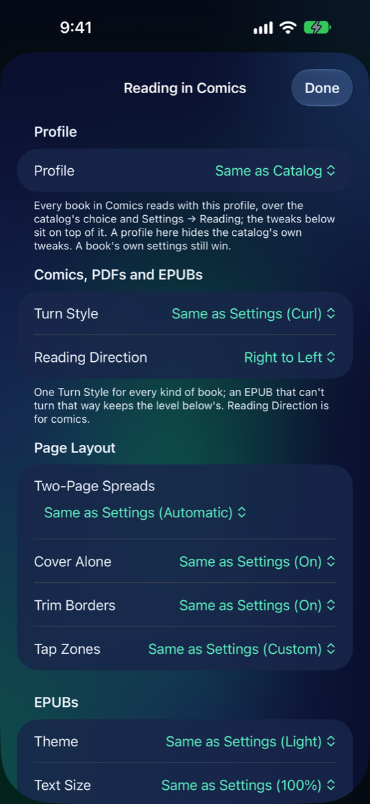

# Reading profiles

A reading profile is a named set of reading settings, such as Manga or Novels. Make one in Settings → **Reading**, then give it to a book server, one of its libraries or a single book, and every book there reads that way.

## What a profile holds

A profile holds everything one book can do differently from another:

- **Turn Style** for comics, PDFs and EPUBs, **Reading Direction**, **Two-Page Spreads**, **Cover Alone** and **Trim Borders**.
- **Tap Zones**.
- How EPUBs look: theme, text size, font, margins, columns, **Book's Layout**, line and paragraph spacing, **Justify** and **Hyphenation**.
- Read Aloud: speed, **Highlight the Sentence** and its color, **Use the Book's Narration** and **Play Narration When a Book Opens**.

Swiping, the Custom Zones grid, Reader Controls, the volume buttons and Auto Turn belong to your iPhone, not to a profile. They stay in Settings → **Reading** for every book.

## Make and change a profile

iPhone 18 Pro Max

1. Open Settings → **Reading** and tap **New Profile…**.
2. Give it a name and tap **Save**. It starts from your settings as they are now.
3. Tap the profile to open its own page. **Book Types**, **Page Layout** and **Turning Pages** there change only that profile.

**Used By** lists the book servers, libraries and books that read with it. The **…** button has **Make Default**, which copies the profile into Settings → Reading, plus **Rename**, **Duplicate** and **Delete**.

## Where a profile can go

Settings → **Reading** itself is the default: how a book reads when nothing else says otherwise. On top of it:

- **A book server:** on its page (Settings → **Server List**, then the server), tap **Reading**.
- **One library:** open the library and tap the book button at the top.
- **One book:** in the book, open **Reading Options** (or **Aa** for an EPUB).

Each starts as **Same as** the level under it, then you can pick a profile. Books from folders, file shares and **Downloads** have only the default and the book itself.

iPhone 18 Pro Max

## Tweaks: one setting on its own

A book server, a library or a book can also change single settings without a whole profile. These are its tweaks. In the **Reading** editor, each setting says **Same as** and where its value comes from, such as **Same as Manga (Right to Left)**; choose a value to make it a tweak.

- **Save as Profile…** turns how that server or library reads now into a new profile and picks it.
- **Clear Tweaks** puts every setting back to **Same as**.

A book server's **Reading** editor also has **Sync Reading Progress**: **Same as Settings**, **On** or **Off**, for that server only.

## Which setting wins

For each setting, the first of these that sets it wins:

1. The book's tweak, then the book's profile.
2. The library's tweak, then the library's profile.
3. The book server's tweak, then its profile.
4. Settings → **Reading**.

A profile answers every setting, so a profile on a library hides the book server's tweaks. Storyteller's readaloud books start with taps that only show the controls, and **Slide**, until one of these levels says otherwise.

## Changing a book while you read

In **Reading Options** or **Aa**, a change is for this book only. The line under each setting says where it comes from: **This book**, a profile's name, **Library**, **Catalog** or **Settings**.

- **Profile** picks a profile for this book.
- **Update** with the profile's name, such as **Update Manga**, moves this book's changes into the profile it reads with, so every book with that profile gets them. When no profile applies, it's **Update Defaults**, which moves them into Settings → Reading.
- **Reset This Book** drops its profile and changes.

## Related pages

- [Reading](Reader.html): turning pages, Reading Options and the rest of the reader
- [Book servers](OPDS-Catalogs.html): adding a server and browsing its libraries
- [Media](Settings-Media.html): every Reading setting

---

Previous: [← Reading](Reader.html) · Next: [Book servers →](OPDS-Catalogs.html)
