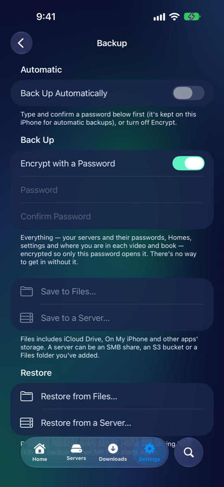
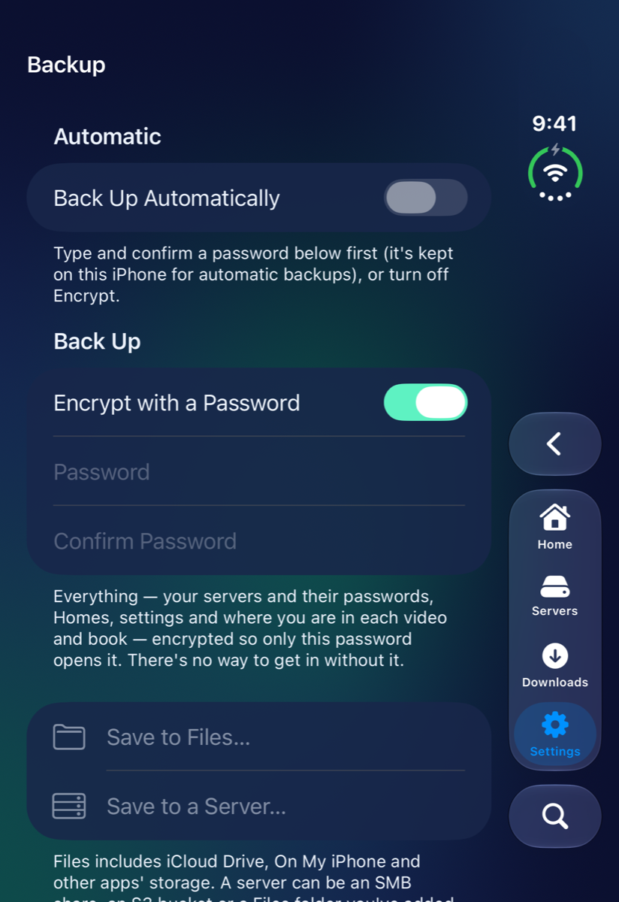
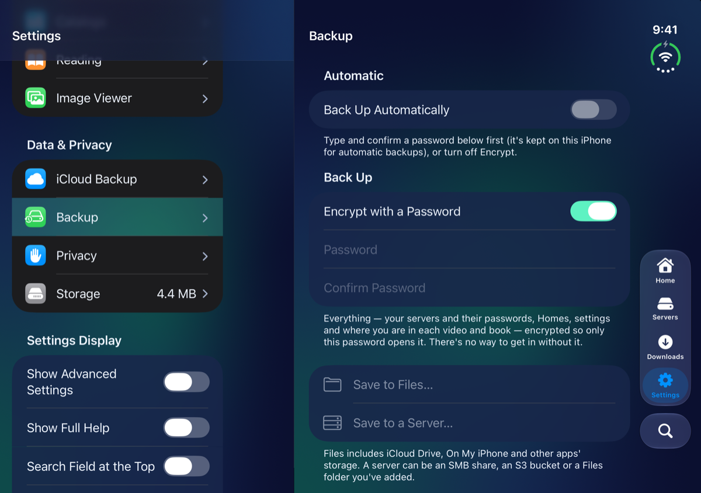
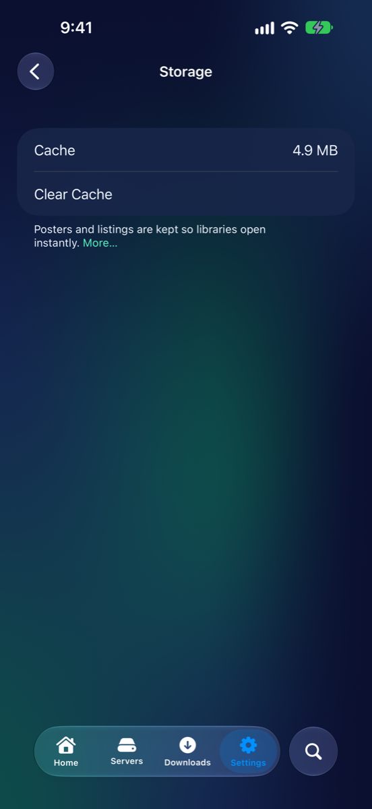
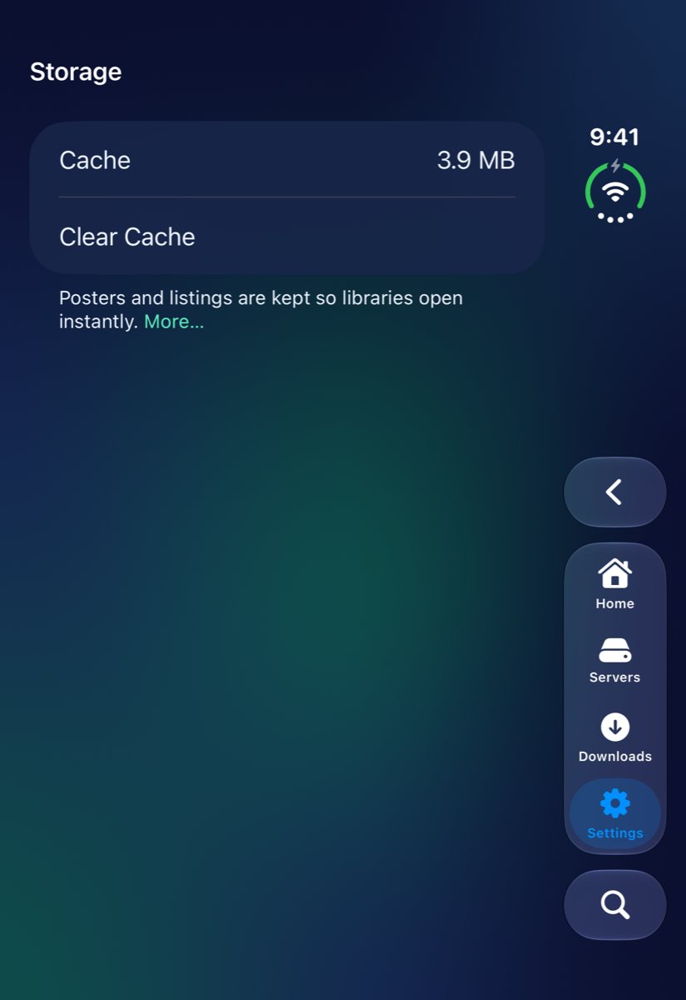
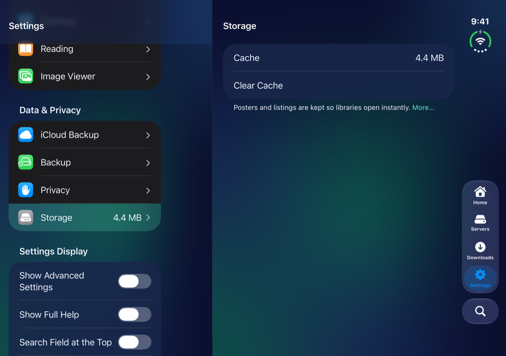

# Data & Privacy

Pictures for
<button type="button" data-device="iphone-18-pro-max" aria-pressed="true">iPhone 18 Pro Max</button>
<button type="button" data-device="duo-front" aria-pressed="false">iPhone Duo — closed</button>
<button type="button" data-device="duo-open-side" aria-pressed="false">iPhone Duo — open, on its side</button>

This group is about keeping your setup safe and your iPhone tidy: **iCloud Backup**, **Backup**, **Privacy** and **Storage**. None of its pages has advanced settings.

## iCloud Backup

Settings → **iCloud Backup** has one switch, **Back Up to iCloud**. With it on, your saved servers, Homes, themes and appearance back up by themselves and sync to your other devices that are signed in to the same Apple Account.

- Passwords aren't kept there. Server passwords and keys sync through iCloud Keychain, when that's on. Jellyfin sign-ins stay on each device, so a new device asks you to sign in to each Jellyfin server once.
- **Last Backed Up** shows when it last ran.
- If you're not signed in to iCloud on your iPhone, the switch is greyed out and the page says **Sign in to iCloud in Settings to enable backup.** Sign in in your iPhone's own Settings app.

## Backup

iPhone 18 Pro Max

iPhone Duo — closed

iPhone Duo — open, on its side

Settings → **Backup** saves the whole app to a file you keep, in Files (which includes iCloud Drive, On My iPhone and other apps' storage) or on a server. A backup holds your servers, your Homes, your settings and where you are in each video and book. Use it before you change phones, or to keep a copy you control.

### Choose how it's protected

**Encrypt with a Password** is on to start with. Type a **Password** and **Confirm Password**. The backup then includes your servers' passwords, tokens and keys, and only that password opens it. There's no way in without it, so keep it somewhere safe.

With **Encrypt with a Password** off, anyone with the file can read your servers and settings, so passwords, tokens and keys are left out. You'll sign in to each server again after restoring.

The buttons stay greyed out until the two passwords match, or you turn encryption off. An encrypted backup asks for Face ID first, since it carries your passwords. On an iPhone without Face ID, it's Touch ID or your passcode.

### Save a backup now

1. Choose **Save to Files…** and pick a place. Or choose **Save to a Server…** and pick a folder on an SMB share, an S3 bucket or a Files folder you've added.
2. When it's done you'll see **Backed Up**.

### Back up by itself

1. In the **Automatic** section, turn on **Back Up Automatically**. It asks for Face ID. If **Encrypt with a Password** is on, type its password first: it's kept on this iPhone for automatic backups.
2. Choose **Back Up To**: **A Folder in Files…** or **A Folder on a Server…**.
3. Set **How Often** to **Every Day** or **Every Week**, and **Keep** to **Last 3**, **Last 5**, **Last 10** or **All**.

MK Plus makes one when you open it and one is due. **Back Up Now** makes one straight away. **Encrypted** says whether they carry passwords. With no password it says **No — without passwords**, and **Add a Password…** includes them (it becomes **Change Password…**). Only automatic backups are ever deleted to keep your last few. Ones you save yourself are left alone.

### Restore

1. Choose **Restore from Files…** or **Restore from a Server…** and pick the backup.
2. If it's encrypted, a **Backup Password** box appears. Type the password it was made with and tap **Open**.
3. **Restore This Backup?** says what's in it. Tap **Replace Everything Here**.
4. When **Restored** appears, tap **Close MK Plus**, then open it again. Everything is as it was in the backup.

Restoring replaces every server, Home and setting on this iPhone with the backup's.

## Privacy

Settings → **Privacy** is where you lock the app and keep private servers private. It holds **Require Face ID**, **Face ID to Edit Servers**, **Hide Private Titles on Lock Screen**, the switches for locked Homes and private servers, and the **Activity Log**, the app's private record of what went wrong, which **Provide Feedback** can attach. On an iPhone without Face ID these say Touch ID or Passcode. [Privacy and Face ID](Privacy.html) goes through all of it.

## Storage

iPhone 18 Pro Max

iPhone Duo — closed

iPhone Duo — open, on its side

Settings → **Storage** shows how much room MK Plus's **Cache** takes, and the Storage row in the list shows the same figure. The cache holds posters and library listings, so libraries open at once and scroll without downloading again. Posters are limited to 200 MB, the least recently viewed going first, and iOS may clear them itself when space is low.

**Clear Cache** empties it. Nothing is lost: posters and listings just download again as you need them. It's greyed out when the cache is empty.

Other things use room too, and have their own controls:

- **Downloads**: press and hold one in the **Downloads** tab and choose **Remove Download**.
- **Generated subtitles**: **Clear Generated Subtitles** in Settings → Video Playback → **Subtitles**.
- **A Whisper model**: **Delete Model**, in the same place.

## What went wrong

| What you see | Try this |
|---|---|
| **Save to Files…** or **Back Up Automatically** is greyed out | Type and confirm a **Password**, or turn off **Encrypt with a Password**. |
| **Save to a Server…** is greyed out | You need a saved SMB share, S3 bucket or Files folder. A private server that's hidden isn't offered. |
| **Backup Password** asks for a password | The backup is encrypted. Enter the one it was made with. Without it, it can't be opened. |
| **Back Up to iCloud** is greyed out | Sign in to iCloud in your iPhone's Settings app. |
| Passwords are missing after a restore | The backup was made without a password, so it left them out. Sign in to each server again. |
| The last automatic backup failed | The line under **Automatic** says why. Check the folder or server is still there, then tap **Back Up Now**. |

---

Home · Previous: [← Media](Settings-Media.html) · Next: [Privacy and Face ID →](Privacy.html) · Up: [Settings](Settings.html)
