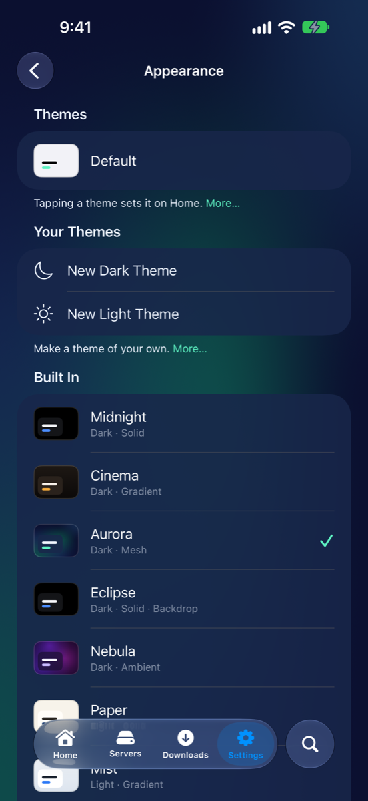
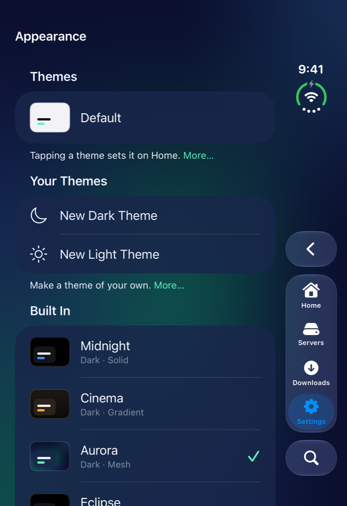
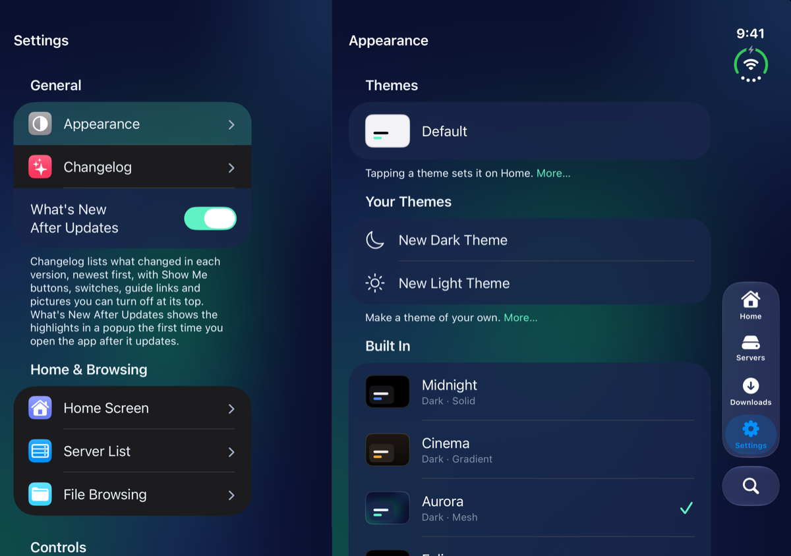

# General

Pictures for
<button type="button" data-device="iphone-18-pro-max" aria-pressed="true">iPhone 18 Pro Max</button>
<button type="button" data-device="duo-front" aria-pressed="false">iPhone Duo — closed</button>
<button type="button" data-device="duo-open-side" aria-pressed="false">iPhone Duo — open, on its side</button>

The first group in Settings has two pages and a switch: **Appearance**, **Changelog** and **What's New After Updates**.

## Appearance

iPhone 18 Pro Max

iPhone Duo — closed

iPhone Duo — open, on its side

Appearance is where you pick a look for your Home and decide how far it reaches. It has no advanced settings.

### Themes

A theme sets a Home's background, the color of its cards and accents, and whether it's light or dark. Each Home has its own, so the Reading Home can look different from the video one.

1. Open Settings → **Appearance**.
2. Tap a theme. It goes on the Home you're on, straight away.

**Default**, in the **Themes** section, follows your iPhone's light or dark. The ready-made ones are under **Built In**: Midnight, Cinema, Aurora, Eclipse and Nebula are dark, and Paper, Mist, Blossom and Daydream are light. If a Home is set to **Light & Dark**, a tap changes the theme for the appearance showing now. You can also set a Home's theme in its own page (see [Home & Browsing](Settings-Home-Browsing.html#a-homes-own-page)) or from the menu on its name. [Your Home](Home-Screen.html#themes-and-backdrops) has more.

### Make your own

1. Under **Your Themes**, tap **New Dark Theme** or **New Light Theme**. It starts from a plain one.
2. Give it a **Name**, choose **Dark** or **Light** under **Look**, and pick a **Background**: **Solid**, **Gradient**, **Mesh** or **Ambient**. **Blurred Artwork Behind It** puts blurred covers from the Home behind the widgets.
3. Under **Colors**, change **Cards**, **Card Opacity**, **Card Style** (**Solid**, **Frosted** or **Glass**), **Accent**, **Text** and **Secondary Text**. **Accent from Artwork** picks an accent from the artwork for you.
4. Tap **Save**.

Tap the pencil beside one of your themes to change it. Swipe a theme to **Duplicate** it, and swipe one of yours to **Delete** it. Deleting a theme puts the Homes that used it back on **Default**. Swipe a built-in theme to **Duplicate** it, then change the copy.

### How far a theme reaches

- **Theme Screens Opened from Home** carries the Home's theme into the folders and other screens you open from it: its colors, light or dark, and its background behind the lists. Off, they keep to your iPhone's light or dark.
- **Settings Follow the Home's Theme** opens Settings in that Home's light or dark, accent color and background.

A Home's theme overrides your iPhone's light or dark while it's on the screen.

### Items

**Item Transparency** says how see-through rows and cards are, on every screen.

- **Per Screen** leaves each screen as it is: Settings' rows and Home's cards take the theme's look, and the Servers list is solid.
- **Translucent** gives every row and card the theme's frosted look.
- **Solid** gives them all the system's plain fill.

Turning on Reduce Transparency in your iPhone's Accessibility settings makes them solid whichever you choose.

### On an iPad

**Large Settings** makes Settings fill most of the screen. Swipe it down to close. Off, it opens as a smaller card in the middle.

## Changelog

**Changelog** lists what changed in every version, newest first. Each version has its date, a title, and its changes under **New**, **Changed** and **Fixed**. Type in **Search Changelog** to look for a word, such as a feature's name. The list starts at the version that added the changelog, and says so at the bottom.

## What's New After Updates

The first time you open MK Plus after it updates, a **What's New** popup shows the highlights. Tap **See Full Changelog** to open the whole list, or **Continue** to close the popup. A version with only behind-the-scenes fixes doesn't bring the popup up.

**What's New After Updates** is the switch for it, and it's on to start with. The first popup also has **Show After Updates**, under **This Popup**, so you can turn the popups off right there. The changelog stays in Settings either way, and you can turn the popups back on any time.

## Related pages

- [Your Home](Home-Screen.html): themes and backdrops
- [Home & Browsing](Settings-Home-Browsing.html): a Home's own page
- [Settings](Settings.html): a tour of the list

---

Previous: [← Settings](Settings.html) · Next: [Home & Browsing →](Settings-Home-Browsing.html)
