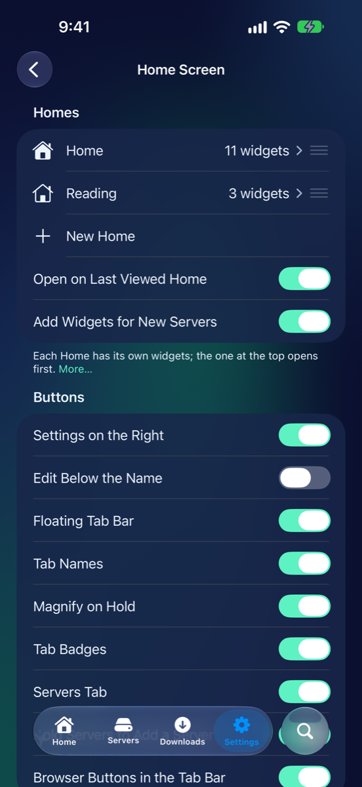
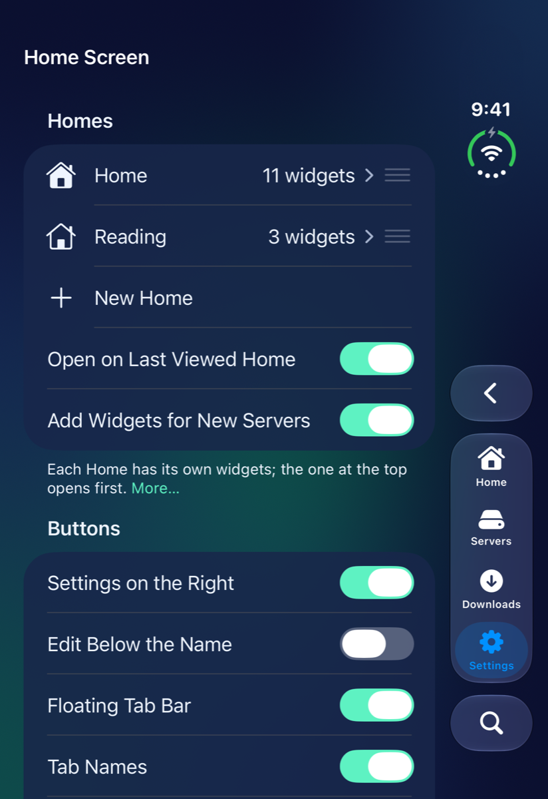
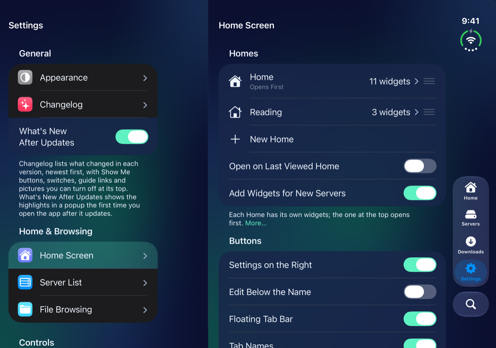
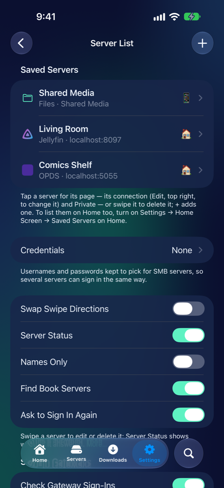
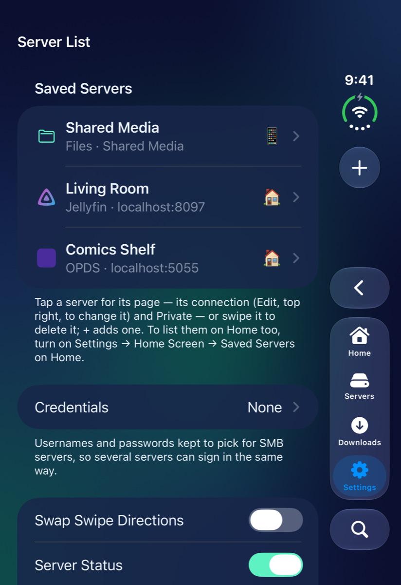
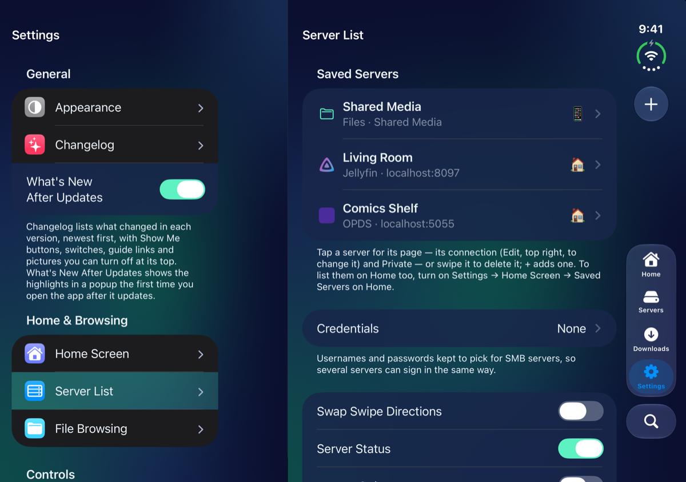
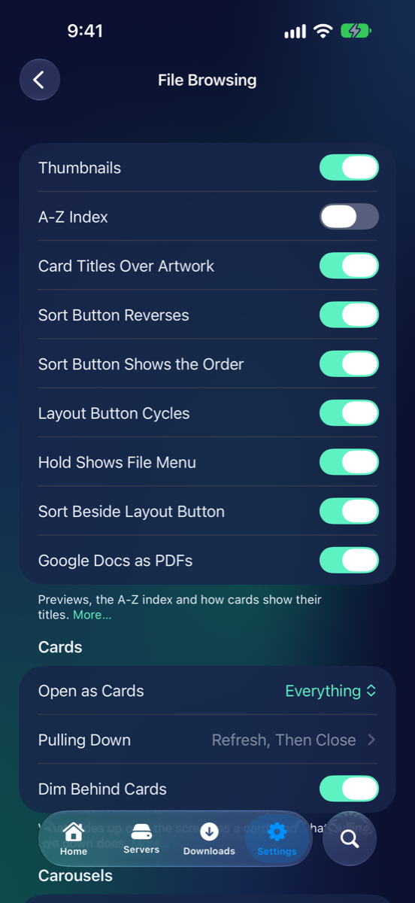
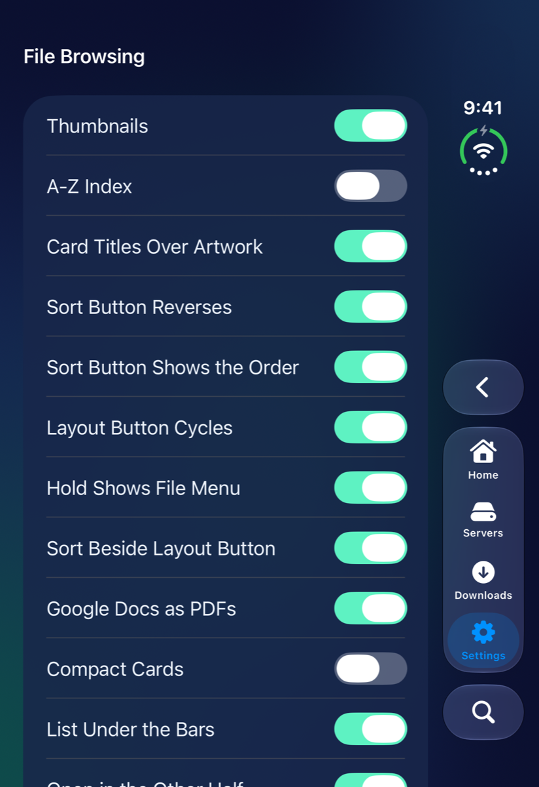
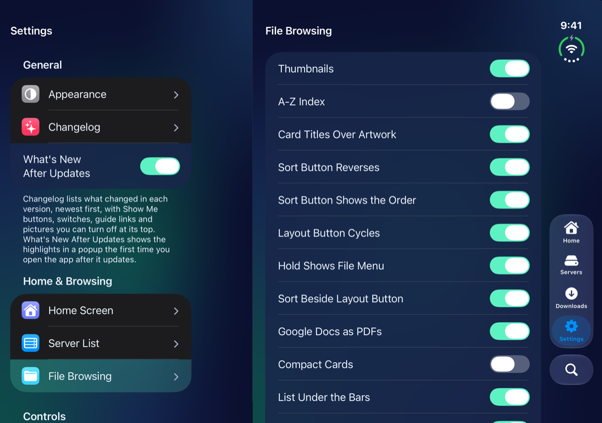

# Home & Browsing

Pictures for
<button type="button" data-device="iphone-18-pro-max" aria-pressed="true">iPhone 18 Pro Max</button>
<button type="button" data-device="duo-front" aria-pressed="false">iPhone Duo — closed</button>
<button type="button" data-device="duo-open-side" aria-pressed="false">iPhone Duo — open, on its side</button>

This group has three pages: **Home Screen**, **Server List** and **File Browsing**. They set up your Homes, your saved servers, and how folders look and behave.

## Home Screen

iPhone 18 Pro Max

iPhone Duo — closed

iPhone Duo — open, on its side

Settings → **Home Screen** has everything about Home in one place. You can also open it from Home itself: press and hold a Home's name and choose **Home Screen Settings**. The widgets, styles and stacks themselves are in [Your Home](Home-Screen.html).

### Homes

The top section lists your Homes, each with how many widgets it holds. The one at the top says **Opens First**.

- Drag a Home by its handle to put your Homes in order. Tap one to open its own page (below).
- **New Home** makes another one.
- **Open on Last Viewed Home** opens the app on the Home you last looked at, instead of the top one.
- **Add Widgets for New Servers** puts a server you add on your top Home as soon as you save it: its tile, plus **Continue Watching**, **Next Up** and its newest movies and shows for Jellyfin, or **Continue Reading** for a book server. A private server's widgets only go on a Home that shows private servers.

### Buttons

This section decides where Home's buttons sit and how the tab bar behaves.

- **Settings on the Right** puts Settings on the right of Home's bottom bar and **+** on the left. Off, they swap.
- **Edit Below the Name** puts **Edit** under the Home's name. Off, it's to the right of the name.
- **Floating Tab Bar** puts **Home**, **Servers**, **Downloads** and **Settings** in a floating bar with **Search** beside it, in place of Home's bottom bar. Press and hold its **Home** tab for your Homes.
- **Tab Names** shows each tab's name under its symbol. Off, the bar shows symbols only and is smaller.
- **Magnify on Hold** makes the bar grow when you touch it and slide along it. See [Getting Started](Getting-Started.html#magnify-on-hold).
- **Tab Badges** puts a count on **Downloads** while things download, and a red ! when one has failed.
- **Servers Tab** adds a **Servers** tab that lists every saved server. It's off to start with. **Hold Servers to Add a Server** makes a hold on that tab open **Add Server**.
- **Browser Buttons in the Tab Bar** gives a folder's buttons to the tab bar, so **Search** in the bar searches the folder you're in. Off, the tab bar steps aside while a folder shows.

Most of the tab bar's switches are greyed out while **Floating Tab Bar** is off. The iPhone Duo and iPad have a few more here: see [On your device](Devices.html).

### Home's look

- **Single Home Name** shows just the Home you're on at the top, and lets you swipe sideways to the next one. Off, every Home's name shows side by side and swiping is off.
- **Fit Shelves to the Screen** sizes the covers on Home's shelves to the screen, so none runs past the edge and a swipe along a shelf stops on every cover. Off, covers keep a fixed size and scroll freely.
- **Blur the Side Covers** blurs the two covers beside a carousel's middle one, by **Carousel Blur** (from **Off** to heavy). Off, as it starts, they stay sharp and are dimmed. **Read Button on Carousels** puts a button on the middle cover, when it's a series, that reads or plays where you left off.
- **Ask to Sign In**: when a widget can't show what's on a server because its sign-in has run out, such as Cloudflare Access after a few weeks away, Home asks you to sign in to that server, once for each server. When you're signed in, the widgets fill. It's on to start with.

With Show Advanced Settings on, this page also has **Tap + for a Menu**, which makes a tap on **+** offer both **Add Server** and **Add Widgets**, and **Floating Done Button**, which floats **Done** over the widgets while you edit a long Home.

### A Home's own page

Tap a Home in the list to open its page.

- **Name** renames it.
- **Look** has its **Theme** and its **Backdrop**: blurred artwork or a picture behind the Home. See [Your Home](Home-Screen.html#themes-and-backdrops).
- **Saved Servers on Home** lists your saved servers under this Home's widgets.
- **Lock with Face ID** hides this Home's widgets behind Face ID once the app has been put away. On an iPhone without Face ID it says Touch ID, or your passcode.
- **Show Private Servers** and **Always Hide Private Servers** decide whether private servers show on this Home. See [Privacy and Face ID](Privacy-and-Face-ID.html).
- **Widgets** lists this Home's widgets. Tap one, or swipe it right, for its options, and swipe it left to remove it. **Reorder** lets you drag them into order, and **Add Widgets** adds more.
- **Delete** (it carries the Home's name) removes the Home and its widgets. The servers and folders they showed stay as they are. It only shows when you have more than one Home.

## Server List

iPhone 18 Pro Max

iPhone Duo — closed

iPhone Duo — open, on its side

Settings → **Server List** lists every server you've saved, and holds the settings that go with them. It has no advanced settings.

- **Saved Servers**: tap a server for its page. Its address and sign-in show there, and **Edit** (top right) lets you change them. Swipe a server to delete it. The **+** at the top adds one: see [Getting Started](Getting-Started.html#add-your-first-server).
- **Private**, on a server's page, hides it until you show it with Face ID. **While Hidden, on Home** is **Hide**, or **Titles Only** to keep its Home widgets as bare titles. See [Privacy and Face ID](Privacy-and-Face-ID.html).
- **Credentials** are usernames and passwords you keep once and pick for several SMB servers, so they all sign in the same way. Tap **+** (**Add Credential**), fill in **Name**, **Username**, an optional **Domain** and **Password**, and tap **Save**. Changing one changes every server that uses it.
- **Show Private Servers** only appears while some are hidden. Tap it to show them with Face ID.
- **Swap Swipe Directions** flips which way edits and which way deletes.
- **Server Status** marks each server with the emoji of the address that answered, or a crossed-out symbol if none did.
- **Names Only** hides the address under each name.
- **Find Book Servers** looks on your Wi-Fi for Kavita, Komga, Calibre-Web, Stump and Calibre, to list in **Add Server**. It can take up to half a minute.
- **Ask to Sign In Again** opens a server's sign-in when its password is missing or isn't accepted, then tries again once it's saved. Off, you just see the error.

The last section, **Sign-In Gateways**, lists servers behind Cloudflare Access or an OpenID Connect sign-in, with whether you're signed in to each. Tap one to sign in or out, and swipe it to forget it. **Check Gateway Sign-Ins** asks each one whether you're still let in when you come back to the app, and marks one that has run out with an orange lock. **Guided Sign-In** signs in to Cloudflare in Safari first and then goes straight on to the server's own sign-in. **Sign In with Safari First** opens a Kavita sign-in, or a catalog's own sign-in page such as Storyteller's, in Safari, where your passkeys work. See [Cloudflare Access](Cloudflare-Access.html).

## File Browsing

iPhone 18 Pro Max

iPhone Duo — closed

iPhone Duo — open, on its side

Settings → **File Browsing** is about folders: how they look, what the buttons do, and what slides up as a card. [Browsing your files](Browsing.html) shows them in use.

### The first section

- **Thumbnails** shows real previews of videos, pictures and comics instead of plain icons.
- **A-Z Index** puts a rail of letters down the right edge of a list sorted by **Name**.
- **Card Titles Over Artwork** writes each card's title on its picture, over a dark fade. Off, it sits in a panel under it.
- **Sort Button Reverses**: a tap reverses the sort, and a hold opens the menu of ways to sort. Off, a tap opens the menu. **Layout Button Cycles** does the same for the layout button.
- **Sort Button Shows the Order** has the sort button show what it sorts by and which way, with an arrow that flips as you tap.
- **Hold Shows File Menu**: pressing and holding a file opens a menu with **Select**, **Copy**, **Cut**, **Move**, **Rename**, **Show Info** and **Delete**. Off, it starts select mode with that file marked.
- **Sort Beside Layout Button** puts the sort button in the top bar next to the layout button.
- **Google Docs as PDFs** shows a Google Drive server's Docs, Sheets, Slides and Drawings as PDFs, made when you open one.

### Cards

**Open as Cards** chooses what slides up over the screen as a card: **Everything** (folders, servers and the pages of movies, shows and series), **Movies, Shows & Series**, or **Off**, which slides everything in from the side with a back button. Drag a card's top bar down, or tap the chevron, to close it.

- **Pulling Down** sets what pulling a card's list down does, for a short pull and a long one: refresh, close the card, both or neither.
- **Zoom into Covers** grows a poster or cover you tap into the page it opens, and shrinks the page back into it when you close it. A picture pulled down to close shrinks back onto its thumbnail the same way. Off, or with Reduce Motion on, a card slides up and a picture slides away, as before.
- **Dim Behind Cards** darkens the screen behind a card as it comes up.
- **Blur Behind Cards** blurs what's behind a card that doesn't fill the screen, so the card is the one thing to read.
- **Libraries Use the Whole Screen** (iPhone Duo and iPad): on its side, a server, library or folder opens as a card across the whole screen, six posters a row.
- **Movie Pages Across the Fold** (iPhone Duo): open on its side, a movie's or show's page runs across the whole screen, its picture behind both halves, the title on the left and the buttons on the right. Off, it's a card down the middle.

With Show Advanced Settings on, this page also has **Selection Mark on Right** and **Swipe from the Left Closes Cards**.

### Carousels

**Episodes on Show Pages** lists a Jellyfin show's episodes right under its details. **More Like This** puts a row of what your server finds is similar under a movie's or show's summary. **Specials Last** puts a show's Specials after its numbered seasons. **Seasons as a Carousel** and **Downloads as a Carousel** show big covers you page through instead of a grid.

The iPhone Duo has more switches in the first section, and a **Cards on the iPhone Duo** section with Show Advanced Settings on. See [On your device](Devices.html).

## What went wrong

| What you see | Try this |
|---|---|
| A tab bar switch is greyed out | **Floating Tab Bar** is off in Settings → Home Screen. Turn it on. |
| Private servers don't show on a Home | That Home's **Show Private Servers** is off, or **Always Hide Private Servers** is on. |
| A hold starts select mode, not a menu | Turn on **Hold Shows File Menu**. |
| A folder slides in from the side, not up | **Open as Cards** is **Off**, or it's **Movies, Shows & Series**, which only lifts movie, show and series pages. |

## Related pages

- [Your Home](Home-Screen.html): widgets, stacks, more than one Home and themes
- [Browsing your files](Browsing.html): layout, sort and the press-and-hold menu
- [Connect a server](Connect-a-server.html): adding the servers the Server List shows
- [Privacy and Face ID](Privacy-and-Face-ID.html): private servers and locked Homes
- [On your device](Devices.html): what's different on the iPhone Duo and iPad

---

Previous: [← General](Settings-General.html) · Next: [Media →](Settings-Media.html)
