# Media

Pictures for
<button type="button" data-device="iphone-18-pro-max" aria-pressed="true">iPhone 18 Pro Max</button>
<button type="button" data-device="duo-front" aria-pressed="false">iPhone Duo — closed</button>
<button type="button" data-device="duo-open-side" aria-pressed="false">iPhone Duo — open, on its side</button>

The **Media** group has a page for each kind of thing MK Plus plays or opens: **Video Playback**, **Jellyfin**, **Catalogs**, **Reading** and **Image Viewer**. This page says what each Settings page is for and what's on it. The pages for each feature, such as [Watching video](Video-Player.html) and [Reading](Reader.html), show the settings in use.

Some settings only show with **Show Advanced Settings** on, and some only on an iPhone Duo or an iPad. Each page below says which. See [Settings](Settings.html#settings-display).

## Video Playback

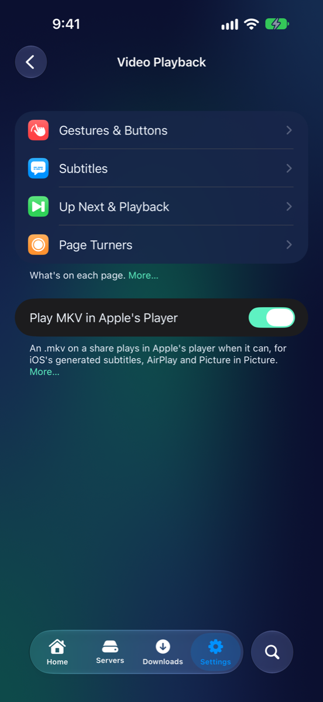
iPhone 18 Pro Max

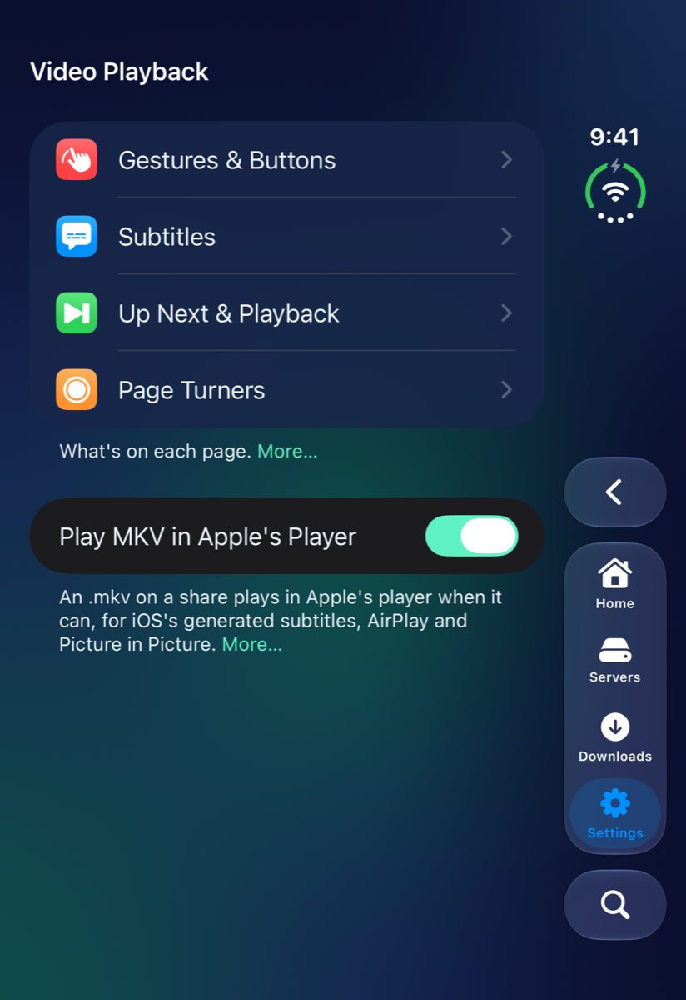
iPhone Duo — closed

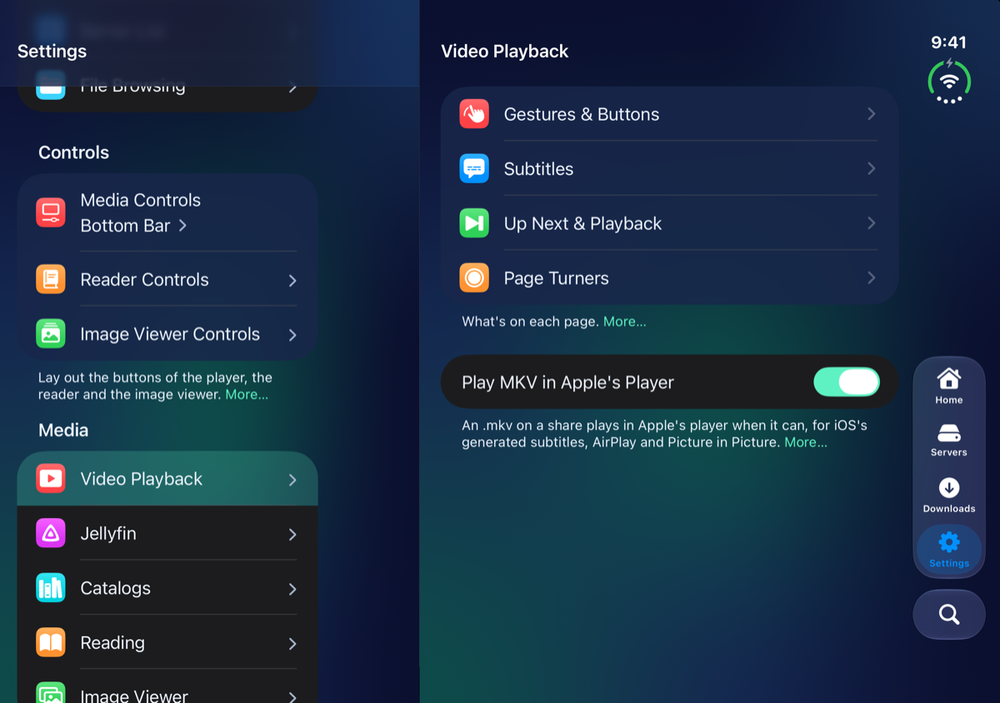
iPhone Duo — open, on its side

Settings → **Video Playback** opens four pages: **Gestures & Buttons**, **Subtitles**, **Up Next & Playback** and **Page Turners**. Under them is one switch, **Play MKV in Apple's Player**, which sends MKV files on a share to Apple's player when it can play them. See [Files that open in a different player](Video-Player.html#files-that-open-in-a-different-player). The player's buttons themselves are laid out in Settings → **Media Controls**: see [Settings](Settings.html#controls).

### Gestures & Buttons

Swipes and taps on the video, the title, and what the player's buttons open. [Watching video](Video-Player.html#gestures) shows them at work.

- **Gestures**: **Vertical Swipes** is **Off**, **Swipe Down to Close** or **Swipe Between Videos**. **Tap to Pause** makes a tap in the middle pause and play. **Lock Buttons While Scrubbing** fades the buttons while you scrub, so a finger passing over one doesn't set it off.
- **Title & Buttons**: **Show Title**, **Settings Button Opens** (**Menu**, **Player Settings Sheet** or **All Settings**), **Playback Options Button Opens** (**Short Menu**, **Full Menu** or **Sheet**), **Rotate Keeps Menu Open**, **Timeline Only While Scrubbing** and **Time Left on the Timeline**.

With Show Advanced Settings on, this page also has **Video Change** (how one video gives way to the next), **Show Play/Pause on Tap**, **Title Above Controls** and **Scrub Preview Popup**. The iPhone Duo has an **iPhone Duo** section here too: see [On your device](Devices.html).

### Subtitles

Whether subtitles turn on by themselves, where they sit and how big they are. [Audio, subtitles and speed](Video-Player.html#audio-subtitles-and-speed) covers using them while you watch.

- **Subtitles**: **Auto Subtitles** is **Off**, **Always** or **Foreign Audio**. **Subtitle Files Beside Videos** offers subtitle files that sit next to a video on a share. **Generate Subtitles** has the app make subtitles from the sound, on your iPhone, for videos Apple's player doesn't play. They show in the video's list as, for instance, "English (Generated)".
- **Generated Subtitles Engine**: **Subtitle Engine** is **Apple** (iOS's own speech recognition, with nothing to download) or **Whisper** (a speech model that runs on your iPhone, better with film sound and about 100 languages). With **Whisper**, **Whisper Model** is **Automatic**, **Tiny**, **Base**, **Small** or **Large v3 Turbo**, from fastest to most accurate. **Download** fetches the model now, and **Delete Model** frees the space. **Download Models on Cellular** lets it download away from Wi-Fi, and **Translate Generated Subtitles to English** gives foreign audio English subtitles. **Show Subtitle Status** puts a short message over the picture while they're being made.
- **Kept Subtitles**: **Keep Generated Subtitles** saves them, so watching again shows them at once. **Space Used** says how much room that takes, and **Clear Generated Subtitles** removes them.
- **Subtitles Above Controls** lifts them clear of the timeline. **Subtitle Size** is **Smaller**, **Standard**, **Larger** or **Largest**, and **Reset Subtitle Style** goes back.

The engine and kept-subtitle sections are greyed out while **Generate Subtitles** is off. The first time you use generated subtitles, the app reads the video a second time from the server, a couple of minutes ahead.

### Up Next & Playback

What happens when a video ends, and how playback starts. See [When a video ends](Video-Player.html#when-a-video-ends).

- **Up Next**: **Auto-Play Next**, then **Ask Before Playing Next** and its **Countdown**, and **Skip Intros Automatically**.
- **Playback**: **Playback Speed** is where every video starts. **Picture in Picture on Leaving**, **Keep Playing When Locked**, **Lock Screen Controls** and **Lock Screen Buttons** (**Skip 10 Seconds** or **Previous & Next Video**). See [Picture in Picture and playing while locked](Video-Player.html#picture-in-picture-and-playing-while-locked).

### Page Turners

What each button of a keyboard, Bluetooth page turner, foot pedal or game controller does, in **Reading** and in **Videos**. Tap an action, then **Add Button…** and press the button on your device. **Camera Remotes** covers remotes that press Volume Up, and **Reset to Defaults** puts every button back. The same page is under Reading → **Turning Pages**.

## Jellyfin

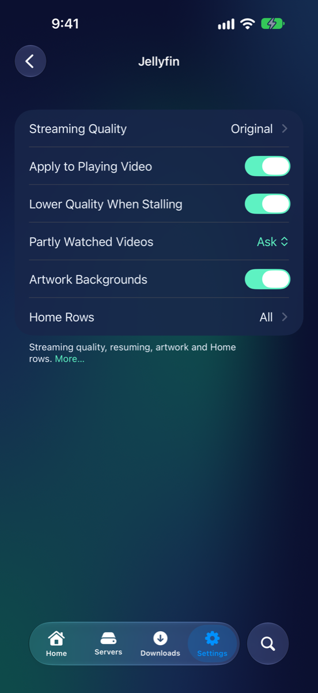
iPhone 18 Pro Max

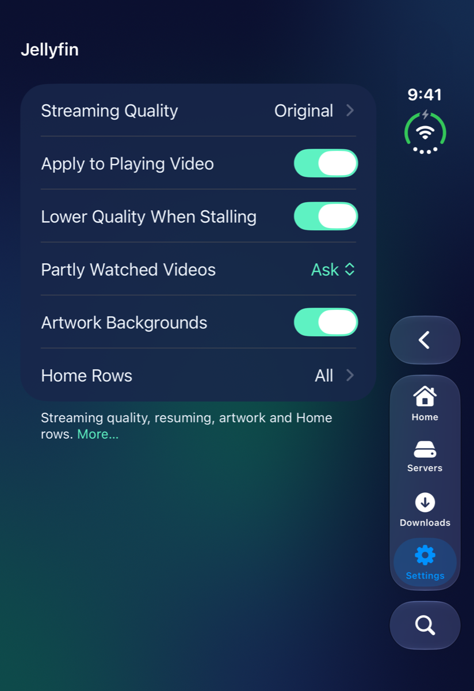
iPhone Duo — closed

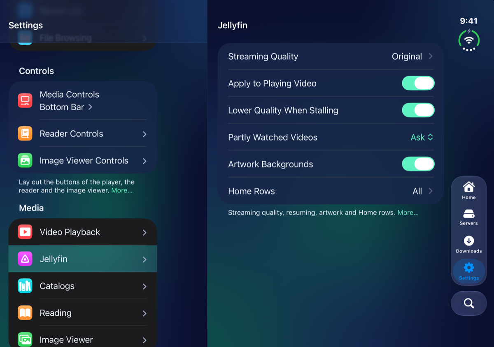
iPhone Duo — open, on its side

Settings → **Jellyfin** is for how Jellyfin videos stream and how a server's page looks. It has no advanced settings. [Jellyfin](Jellyfin.html#streaming-quality) explains the streaming settings.

- **Streaming Quality** is **Original**, or a lower rate for away from home. **Apply to Playing Video** reopens a playing video at the quality you pick. **Lower Quality When Stalling** turns a video that keeps stopping down a step.
- **Partly Watched Videos** is **Ask**, **Resume** or **Start Over**: what happens when you start a video you've begun.
- **Artwork Backgrounds** puts a show's or season's artwork behind its list.
- **Home Rows** opens a page for the rows above a server's libraries. **Show** turns **Continue Watching**, **Next Up** and **Favorites** on and off. **Order** is **Continue Watching First** or **Next Up First**. **Style** is **Wide Thumbnails** or **Posters**.

## Catalogs

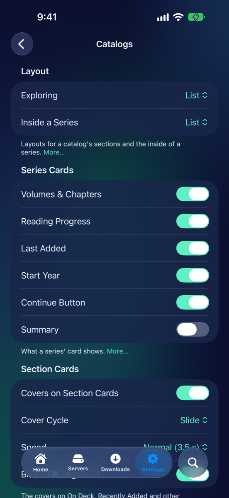
iPhone 18 Pro Max

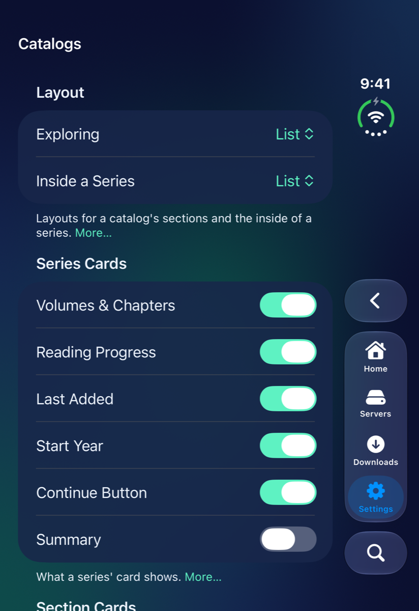
iPhone Duo — closed

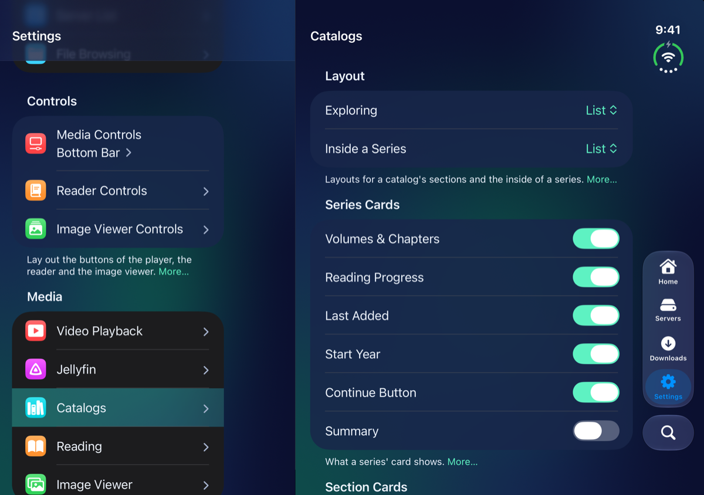
iPhone Duo — open, on its side

Settings → **Catalogs** is for Kavita, Komga and the other book servers: how they're laid out, what a series' card shows, and reading from them. It has no advanced settings. See [Book servers](OPDS-Catalogs.html).

- **Layout**: **Exploring** is for a catalog's sections, libraries and series, and **Inside a Series** is for its volumes and chapters. Each is a layout, such as **List** or **Cards**.
- **Series Cards**: **Volumes & Chapters**, **Reading Progress**, **Last Added**, **Start Year**, **Continue Button** and **Summary** switch what a series' card shows.
- **Section Cards**: **Covers on Section Cards** shows what's in **On Deck**, **Recently Added** or a library on its card. **Cover Cycle** is how they move, **Speed** is how long each stays, and **Blurred Background** washes the main cover behind them.
- **Series Pages**: **Series Pages** puts a series' cover, summary, progress and a button for what to read next above its volumes. **Cover Behind Series Pages** blurs the cover behind the page.
- **Reading**: **Stream Comic Pages** opens a comic straight away and loads its pages as you read. **Sync Reading Progress** keeps your place in sync with the server. See [Read, and keep your place](OPDS-Catalogs.html#read-and-keep-your-place).

The iPhone Duo adds two switches to **Series Pages**: see [On your device](Devices.html).

## Reading

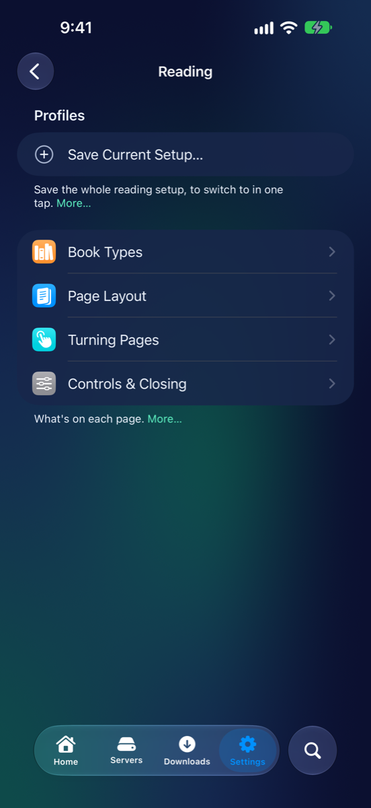
iPhone 18 Pro Max

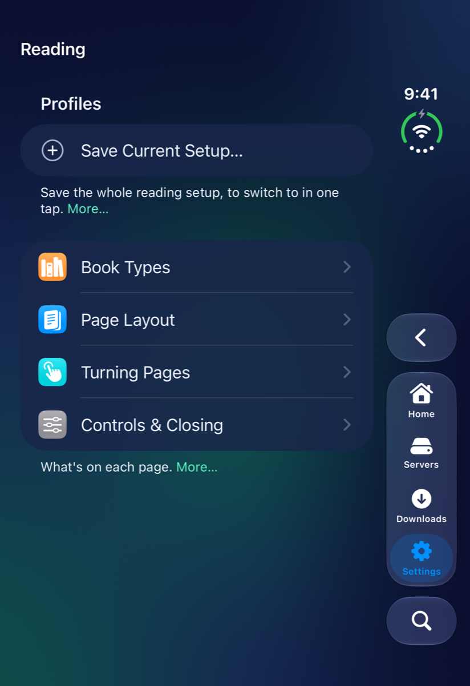
iPhone Duo — closed

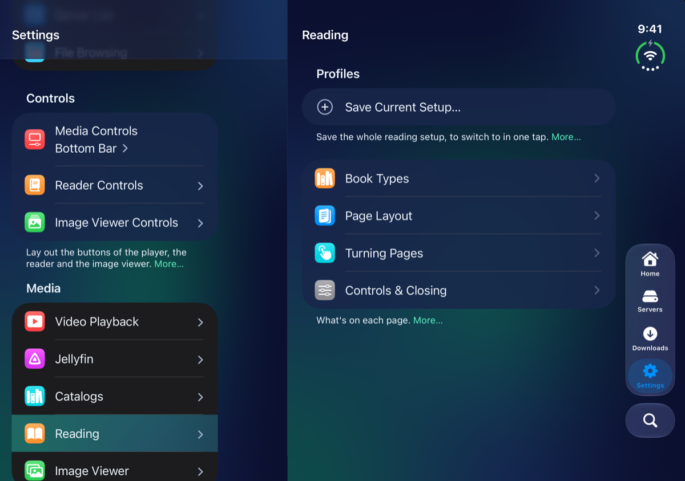
iPhone Duo — open, on its side

Settings → **Reading** sets how comics, PDFs and EPUBs read. At the top, **Profiles** lists your saved setups: tap one to switch to it, swipe it to delete it, or tap **Save Current Setup…** to save what's set now. See [Reading Profiles](Reader.html#reading-profiles). Under it are four pages. A book can have its own settings with **This Book Only** in Reading Options.

### Book Types

How each kind of book turns and looks.

- **Comics**: **Turn Style** (**Slide**, **Curl**, **Instant**, **Fade**, **Vertical Paged** or **Vertical Scroll**), **Reading Direction** (**Automatic**, **Left to Right** or **Right to Left**) and **Manga: Yes Reads Right to Left**.
- **PDFs**: its own **Turn Style**. See [PDFs](Reader.html#pdfs).
- **EPUBs** and **EPUB Layout**: **Theme**, **Text Size**, **Turn Style**, **Font**, **Margins**, **Columns**, **Book's Layout**, **Line Spacing**, **Paragraph Spacing**, **Justify** and **Hyphenation**. See [EPUBs](Reader.html#epubs).

### Page Layout

- **Two-Page Spreads**: the **Two-Page Spreads** choice, **Two Pages When Upright** and **Cover Alone**. See [Two pages at once](Reader.html#two-pages-at-once).
- **Page Thumbnails**: a row of pages by the timeline, with **Keep Page Centered** and **In Vertical Scroll**.
- **Zoom**: **Double-Tap to Zoom** and what a double tap does, **Fill the Screen** or **Closer (2.5×)**.

With Show Advanced Settings on, this page also has **Lone Pages Like a Book**, **Curl Spreads Like a Book**, **Timeline Below Thumbnails** and **Thumbnails Over the Spine**. The iPhone Duo adds **Pages Either Side of the Fold**.

### Turning Pages

- **Tapping**: **Tap Zones** picks a preset (**Sides**, **Kindle**, **Edges Only**, **One-Handed (Right)**, **One-Handed (Left)**, **Forward Anywhere**, **Off** or **Custom**), and **Custom Zones** sets each of nine zones. **Follow Reading Direction** swaps the sides in a right-to-left book. See [Tap zones](Reader.html#tap-zones).
- **Swiping**: **Invert Swipe Direction** swaps which way a swipe turns the page.
- **Hands-Free**: **Page Turners**, **Volume Buttons** (**Off**, **Down Turns Forward** or **Up Turns Forward**) and **Auto Turn Every**. See [Keyboards, page turners and volume buttons](Reader.html#keyboards-page-turners-and-volume-buttons).
- **Read Aloud**: **Speed**, **Turn Pages to Follow** and **Highlight the Sentence**, for an EPUB read to you.

With Show Advanced Settings on, this page also has **Show Zones After a Change**, **Hold to Flip**, **Swipe Sensitivity** and **Swipe Beside the Page**.

### Controls & Closing

- **Controls**: **Keep Controls When Turning** and **Haptic on Page Turn**.
- **Closing & the End**: **Swipe Down to Close**, and **At the End**: **Offer Next Book**, **Close the Book** or **Nothing**. With **Offer Next Book**, **Open Without Asking** skips the card.

With Show Advanced Settings on, this page also has **Title Above Controls** and **Center Timeline on Display**.

## Image Viewer

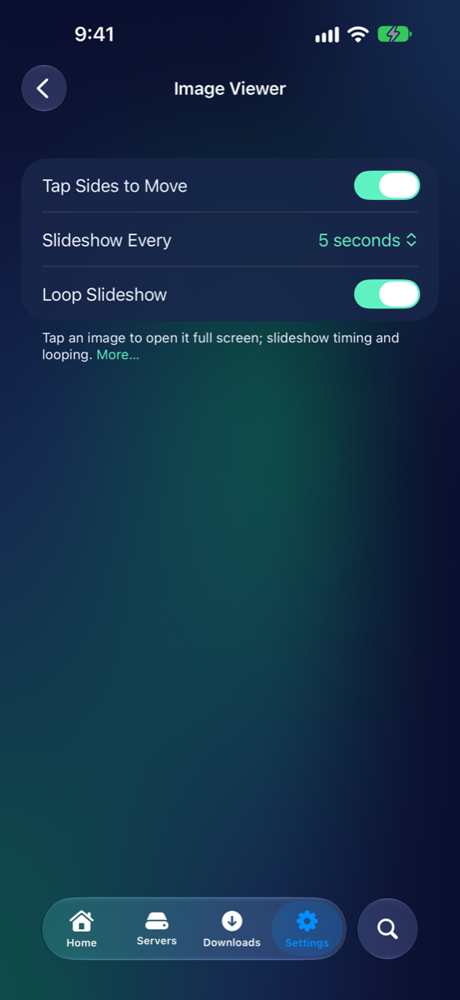
iPhone 18 Pro Max

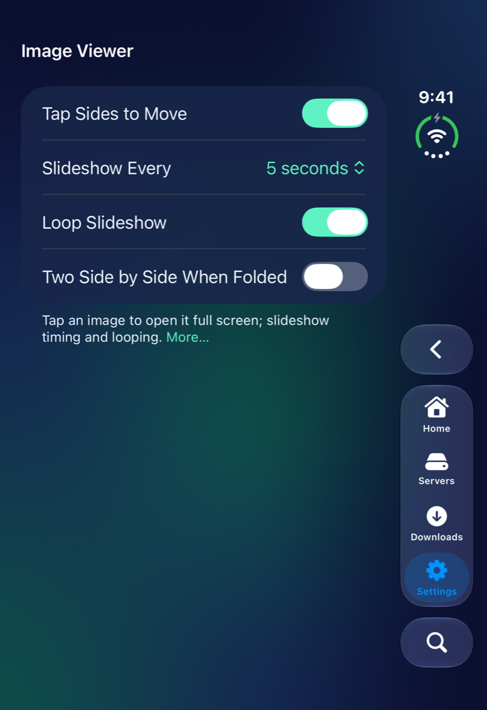
iPhone Duo — closed

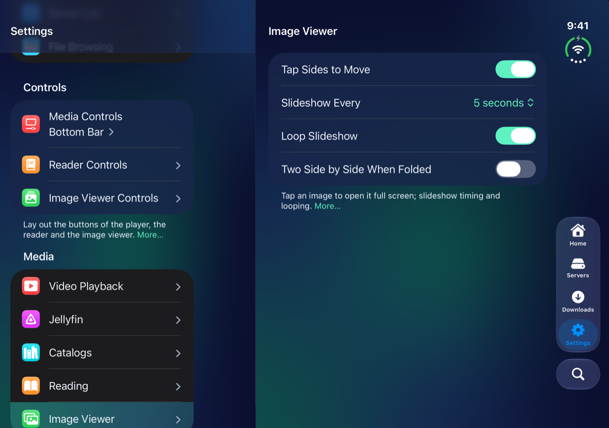
iPhone Duo — open, on its side

Settings → **Image Viewer** is one short page with no advanced settings: **Tap Sides to Move**, **Slideshow Every** (how long each picture stays up) and **Loop Slideshow**. See [Pictures](Image-Viewer.html#viewer-settings). The iPhone Duo adds **Two Side by Side When Folded**: see [On your device](Devices.html).

## What went wrong

| What you see | Try this |
|---|---|
| Subtitles don't turn on by themselves | Set **Auto Subtitles** to **Always** in Video Playback → **Subtitles**. |
| No subtitles appear for an MKV | Turn on **Generate Subtitles**, and give it a moment: the first time, a model downloads. |
| A video keeps stopping to load | Lower **Streaming Quality** in Settings → **Jellyfin**. |
| A manga reads the wrong way | Set **Reading Direction** to **Right to Left**. |
| A setting from the guide isn't on your page | It's advanced, or for the iPhone Duo or an iPad only. Turn on **Show Advanced Settings**. |

---

Home · Previous: [← Home & Browsing](Settings-Home-Browsing.html) · Next: [Data & Privacy →](Settings-Data.html) · Up: [Settings](Settings.html)
