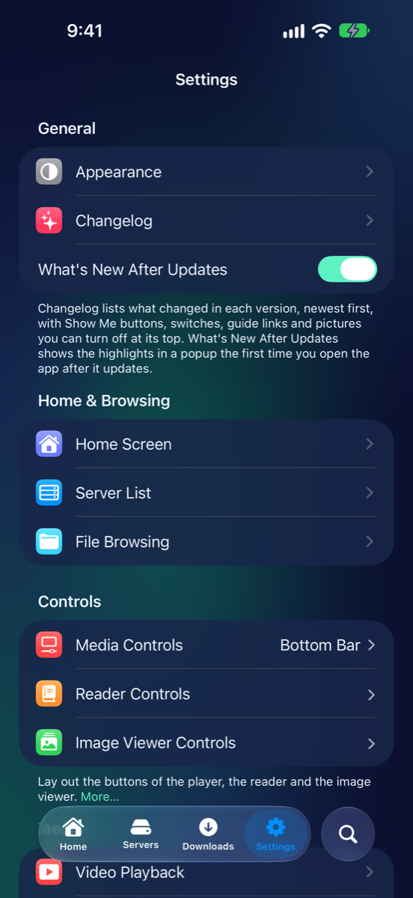
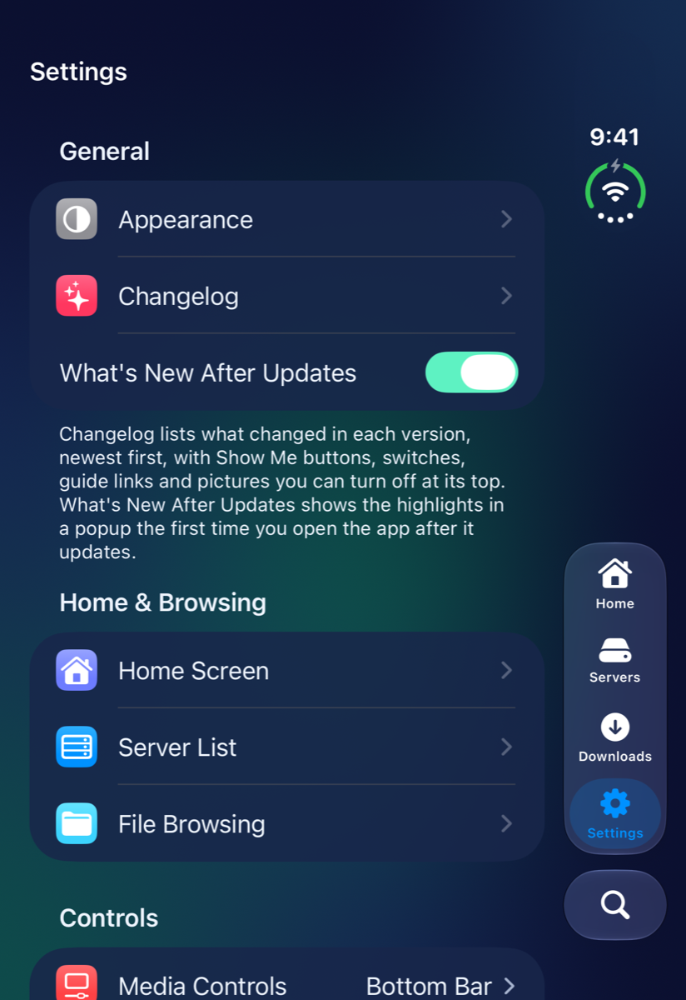
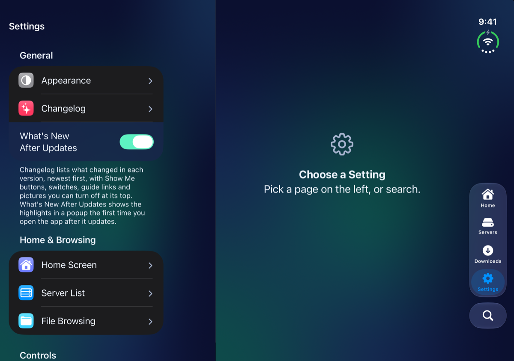
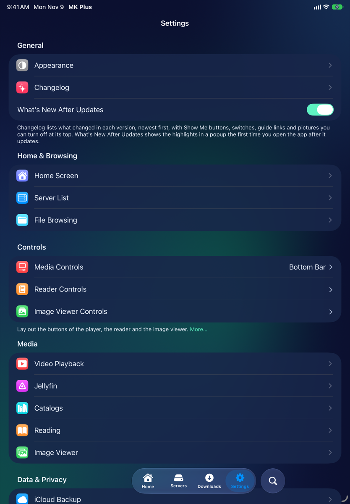
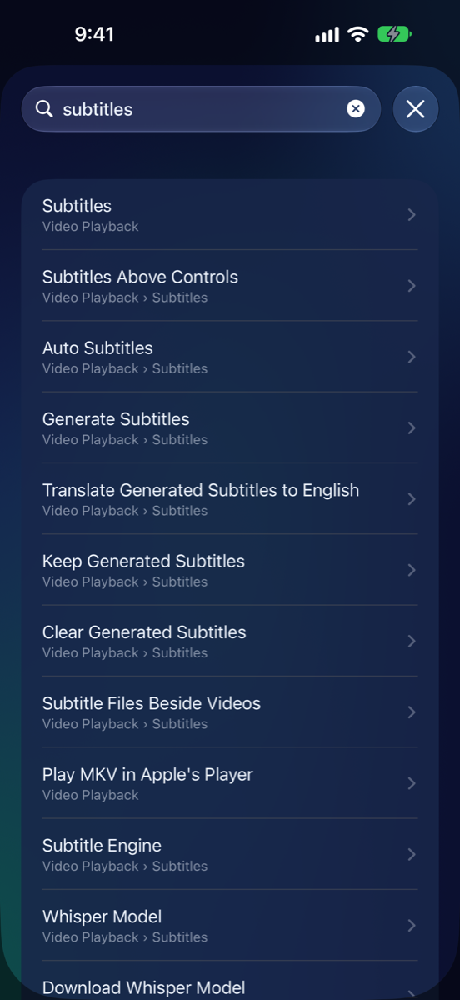
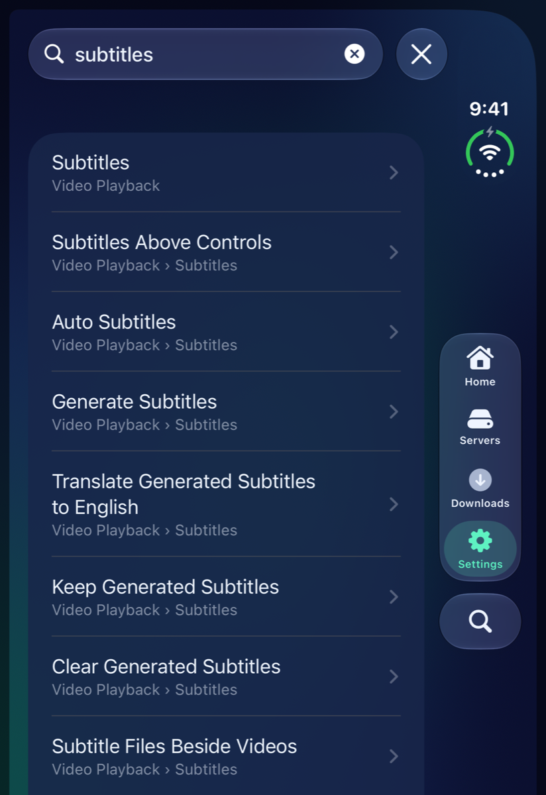
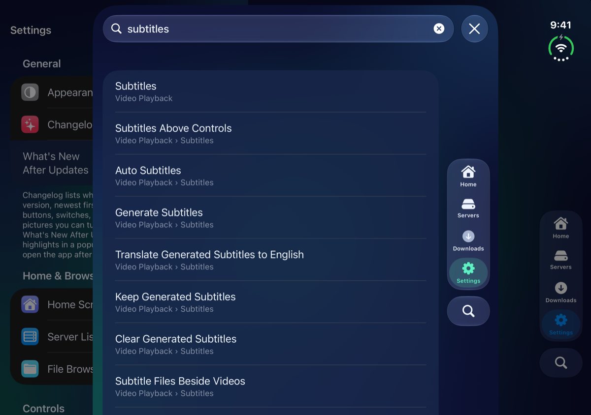

# Settings

Pictures for
<button type="button" data-device="iphone-18-pro-max" aria-pressed="true">iPhone 18 Pro Max</button>
<button type="button" data-device="duo-front" aria-pressed="false">iPhone Duo — closed</button>
<button type="button" data-device="duo-open-side" aria-pressed="false">iPhone Duo — open, on its side</button>
<button type="button" data-device="ipad-air-11" aria-pressed="false">iPad Air 11-inch</button>

Settings is where everything in MK Plus can be changed. This page is a tour of the list, and of how to find a setting fast. The pages after it go through each group.

## Open Settings

iPhone 18 Pro Max

iPhone Duo — closed

iPhone Duo — open, on its side

iPad Air 11-inch

- Tap the **Settings** tab in the bar along the bottom.
- With Settings → Home Screen → **Floating Tab Bar** off, Home has its own bottom bar instead. Tap the **Settings** button there (a gear), and Settings opens as a sheet. Tap **Done** to close it.
- While a video plays, the player's gear has **All Settings…**, which opens Settings over the video. See [Watching video](Video-Player.html#the-players-settings).
- Press and hold a Home's name and choose **Home Screen Settings** to open just that page.

## What's in the list

The list is in groups, top to bottom:

- **General**: **Appearance**, **Changelog** and **What's New After Updates**. See [General](Settings-General.html).
- **Home & Browsing**: **Home Screen**, **Server List** and **File Browsing**. See [Home & Browsing](Settings-Home-Browsing.html).
- **Controls**: the three layout editors, below.
- **Media**: **Video Playback**, **Jellyfin**, **Catalogs**, **Reading** and **Image Viewer**. See [Media](Settings-Media.html).
- **Data & Privacy**: **iCloud Backup**, **Backup**, **Privacy** and **Storage**. See [Data & Privacy](Settings-Data.html).
- **Settings Display**: how Settings itself looks and behaves, below.
- The rows at the bottom, which are for help and feedback, below.

Tap a row to open its page. A page is a list of sections, and most sections end with a line of help. A page only shows the settings your iPhone can use: some are only for the iPhone Duo or for an iPad. See [On your device](Devices.html).

## Find a setting

iPhone 18 Pro Max

iPhone Duo — closed

iPhone Duo — open, on its side

1. On the **Settings** tab, tap **Search** in the tab bar.
2. A sheet opens with a **Search Settings** field and the words **Find a setting by name.** Type a word or two.
3. Each result shows the setting's name and where it is, such as Video Playback › Subtitles. Tap one.
4. Its page opens, scrolls to the setting and flashes it once.
5. Tap **Done** to close the search without choosing.

Every word you type has to match the setting's name, the name of the page it's on, or another word people use for it. Typing `manga` finds **Reading Direction**, for example. If nothing matches, you'll see **No Results**.

Search only finds what's there for you. Advanced settings turn up once **Show Advanced Settings** is on, and settings for the iPhone Duo or iPad only turn up on those devices. Search also finds the three layout editors and the switches on the main list.

## Settings Display

The last group changes Settings itself.

- **Show Advanced Settings** shows the settings most people never change: the finer points of layout, gestures and animation. It's off to start with. Hidden or not, an advanced setting keeps working as it's set. The pages that follow say which of their settings are advanced.
- **Show Full Help** writes each section's help out in full. Off to start with, most sections show one short line with **More…** after it. Tap **More…** for the full help, and **Less** to fold it back.
- **Search Field at the Top** puts a search field, **Search Settings**, above the list. With it off, the tab bar's **Search** button does the searching while you're in Settings. When Settings opens as a sheet, the field is always there.
- **Two Columns on the Unfolded Duo** shows on an iPhone Duo only. With the Duo unfolded and on its side, it keeps the list of pages on the left and shows the page you pick on the right, like the iPad's Settings app. Partly folded like a book, Settings moves into one half and is one column again. Off, each page fills the screen. It's on to start with.

## Controls

Three rows lay out the buttons of the player, the reader and the picture viewer. Each opens full screen, on a sample, so you see every change as you make it.

- **Media Controls** lays out the video player's buttons, title and timeline. See [Lay the controls out your way](Video-Player.html#lay-the-controls-out-your-way).
- **Reader Controls** lays out a book's buttons, title, scrubber and page number, on a sample comic. See [Lay the controls out your way](Reader.html#lay-the-controls-out-your-way).
- **Image Viewer Controls** lays out the picture viewer's buttons, title and filmstrip or timeline. See [Lay the controls out your way](Image-Viewer.html#lay-the-controls-out-your-way).

## Help, feedback and about

The rows below the groups:

- **Provide Feedback** opens a form. Choose **Problem** or **Feature Request**, give it a **Title**, write what happened or what you'd like, and tap **Send**. It goes to the developer with the app's version and your phone's model and iOS version, and you'll see its reference number.
  - **Attach Pictures** adds up to five pictures, such as screenshots. **Attach Files** adds up to three files of any kind, 20 MB each: a video that won't play, a subtitle file. Check they don't show anything you'd rather keep private.
  - Under **Reply To**, **Email (Optional)** is for an address to answer you at, if you'd like an answer. Only the developer sees it.
  - **Attach Activity Log** adds the app's private log of what went wrong. **See the Log** lets you read it, and you can take it off before sending.
  - If it can't be sent, **Email Instead** sends it from Mail.
- **Sent Feedback** lists what you've sent from this iPhone, newest first, with each one's reference number. Tap one to see what you wrote and the names of what you attached. Swipe one to delete it, or tap **Clear**. It stays on your iPhone.
- **Keep Sent Feedback** keeps those copies. It's on to start with. Off, new reports aren't kept.
- **Attach Activity Log** starts the form with the log attached. It's greyed out while Settings → Privacy → **Keep an Activity Log** is off.
- **Shake to Provide Feedback** asks whether you'd like to send feedback when you shake your iPhone.
- **Setup Guide** opens step-by-step help in Safari, for connecting Dropbox, Google Drive, OneDrive, Box and S3 storage. This guide is on the same site.
- **Privacy Policy** opens the privacy policy, in Safari. A short summary is in [Privacy and Face ID](Privacy.html).
- **Acknowledgements** lists the open-source projects MK Plus is built with. Tap one for what it does here and its licence.
- The line at the very bottom is the **Version**, with the build number after it in brackets. It's the one to look up in **Changelog**.

In TestFlight you can also take a screenshot and tap **Share Beta Feedback**.

## What went wrong

| What you see | Try this |
|---|---|
| A setting someone mentions isn't on your page | It may be advanced: turn on **Show Advanced Settings**. Or it may be for the iPhone Duo or an iPad only. |
| Search can't find it | Try another word, or turn on **Show Advanced Settings** and search again. |
| The help under a section is only a line | Tap **More…**, or turn on **Show Full Help**. |
| **Attach Activity Log** is greyed out | Turn on **Keep an Activity Log** in Settings → Privacy. |
| No **Search** button in the tab bar | The **Floating Tab Bar** is off in Settings → Home Screen. Settings then has its search field at the top of the list. |

## Go on

- [General](Settings-General.html): Appearance, the Changelog and the What's New popup.
- [Home & Browsing](Settings-Home-Browsing.html): Home Screen, Server List and File Browsing.
- [Media](Settings-Media.html): video, Jellyfin, book servers, reading and pictures.
- [Data & Privacy](Settings-Data.html): iCloud Backup, Backup, Privacy and Storage.
- [Privacy and Face ID](Privacy.html): locking the app, Homes and servers.
- [On your device](Devices.html): what's different on an iPhone Duo, a small iPhone and an iPad.

---

Home · Previous: [← Pictures](Image-Viewer.html) · Next: [General →](Settings-General.html)
