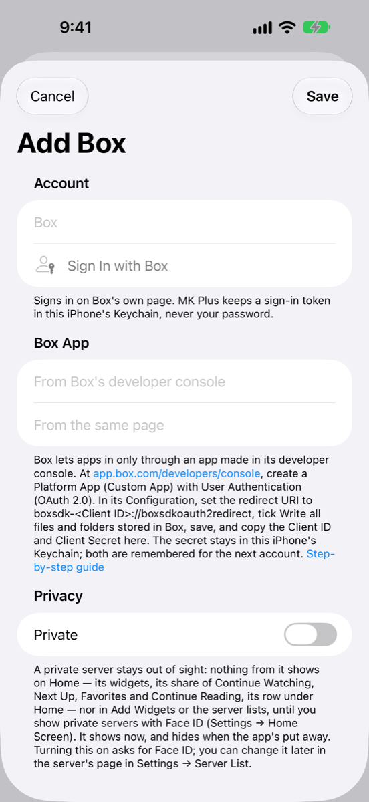

# Setting up Box

Box only lets apps in through an app you make in its developer console. It takes about five minutes and is free. You do it once, and MK Plus remembers the result for any other Box account you add later.

_Checked November 2026. Consoles change; if a button's moved, the names below should still find it._

## What you need

- A Box account (a free one is fine).
- About 5 minutes.
- Nothing to pay. Making a Box app is free.

Box gives your app two codes: a **client ID**, which names the app, and a **client secret**, which proves it's really yours. Treat the secret like a password. Each is 32 letters and digits.

## In the Box developer console

1. Open **<https://app.box.com/developers/console>** and sign in.
2. Choose **Create Platform App** (older consoles: **Create New App**).
3. Pick **Custom App** and choose **Next**.
4. Give it any name, such as `My MK Plus`, and a short description if it asks. Choose **Next**.
5. Under **Authentication Method**, pick **User Authentication (OAuth 2.0)**, then choose **Create App**.
6. Open the **Configuration** tab.
7. Under **OAuth 2.0 Redirect URI**, enter the address below, with your own Client ID in place of `<Client ID>`:

   `boxsdk-<Client ID>://boxsdkoauth2redirect`

   You'll find the **Client ID** on the same page, under **OAuth 2.0 Credentials**. For example, if it's `abc123xyz…`, the redirect address is `boxsdk-abc123xyz…://boxsdkoauth2redirect`. MK Plus also shows the exact address in the note under the **Box App** section once you've typed the Client ID.
8. Under **Application Scopes**, tick **Write all files and folders stored in Box**. (Reading comes with it.)
9. Choose **Save Changes** at the top right.
10. Copy the **Client ID** and the **Client Secret** (choose **Fetch Client Secret** if it's hidden).

## In MK Plus

1. On the Server List, tap the **+** button and choose **Add Server**.
2. Tap **Box**.
3. Under **Box App**, paste the **Client ID** and the **Client Secret**.
4. Tap **Sign In with Box** (under **Account**). Box's own page opens in a sheet that shares Safari's sign-ins. Sign in and choose **Grant access to Box**.
5. Back in the form, **Signed In As** shows your Box login. Change **Name** if you like.
6. Optionally switch the server to private, then tap **Save**.

**Sign In with Box** stays greyed out until both the ID and the secret are 32 letters and digits. **Save** stays greyed out until you've signed in.

## What went wrong

Sign-in problems show an alert titled **Couldn't Sign In**. Messages that come later, while you browse, appear on the server itself.

| What you see | Why | What to do |
|---|---|---|
| **Sign In with Box** is greyed out | The **Client ID** or **Client Secret** is empty, or isn't 32 letters and digits. | Copy both again from **Configuration → OAuth 2.0 Credentials**, with no spaces. |
| Box's page says the redirect address doesn't match ("redirect_uri_mismatch") | The redirect address in the console isn't exactly `boxsdk-<Client ID>://boxsdkoauth2redirect`, with your own ID. | In **Configuration**, fix **OAuth 2.0 Redirect URI** and choose **Save Changes**. |
| "Couldn't sign in to Box: Box didn't accept the Client ID and secret. Check both in the developer console." | One of the two is wrong, usually the secret. | Copy both again from the console. |
| "Couldn't sign in to Box: Box's answer didn't match this sign-in." | The reply wasn't for this sign-in attempt, for example from an older sheet. | Tap **Sign In Again** once and wait for the sheet. |
| "Couldn't sign in to Box: Box didn't send a token to stay signed in with." | Box signed you in without a long-lasting token. | Tap **Sign In Again**. |
| "Couldn't sign in to Box." (nothing after it) | Box sent the sheet back without a code or a reason. | Try again. |
| "Box has signed this app out. Sign in again in the server's settings." | Box's sign-in tokens work once and last 60 days. This one was used already (on another device, say), revoked, or went 60 days unused. | Open the server in **Settings → Server List** and tap **Sign In Again**. |
| "This Box app's client secret isn't on this iPhone. Enter it in the server's settings and sign in again." | The secret is kept in this iPhone's Keychain, and it isn't there, for example after a restore to a new phone. | Open the server's page, paste the **Client Secret** and tap **Sign In Again**. |
| "The Box app isn't allowed to change files. In the developer console, turn on "Write all files and folders stored in Box" and sign in again." | The scope in step 8 isn't ticked, or was ticked and not saved. | Tick it, choose **Save Changes**, and tap **Sign In Again**. |
| "Box is asking for a slower pace. Try again shortly." | Box is limiting how fast requests come in. | Wait a minute and try again. |
| "This Box account is full." | No space left to save to. | Free some space in Box. |
| "This file is bigger than this Box account takes in one file." | Box's upload limit for your plan. | Use a smaller file, or upload it from Box's own app. |
| "There's already something with that name there." / "Box doesn't take that name." | A name clash, or a name Box won't accept. | Pick another name. |
| "You don't have permission to do that to this item." | The item is read-only or locked. | Check its sharing settings in Box. |
| "That isn't in this Box account any more." | The file or folder was moved or deleted. | Refresh the folder. |

## Good to know

- **Your password never reaches MK Plus.** You sign in on Box's own page. The app keeps a sign-in token and your client secret in this iPhone's Keychain.
- **One client ID, one secret.** Both are remembered for the next Box account you add.
- **A sign-in token that's already been used won't work again.** Box makes a new one each time MK Plus refreshes. If you also have the same server on another device sharing your Keychain, use whichever signs in last, or sign in again.
- **Changed a permission?** Box only applies it to sign-ins made after you save, so tap **Sign In Again**.

---

Previous: [← OneDrive](Setup-OneDrive.html) · Next: [S3-compatible storage →](Setup-S3.html)
