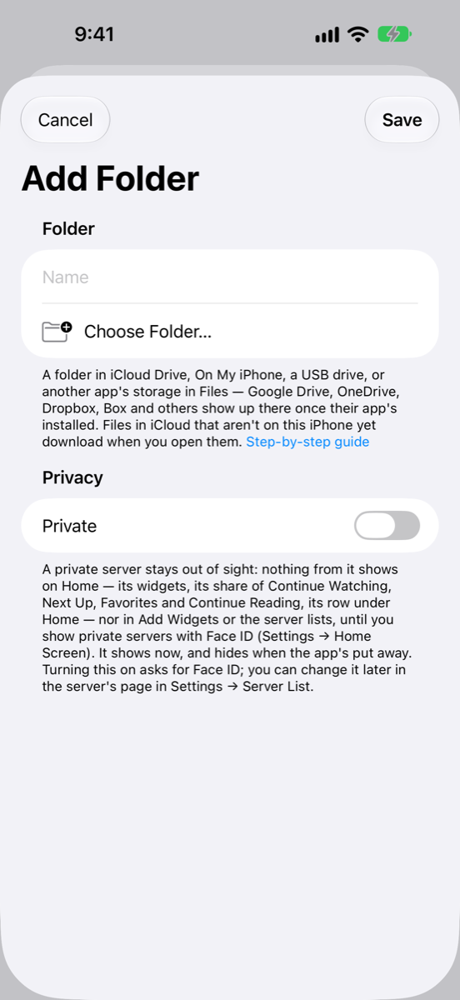

# Setting up a folder from the Files app

This one needs no key and no sign-in. If your videos, comics or books are in a folder the iPhone's **Files** app can open, MK Plus can use that folder as a server: **iCloud Drive**, **On My iPhone**, a **USB drive**, or the storage of another app that shows up in Files.

_Checked November 2026. Consoles change; if a button's moved, the names below should still find it._

## What you need

- A folder you can see in the **Files** app.
- Under a minute.
- Nothing to pay.

For another app's storage (Google Drive, OneDrive, Dropbox, Box and others), install that app and sign in to it first. Its storage then appears in Files. If you'd rather not install the app, see [Dropbox](Setup-Dropbox.html), [Google Drive](Setup-Google-Drive.html), [OneDrive](Setup-OneDrive.html) and [Box](Setup-Box.html) for signing in from MK Plus directly.

## In the Files app

<!-- screenshots: add-form, console steps (phase 2/3) -->

You don't have to do anything here, but it helps to check that the folder is there:

1. Open the **Files** app and tap **Browse**.
2. Look for your folder under **iCloud Drive**, **On My iPhone**, or the drive or app it's on. A USB drive appears under **Locations** while it's plugged in.

## In MK Plus

1. On the Server List, tap the **+** button and choose **Add Server**.
2. Tap **iCloud Drive & Files**.
3. Files' folder picker opens straight away. Open the folder you want and tap **Open**. (Tapping **Cancel** the first time closes the form without adding anything.)
4. Back in the **Folder** section, the form shows where it is and its name. **Name** starts as the folder's name; change it if you like.
5. Optionally switch the server to private, then tap **Save**.

To use a different folder later, open the server's page in **Settings → Server List** and tap **Choose Another Folder…**.

**Save** stays greyed out until a folder is chosen and **Name** isn't empty.

## Why videos can take a moment to start

A video in iCloud Drive or another app's storage isn't always on your iPhone. iOS keeps those files in the cloud until something asks for them, and the system brings the **whole file** down before it lets an app read any of it. So the first time you play a file that isn't on the iPhone yet, MK Plus waits for the entire download, with no progress bar yet, and a big film can take a while. It's the same thing the Files app does when you open a file in iCloud.

Once a file's downloaded, it plays straight away. Files that are already on the iPhone (in **On My iPhone**, or in iCloud Drive and kept downloaded) start at once, and so should a USB drive's, which is read directly. To avoid the wait, open the file in the **Files** app first and let it finish.

MK Plus never downloads files you didn't ask for. Thumbnails, comic covers and folder art only use files already on your iPhone, so browsing a big iCloud folder doesn't pull everything down. A file still in iCloud may get the thumbnail the system keeps for it, or none.

## What went wrong

| What you see | Why | What to do |
|---|---|---|
| An alert titled **Couldn't Use That Folder**, with a reason from iOS | Files wouldn't give MK Plus access to that folder. | Pick another folder, or one inside it. |
| "This folder can't be found any more — it may have been moved, renamed or deleted, or the app it's in signed out. Choose it again in the server's settings." | The folder was moved, renamed or deleted, the USB drive is unplugged, or the other app signed out. | Plug the drive back in or sign in to the app, or open the server's page in **Settings → Server List** and tap **Choose Another Folder…**. |
| "That's outside this folder." | Something asked for a path that leaves the folder. MK Plus never goes above the folder you picked. | Pick a folder higher up if you need those files. |
| A video takes a long time to start, or seems stuck | The file's still coming down from iCloud (see above). | Wait, or download it in the **Files** app first. |
| A video in iCloud fails to open the first time, and plays on the second try | A file that isn't on the iPhone yet may not open on the first attempt in the player used for formats like `.mkv`. | Open the video again once the download finishes. |

## Good to know

- **Hidden files are left out.** Files whose names start with a dot don't show.
- **It behaves like any other server.** You can browse, search, play, read comics, PDFs and EPUBs, download, and delete, move and copy.
- **Restoring on another device.** The picked folder is remembered on the iPhone that picked it. If you restore your servers on a different device, choose the folder again there.
- **The name in the list.** A row reads "iCloud Drive · Movies" or "Files · Films". Other apps' storage shows as "Files".
- **Nothing to sign in to.** The folder access is kept on this iPhone, and MK Plus has no password for it.

Back to the setup guides.
