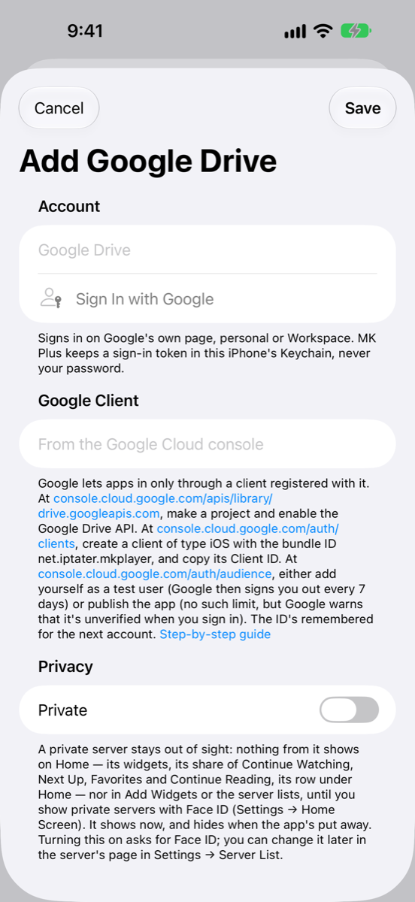

# Setting up Google Drive

Google only lets apps in through a client you register yourself. It takes about ten minutes and is free. You do it once, and MK Plus remembers the result for any other Google account you add later.

_Checked November 2026. Consoles change; if a button's moved, the names below should still find it._

## What you need

- A Google account (personal or Google Workspace).
- About 10 minutes.
- Nothing to pay. Google Cloud's free tier covers this; you don't need to turn on billing.

A **client ID** is a long code that names the app you register with Google. It isn't a password: on its own it opens nothing.

## In the Google Cloud console

**Step 1: make a project and turn on the Drive API**

1. Open **https://console.cloud.google.com/apis/library/drive.googleapis.com** and sign in.
2. If you're asked to choose a project, choose **Create project**, name it anything (`MK Plus`, say) and choose **Create**. Make sure it's the project selected at the top of the page.
3. On the **Google Drive API** page, choose **Enable**.

**Step 2: make an iOS client**

4. Open **https://console.cloud.google.com/auth/clients**. If the console first asks you to set up Google Auth Platform (also called the OAuth consent screen), follow its prompts: any app name, your own email for support and contact, and **External** as the audience.
5. Choose **Create client** (older consoles say **Create credentials → OAuth client ID**).
6. For **Application type**, pick **iOS**.
7. Give it any name, and for **Bundle ID** type exactly: `net.iptater.mkplayer`
8. Choose **Create**, then copy the **Client ID**. It ends in `.apps.googleusercontent.com`. (You don't need a client secret: an iOS client doesn't have one.)

**Step 3: say who can sign in**

9. Open **https://console.cloud.google.com/auth/audience**.
10. Pick one:
    - **Stay in Testing and add yourself as a test user.** Under **Test users**, choose **Add users** and enter the Google account you'll sign in with. This is the quickest way, but Google signs you out every 7 days, and you'll have to sign in again.
    - **Choose Publish app.** There's no 7-day limit. Google warns that the app is unverified when you sign in; that's expected, because you're the only person using it.

## In MK Plus

1. On the Server List, tap the **+** button and choose **Add Server**.
2. Tap **Google Drive**.
3. Under **Google Client**, paste the ID into **Client ID**.
4. Tap **Sign In with Google** (under **Account**). Google's own page opens in a sheet that shares Safari's sign-ins, so pick your account or sign in.
5. If you published the app, Google says it hasn't verified it. Choose **Advanced**, then **Go to … (unsafe)** (some versions just show **Continue**). Then leave every box ticked, including the one for Google Drive, and continue.
6. Back in the form, **Signed In As** shows your Google email. Change **Name** if you like.
7. Optionally switch the server to private, then tap **Save**.

**Sign In with Google** stays greyed out until the **Client ID** looks right (it must end in `.apps.googleusercontent.com`). **Save** stays greyed out until you've signed in.

## What went wrong

Sign-in problems show an alert titled **Couldn't Sign In**. Messages that come later, while you browse, appear on the server itself.

| What you see | Why | What to do |
|---|---|---|
| **Sign In with Google** is greyed out | The **Client ID** is empty or isn't a Google client ID. | Paste the whole ID, ending in `.apps.googleusercontent.com`. |
| "Google hasn't verified this app" or "This app isn't verified", with **Advanced** and **Continue** links | You published the app without Google's review. | Choose **Advanced → Go to … (unsafe)**. It's your own client, so this is expected. |
| "Access blocked", with `Error 403: access_denied` | The app is in Testing and the account isn't on the **Test users** list. | In **https://console.cloud.google.com/auth/audience**, add the account under **Test users**. |
| "Couldn't sign in to Google Drive: …" with a reason such as `redirect_uri_mismatch` or `invalid_request` | The client isn't an **iOS** client, or its **Bundle ID** isn't exactly `net.iptater.mkplayer`. | Make a new client of type **iOS** with that bundle ID. |
| "Couldn't sign in to Google Drive: MK Plus needs to see and manage your Google Drive files. Sign in again and leave that box ticked." | You unticked the Google Drive permission on Google's page. | Tap **Sign In Again** and leave every box ticked. |
| "Couldn't sign in to Google Drive: Google's answer didn't match this sign-in." | The reply wasn't for this sign-in attempt, for example from an older sheet. | Tap **Sign In Again** once and wait for the sheet. |
| "Couldn't sign in to Google Drive: Google didn't send a token to stay signed in with." | Google signed you in without a long-lasting token. | Tap **Sign In Again**. |
| "Couldn't sign in to Google Drive." (nothing after it) | Google sent the sheet back without a code or a reason. | Try again. |
| "Google has signed this app out. Sign in again in the server's settings." | You removed MK Plus's access in your Google account, or the app is in Testing and its 7 days ran out. | Open the server in **Settings → Server List** and tap **Sign In Again**. To stop it recurring, publish the app. |
| "The Google Drive API isn't turned on for this client's project. Enable it in the Google Cloud console." | Step 1 was skipped, or the client belongs to a different project than the one you enabled the API in. | Enable **Google Drive API** in the same project as the client. |
| "MK Plus isn't allowed to do that. Sign in again in the server's settings and leave Google Drive's box ticked." | The sign-in doesn't carry the Drive permission. | Tap **Sign In Again** and leave the Drive box ticked. |
| "Google Drive is asking for a slower pace. Try again shortly." | Google is limiting how fast requests come in. | Wait a minute and try again. |
| "This Google Drive is full." | No space left to save to. | Free some space in Google Drive. |
| "Google has paused downloads of this file for now, because it's been downloaded so much. Try again later." | Google limits very popular shared files. | Try again later. |
| "That isn't in this Google Drive any more." | The file or folder was moved or deleted. | Refresh the folder. |

## Good to know

- **Testing or published?** In Testing, only the test users you list can sign in, and Google signs them out every 7 days. Published, there's no such limit, but Google shows the unverified warning at each fresh sign-in. Both are free.
- **Your password never reaches MK Plus.** You sign in on Google's own page, and the app keeps only a sign-in token, in this iPhone's Keychain.
- **Passkeys and saved sign-ins work.** The sheet shares Safari's sign-ins, so if Safari is signed in to Google you just pick the account.
- **The ID is remembered.** Adding a second Google account fills **Client ID** in for you.
- **Shared drives show up too.** My Drive, shared drives and Shared with me all appear at the top level.

Next: [OneDrive](Setup-OneDrive.html).
