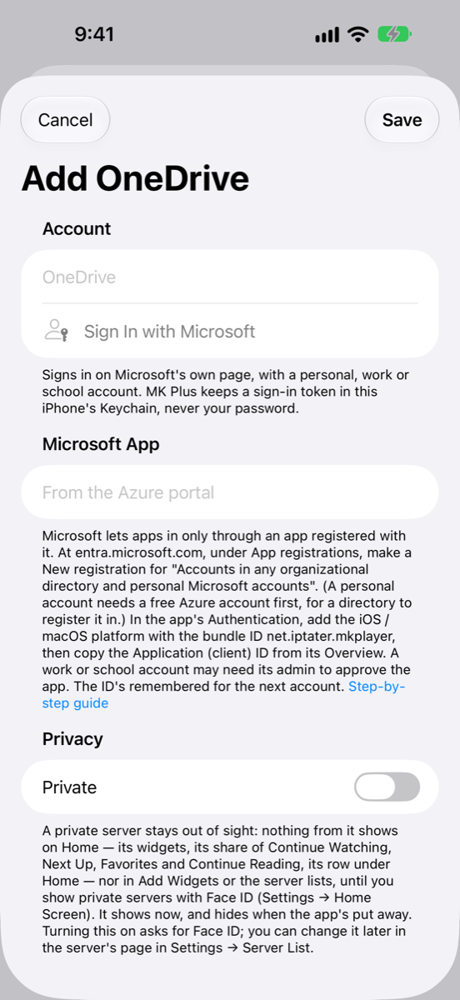

# Setting up OneDrive

Microsoft only lets apps in through an app you register yourself. It takes about ten minutes and is free. You do it once, and MK Plus remembers the result for any other Microsoft account you add later.

_Checked November 2026. Consoles change; if a button's moved, the names below should still find it._

## What you need

- A Microsoft account with OneDrive: personal, work or school.
- For a **personal** account, a free **Azure** account too. Microsoft keeps app registrations in a "directory", and a personal account doesn't have one until you sign up for Azure. Sign-up is free, though Microsoft may ask for a phone number and a card to confirm who you are.
- About 10 minutes.
- Nothing to pay for the registration itself.

A **client ID** (Microsoft calls it the "Application (client) ID") is a long code that names the app you register. It isn't a password: on its own it opens nothing.

## In the Microsoft Entra admin center

1. Open **<https://entra.microsoft.com>** and sign in. (For a personal account, sign up for Azure first at **<https://azure.microsoft.com/free>** and use the same account here.)
2. In the left menu, open **Entra ID → App registrations** (in some views it's under **Identity → Applications → App registrations**).
3. Choose **New registration**.
4. Give it any name, such as `MK Plus`.
5. Under **Supported account types**, pick **Accounts in any organizational directory and personal Microsoft accounts**. The other choices won't let a personal account in.
6. Leave **Redirect URI** empty for now and choose **Register**.
7. In the app's left menu, open **Authentication**. Choose **Add a platform** (in the newer layout, **Add Platform** under **Redirect URI configuration**), then pick **iOS / macOS**.
8. For **Bundle ID**, type exactly: `net.iptater.mkplayer`
9. Choose **Configure**. Microsoft fills in the redirect address for you: `msauth.net.iptater.mkplayer://auth`. Choose **Save** if the page asks.
10. Open **Overview** and copy the **Application (client) ID**. It looks like `12345678-abcd-1234-abcd-1234567890ab`.

If you're signing in with a **work or school** account, your organization's administrator may need to approve the app before it works (see the table below).

## In MK Plus

1. On the Server List, tap the **+** button and choose **Add Server**.
2. Tap **OneDrive**.
3. Under **Microsoft App**, paste the ID into **Client ID**.
4. Tap **Sign In with Microsoft** (under **Account**). Microsoft's own page opens in a sheet that shares Safari's sign-ins. Pick your account or sign in, and accept the permissions it lists.
5. Back in the form, **Signed In As** shows your email. Change **Name** if you like.
6. Optionally switch the server to private, then tap **Save**.

**Sign In with Microsoft** stays greyed out until the **Client ID** has the right shape (letters and digits in groups, separated by dashes). **Save** stays greyed out until you've signed in.

MK Plus asks only to read and change the files in your own OneDrive, to stay signed in, and to see who you are.

## What went wrong

Sign-in problems show an alert titled **Couldn't Sign In**. Messages that come later, while you browse, appear on the server itself.

| What you see | Why | What to do |
|---|---|---|
| **Sign In with Microsoft** is greyed out | The **Client ID** is empty or isn't an Application (client) ID. | Copy the **Application (client) ID** from the app's **Overview** page, not the Object ID or Directory ID. |
| Microsoft's page says "Need admin approval" | You're signing in with a work or school account whose administrator controls which apps may be used. | Ask your administrator to approve the app, or use a personal account. |
| "Couldn't sign in to OneDrive: AADSTS65001 …" | Nobody has agreed to the app's permissions yet. | Sign in again and accept the permissions. For a work or school account, ask your administrator to approve the app. |
| "Couldn't sign in to OneDrive: AADSTS50011 …" (or any message about a reply or redirect address) | The **iOS / macOS** platform is missing, or its **Bundle ID** isn't exactly `net.iptater.mkplayer`. | In the app's **Authentication**, add the platform with that bundle ID. |
| "Couldn't sign in to OneDrive: AADSTS700016 …" | Microsoft can't find an app with that ID, or the registration doesn't allow your kind of account. | Check the ID, and that **Supported account types** is **Accounts in any organizational directory and personal Microsoft accounts**. |
| "Couldn't sign in to OneDrive: Microsoft's answer didn't match this sign-in." | The reply wasn't for this sign-in attempt, for example from an older sheet. | Tap **Sign In Again** once and wait for the sheet. |
| "Couldn't sign in to OneDrive: Microsoft didn't send a token to stay signed in with." | Microsoft signed you in without a long-lasting token. | Tap **Sign In Again**. |
| "Couldn't sign in to OneDrive." (nothing after it) | Microsoft sent the sheet back without a code or a reason. | Try again. |
| "Microsoft has signed this app out. Sign in again in the server's settings." | The sign-in ran out (90 days without using it), you changed your password, or access was removed. | Open the server in **Settings → Server List** and tap **Sign In Again**. |
| "OneDrive is asking for a slower pace. Try again shortly." | Microsoft is limiting how fast requests come in. | Wait a minute and try again. |
| "This OneDrive is full." | No space left to save to. | Free some space in OneDrive. |
| "There's already something with that name there." | A file or folder by that name is in the way. | Pick another name. |
| "You don't have permission to do that to this item." / "OneDrive doesn't allow that here." | The item is read-only or locked. | Check its sharing settings in OneDrive. |
| "That isn't in this OneDrive any more." | The file or folder was moved or deleted. | Refresh the folder. |

## Good to know

- **Your password never reaches MK Plus.** You sign in on Microsoft's own page, and the app keeps only a sign-in token, in this iPhone's Keychain.
- **Staying signed in.** Microsoft hands out a fresh token each time MK Plus refreshes, and MK Plus keeps the newest one. As long as you use the account within 90 days, you stay signed in.
- **Passkeys and saved sign-ins work.** The sheet shares Safari's sign-ins.
- **The ID is remembered.** Adding a second Microsoft account fills **Client ID** in for you.

---

Previous: [← Google Drive](Setup-Google-Drive.html) · Next: [Box →](Setup-Box.html)
