# Watching video

Pictures for
<button type="button" data-device="iphone-18-pro-max" aria-pressed="true">iPhone 18 Pro Max</button>
<button type="button" data-device="duo-front" aria-pressed="false">iPhone Duo — closed</button>
<button type="button" data-device="duo-open-side" aria-pressed="false">iPhone Duo — open, on its side</button>
<button type="button" data-device="iphone-17e" aria-pressed="false">iPhone 17e</button>
<button type="button" data-device="ipad-air-11" aria-pressed="false">iPad Air 11-inch</button>

Tap a video in a folder, on a Jellyfin page or on Home and it plays full screen. This page covers the controls, choosing audio and subtitles, skipping intros, what happens when a video ends, and how to lay the buttons out your own way.

## Playing a video

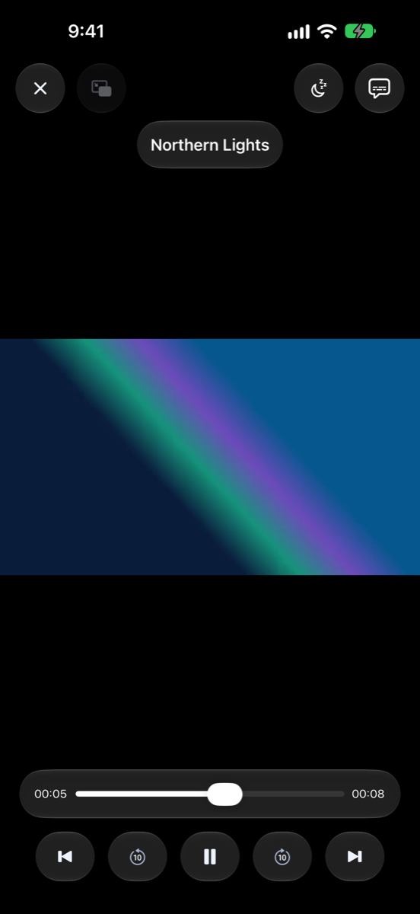
iPhone 18 Pro Max

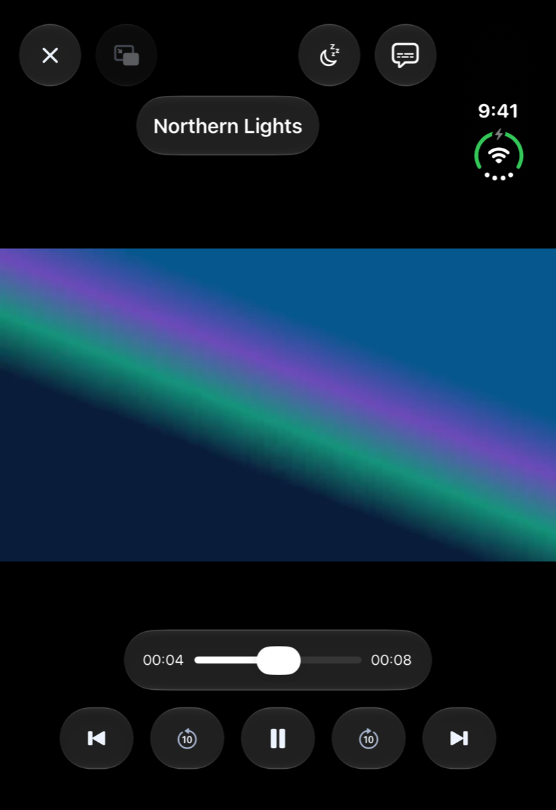
iPhone Duo — closed

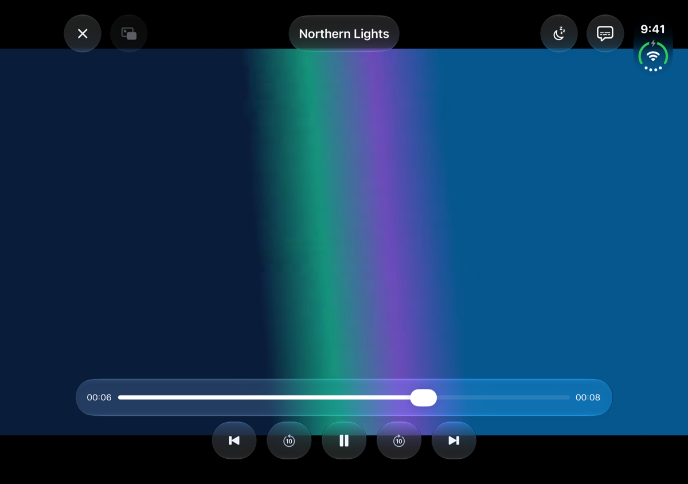
iPhone Duo — open, on its side

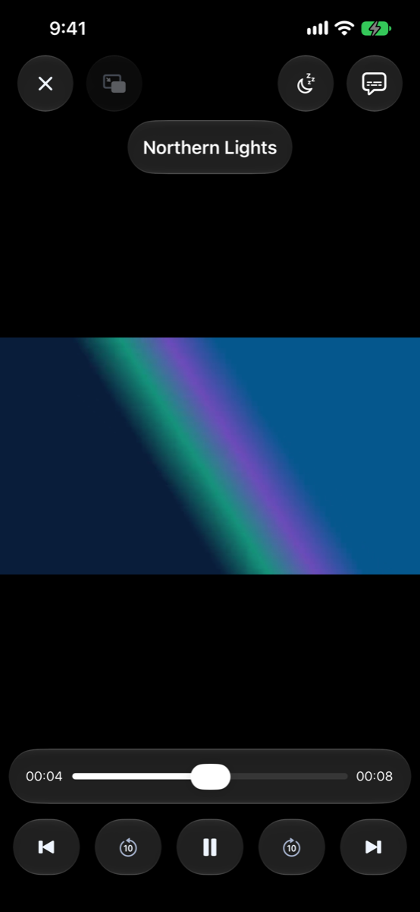
iPhone 17e

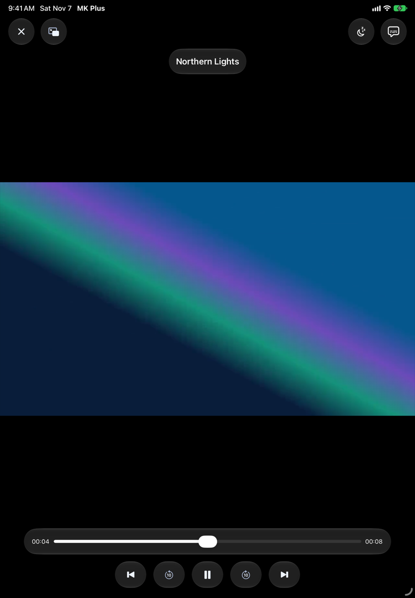
iPad Air 11-inch

Tap the video to show or hide the controls. They are:

- **Back** closes the player.
- The **timeline** shows how far in you are. Drag along it to scrub. With Settings → Video Playback → Gestures & Buttons → **Scrub Preview Popup** on, a small picture shows where you'll land.
- The media buttons are **Previous**, **Skip Back 10s**, **Play/Pause**, **Skip Forward 10s** and **Next**. **Previous** and **Next** go to the neighbouring video in the folder, or the previous and next episode of a show.
- **Playback Options** (the captions button) holds the audio, subtitles, speed and more. See below.
- **Playback Speed**, **Sleep Timer**, **Picture in Picture**, **Rotate Video** and the **Settings** gear are buttons too. Which of them show, and where, is up to you: see [Lay the controls out your way](#lay-the-controls-out-your-way).

Turn your iPhone on its side and the video fills the screen. The controls rearrange themselves to suit, and on a side the media buttons can stack down one edge.

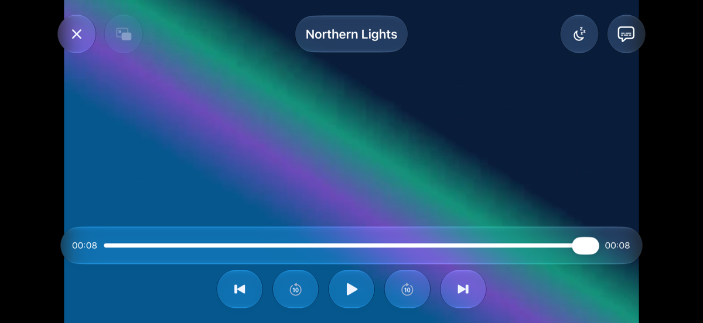
iPhone 18 Pro Max

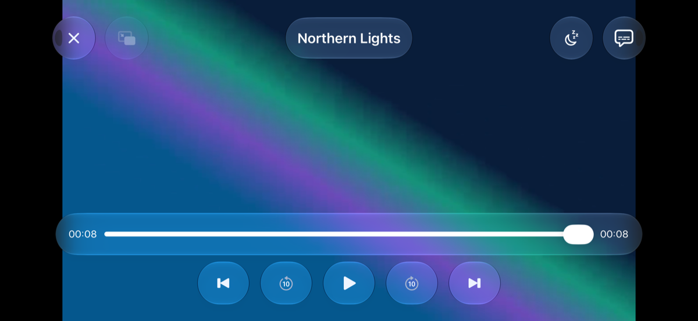
iPhone 17e

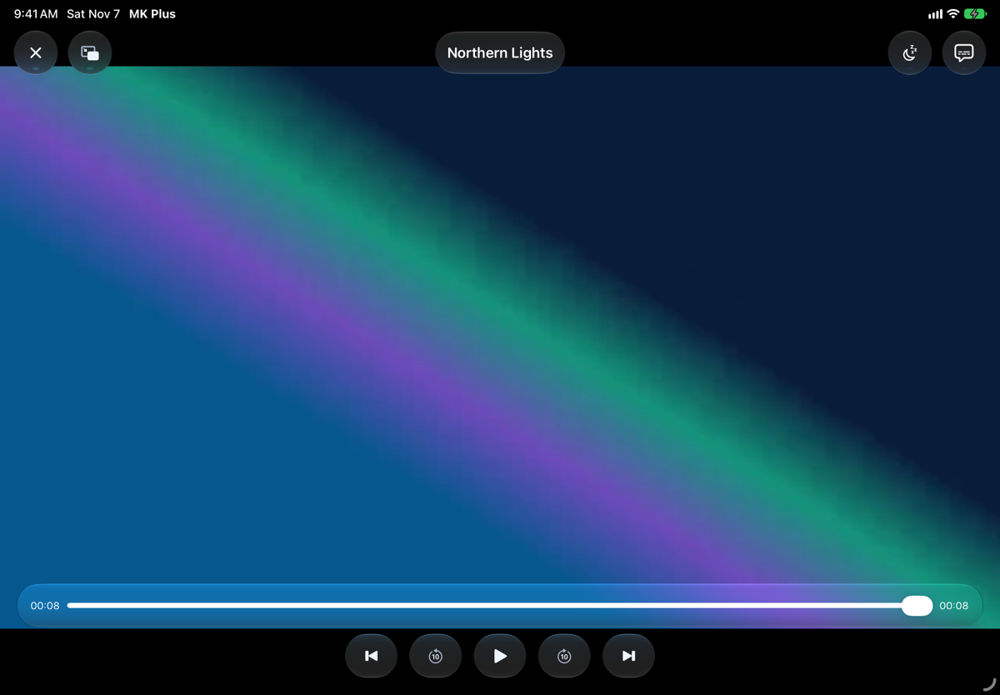
iPad Air 11-inch

## Gestures

- **Tap** shows or hides the controls. With Settings → Video Playback → Gestures & Buttons → **Tap to Pause** on, a tap in the middle of the picture pauses or plays instead. A tap near the left or right edge still just shows or hides the controls.
- **Double tap** zooms in on the spot you tapped. Double tap again to zoom back out.
- **Drag sideways** anywhere on the picture to scrub, the same as dragging the timeline.
- **Press and hold** while a video plays to watch it at double speed. Let go and it returns to the speed it was at. It does nothing while the video is paused.
- **Swipe down** closes the video. The **Vertical Swipes** setting changes that: **Swipe Between Videos** makes up the next video and down the previous one (past either end, or a long pull down, it closes the player), and **Off** leaves only **Back** to close it.

## Audio, subtitles and speed

Tap **Playback Options**. By default it opens a short menu with **Subtitles**, **Audio**, **Speed**, **Rotate** and **All Playback Options…**. Press and hold the button for the full menu.

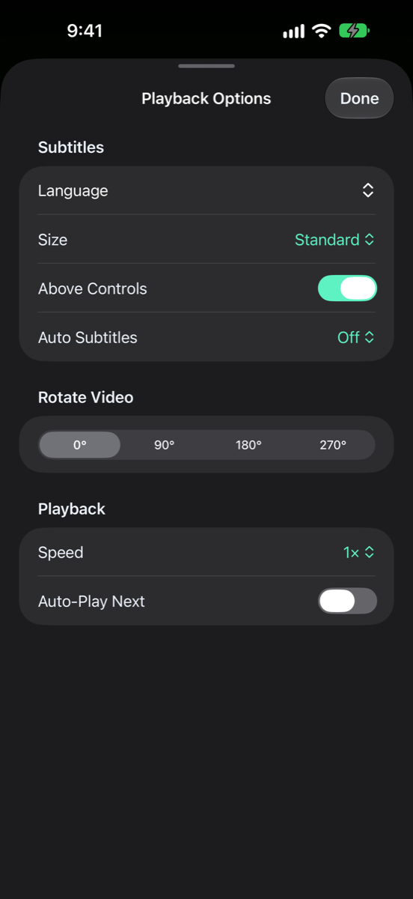
iPhone 18 Pro Max

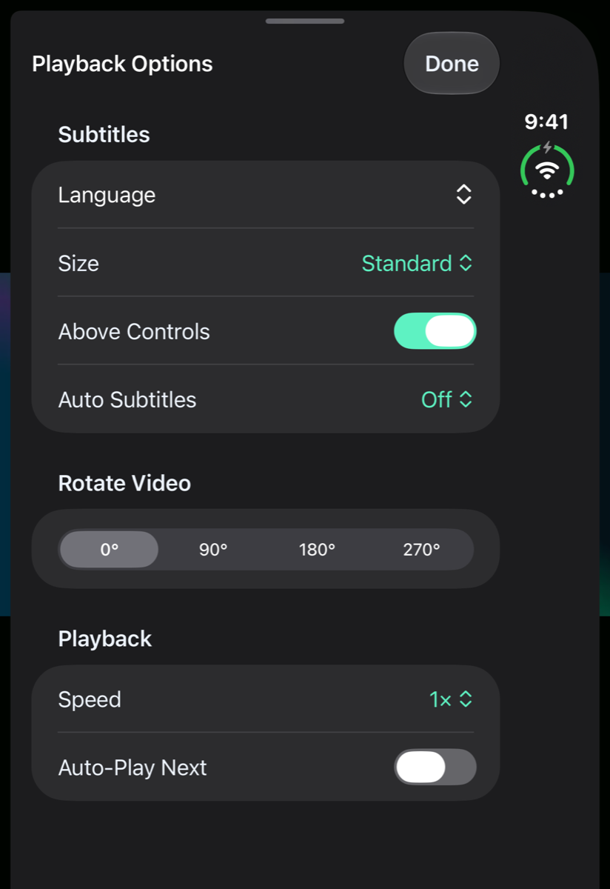
iPhone Duo — closed

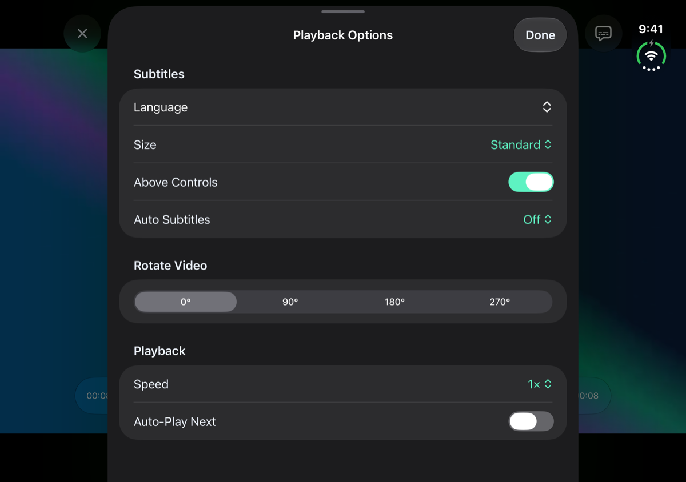
iPhone Duo — open, on its side

**All Playback Options…** opens the whole set in a sheet:

- **Audio**: **Language** picks the sound track.
- **Subtitles**: **Language** turns them on, off or changes the language. **Size** is **Smaller**, **Standard**, **Larger** or **Largest**. **Above Controls** lifts subtitles clear of the timeline while the controls show. **Auto Subtitles** can be **Off**, **Always** or **Foreign Audio** (on when the sound isn't in your language).
- **Rotate Video**: turns the picture in quarter turns, to 90°, 180° or 270°.
- **Playback**: **Speed** runs from 0.5× to 2×, and **Auto-Play Next** is the switch for the next video.
- **Jellyfin** (only for a Jellyfin video): **Skip Intros** and **Streaming Quality**.

Tap **Done** to close it. If you'd rather a tap on the button opened the sheet or the full menu, change Settings → Video Playback → Gestures & Buttons → **Playback Options Button Opens** to **Full Menu** or **Sheet**.

The rest of the subtitle settings live in Settings → Video Playback → **Subtitles**, including **Subtitle Files Beside Videos** (it offers subtitle files that sit next to a video on a share) and **Generate Subtitles** (the app makes subtitles from the sound, on your iPhone, for videos Apple's player doesn't play).

## The player's settings

The **Settings** gear (a tap, by default, opens its menu) holds the things you reach for while watching.

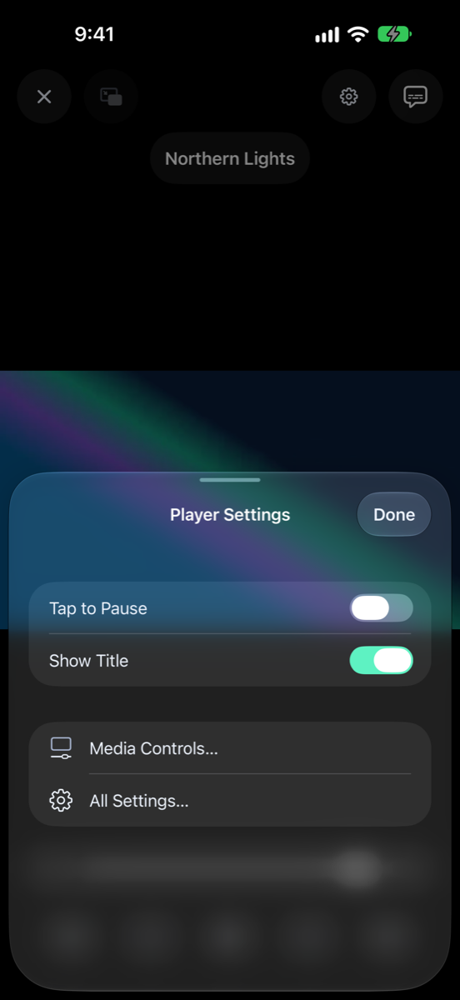
iPhone 18 Pro Max

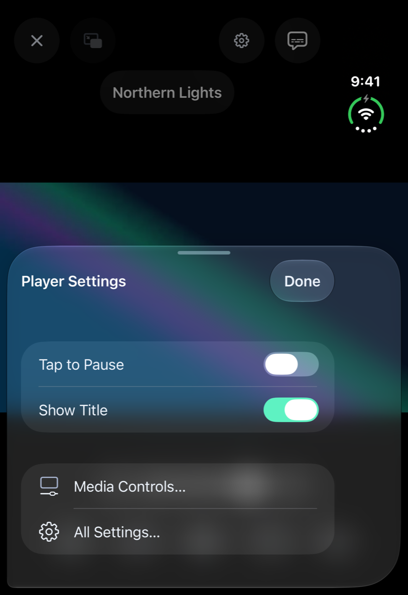
iPhone Duo — closed

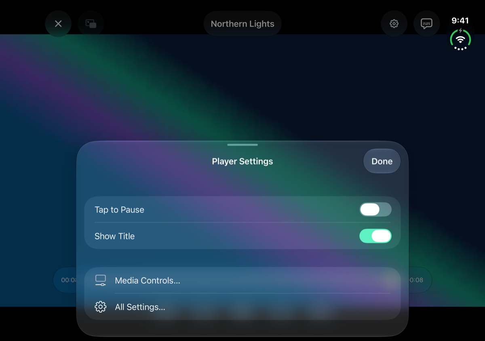
iPhone Duo — open, on its side

- **Tap to Pause** and **Show Title** switch on and off right there.
- **Media Controls…** opens the editor below.
- **All Settings…** opens the full Settings, over the video. It keeps playing underneath.

Settings → Video Playback → Gestures & Buttons → **Settings Button Opens** chooses between **Menu**, **Player Settings Sheet** and **All Settings**. Whichever you pick, pressing and holding the gear opens the menu.

## Skipping intros and credits

When a Jellyfin server has marked where an episode's intro, recap or credits are, a **Skip Intro**, **Skip Recap** or **Skip Credits** button shows in the bottom right while they play. Tap it to jump past. Turn on **Skip Intros** in Playback Options (or **Skip Intros Automatically** in Settings → Video Playback → **Up Next & Playback**) and intros and recaps are skipped without asking.

## When a video ends

With **Auto-Play Next** on, the next video in the folder, or the next episode of a show (even in the next season), plays when one ends. An **Up Next** card counts down first, with **Cancel** to stay put and **Play Now** to go straight on. On Jellyfin the countdown starts as the credits roll.

In Settings → Video Playback → **Up Next & Playback**, **Ask Before Playing Next** turns the countdown off (it goes straight on), **Countdown** sets how long it runs, and **Playback Speed** sets the speed every video starts at.

## Sleep timer

The **Sleep Timer** button (the moon) pauses playback later, so you can fall asleep to something. Choose **End of Video** or a time, from 5 minutes up to 2 hours. While a timer runs the moon fills in, and the menu says when the video will pause. **Turn Off Sleep Timer** cancels it.

## Picture in Picture and playing while locked

- **Picture in Picture** shrinks the video into a small floating window you can keep while you use another app. Tap the **Picture in Picture** button, or turn on Settings → Video Playback → **Up Next & Playback** → **Picture in Picture on Leaving** to have it start whenever you leave the app.
- **Keep Playing When Locked** carries the sound on after you lock the screen.
- **Lock Screen Controls** puts the video on the Lock Screen and in Control Center. **Lock Screen Buttons** chooses whether the buttons beside play and pause skip 10 seconds or change video.

## Lay the controls out your way

Settings → **Media Controls** opens an editor that looks like the player itself.

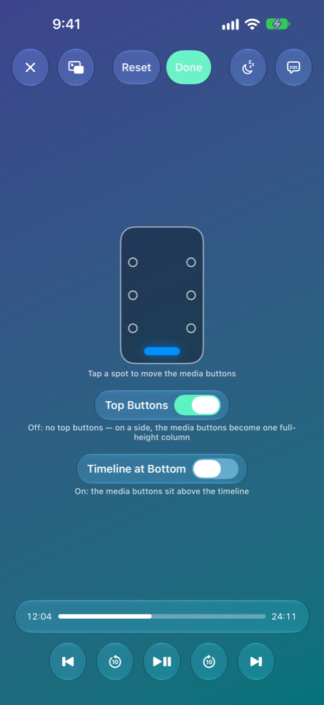
iPhone 18 Pro Max

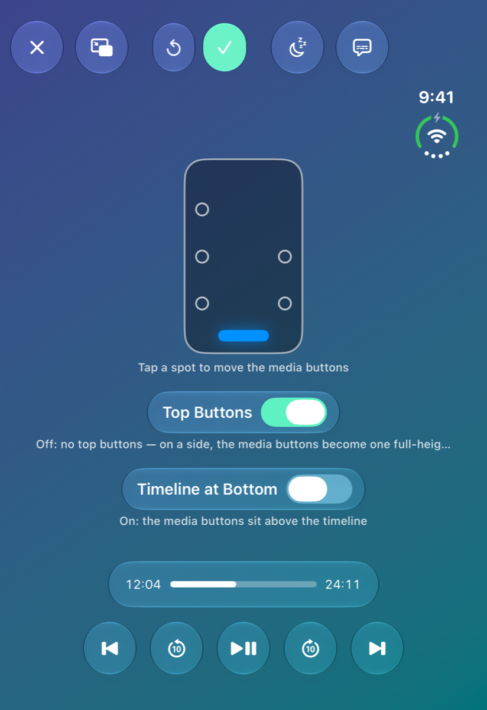
iPhone Duo — closed

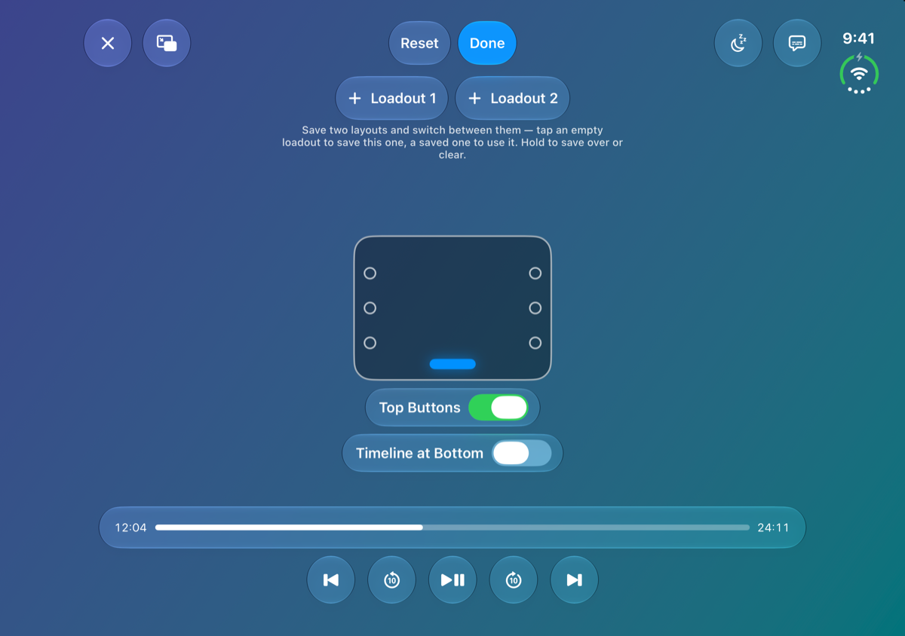
iPhone Duo — open, on its side

1. Tap a spot on the miniature phone to move the media buttons: along the bottom, or down the left or right side.
2. Tap a slot to choose which button goes there, including the corners at the top. **None** leaves it empty.
3. Turn **Top Buttons** off to remove the top row (down a side, the media buttons then become one long column), and turn **Timeline at Bottom** on to put the timeline at the very bottom, under the buttons.
4. Tap **Reset** to go back to the original layout, and **Done** when you're happy.

The Media Controls page is also the way to add buttons that aren't there to start with, such as **Playback Speed** or **Sleep Timer**.

## Files that open in a different player

MK Plus has two players behind the same controls. Apple's player handles what iOS plays itself. The app's own player takes the rest, such as DTS or TrueHD sound, and jumps around a video on a share quickly. You don't have to choose.

- **MKV files** from a share play in Apple's player when they can, which gives them iOS's generated subtitles, AirPlay and Picture in Picture. Others, and any MKV from Jellyfin, play in the app's own player. Turn off Settings → Video Playback → **Play MKV in Apple's Player** to send every MKV there.
- **If a video won't play** in Apple's player, the app's own player tries it. For a Jellyfin video it can't play either, the server converts it. If nothing can, the player says so.

## On the iPhone Duo and iPad

- On the Duo's front screen, the status bar sits in a strip down one side and the controls keep clear of it.
- Partly folded, an unfolded Duo can stand the video on one half and keep the controls on the other. Settings → Video Playback → Gestures & Buttons has **Tabletop Layout** and **Book Layout** for that.
- The unfolded Duo has two **Loadout** buttons at the top of the Media Controls editor. Tap an empty one to save the layout you have, and tap a saved one to use it.
- On iPad the video fills the width, and everything else works the same.

## What went wrong

| What you see | Try this |
|---|---|
| A swipe closes the video by accident | Settings → Video Playback → Gestures & Buttons → **Vertical Swipes** → **Off**. |
| A tap doesn't pause | **Tap to Pause** is off. Turn it on in the player's settings or in Settings. |
| Subtitles sit behind the timeline | Turn on **Above Controls** in Playback Options. |
| No **Skip Intro** button | The server hasn't marked an intro for that episode. Only Jellyfin does. |
| A Jellyfin video keeps stopping to load | Lower **Streaming Quality** in Playback Options. See [Jellyfin](Jellyfin.html). |
| A button you want isn't on the player | Add it in Settings → **Media Controls**. |

---

Home · Previous: [← Browsing your files](Browsing.html) · Next: [Jellyfin →](Jellyfin.html)
