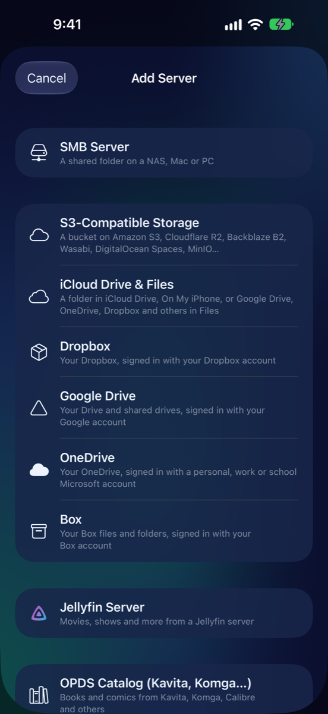
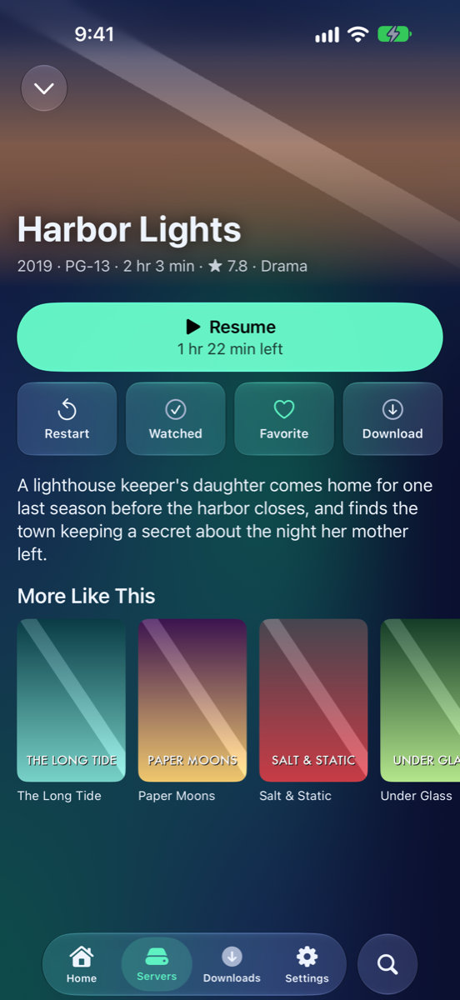
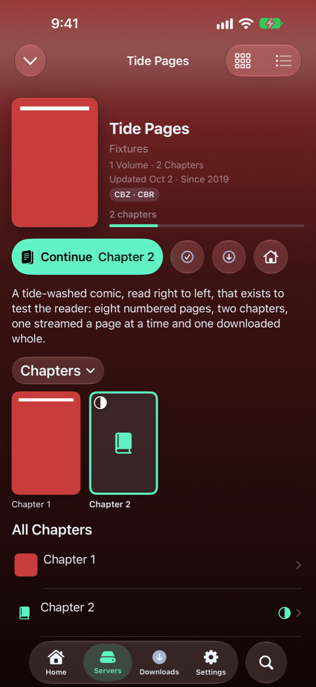
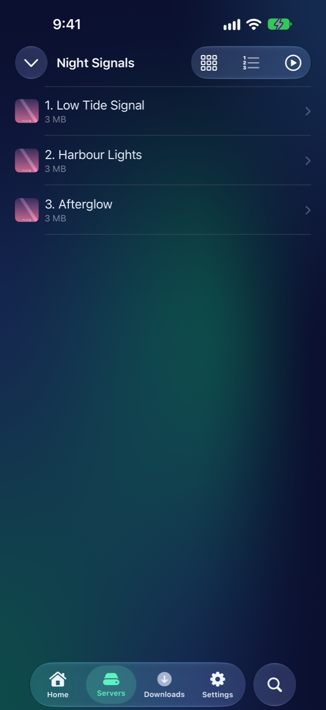
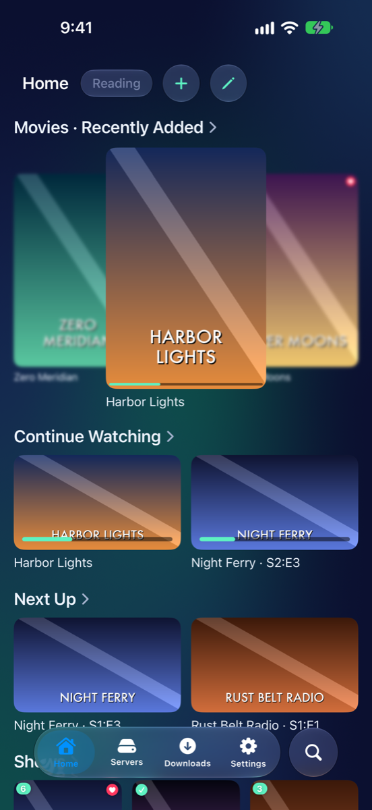
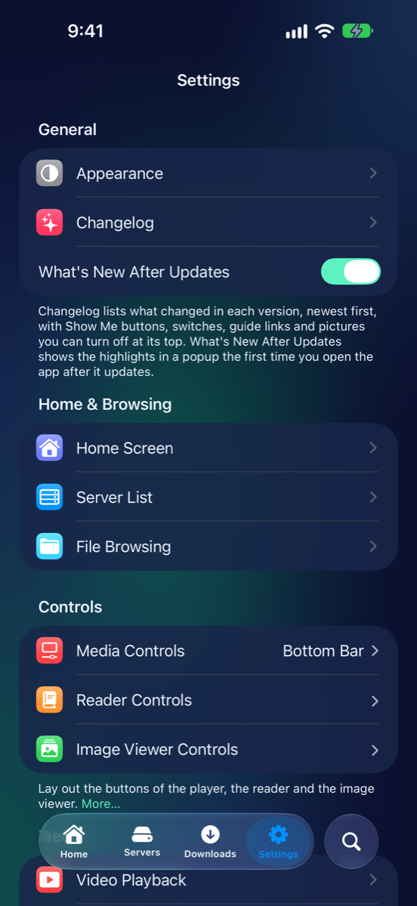

# MK Plus Guide

Your own videos, music, comics and books, from your servers and cloud
storage, on iPhone and iPad.
{: .home-lead }

<a class="home-start" href="Getting-Started.html" markdown="0">New to MK Plus? Install it and find your way around.<b>Get started →</b></a>

## What would you like to do?

<a class="home-card" href="Connect-a-server.html">Connect a serverJellyfin, SMB shares, book servers, Dropbox, Google Drive, OneDrive, Box and S3</a>
<a class="home-card" href="Video-Player.html">Watch videoThe player, subtitles and audio, skipping intros, Up Next</a>
<a class="home-card" href="Reader.html">Read comics and booksComics, PDFs and EPUBs: page turns, spreads, tap zones</a>
<a class="home-card" href="Music.html">Listen to musicSongs from Jellyfin or a folder, the mini player and the queue</a>
<a class="home-card" href="Home-Screen.html">Make Home yoursWidgets, more than one Home, themes and searching every server</a>
<a class="home-card" href="Settings.html">Change a settingEvery Settings page: what it's for and what's on it</a>

## Help

[Help](Help.html) has feedback, the privacy policy and the open-source
libraries. [What's New](whats-new.html) has the highlights of each update.
