

# What's New

The highlights of each MK Plus update since public TestFlight testing began (version 1.281.0), newest first. Every detail is in **Settings → Changelog** in the app.

## November 2026

### A movie's page, redone

_Version 1.344.0 · 11 November 2026_

- The picture runs across the top of a movie's or show's page, with the title on it.
- One big Resume shows the time left. Under it, Restart, Watched, Favorite and Download are the same size, each with its name.
- More Like This, under the summary, shows what your server finds is similar.
- On the iPhone Duo open on its side, the picture fills both halves and the buttons sit on the right, by your thumb.

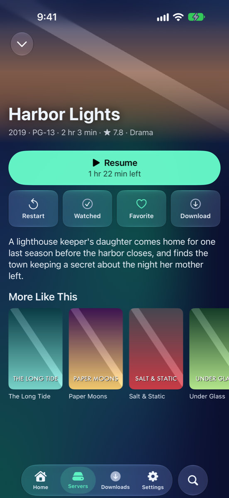

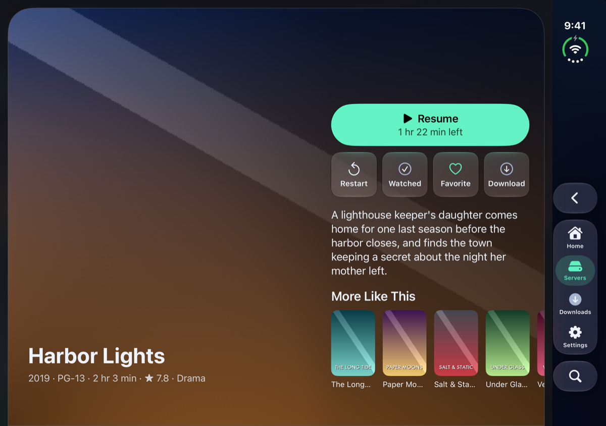

Everything in 1.344.0

**New**

- More Like This on a Jellyfin movie's or show's page: a row of posters your server finds are similar. Tap one for its page. Settings → File Browsing → More Like This turns it off.
- Movie Pages Across the Fold, for the iPhone Duo open on its side: a movie's or show's page runs across the whole screen, its picture behind both halves, the title on the left and the buttons and details on the right, lower down. Nothing sits across the fold. Turn it off in Settings → File Browsing → Cards for a card down the middle.

**Changed**

- A movie's or show's title, year, rating, running time and genre now sit on its picture, in one line.
- Resume is one wide button with the time left under it (Play shows the running time). From Beginning is now Restart, and Restart, Watched, Favorite, Home and Download are buttons of one size with their names.

### Home on the open iPhone Duo: Spotlight

_Version 1.343.0 · 11 November 2026_

- Open on its side, Home puts what you were watching big on the left, with Resume and Details on it.
- Continue Watching sits under it, and the rest of your shelves are on the right.
- Nothing sits across the fold.

Everything in 1.343.0

**New**

- Spotlight, a new Home layout for the unfolded iPhone Duo and iPad: left of the fold the one thing you're most likely to carry on with, big, with Resume (Play, or Read for a book) and Details, and Continue Watching under it; right of the fold the rest of Home. With nothing to continue, it shows the newest thing on Home's first shelf. Choose it in Settings → Home Screen.

**Changed**

- The iPhone Duo open on its side starts in Spotlight instead of In a Card. If you picked a layout yourself, it's kept.
- While you edit Home in Spotlight, it's two columns, so a widget can go anywhere.

### Covers grow into their page

_Version 1.342.0 · 11 November 2026_

- Tap a poster or a cover on Home and its page grows out of it.
- Close the page and it shrinks back into the cover you tapped.
- Zoom into Covers, in Settings → File Browsing, turns it off. With Reduce Motion on, pages slide up as before.

Everything in 1.342.0

**New**

- Zoom into Covers: a movie's or show's page opened from a cover on Home or a poster in a movie or show library grows from that cover, and closing it with its chevron or Back shrinks it back. Pulling a card down or swiping it across still carries it away under your finger. It's in Settings → File Browsing → Cards, and Reduce Motion turns it off.

**Changed**

- With VoiceOver, the two-finger scrub closes a card, as its chevron does.

### Sharper covers on Home, and you choose the words under them

_Version 1.341.0 · 11 November 2026_

- The covers beside a carousel's middle one stay sharp, a little dimmed, with the year, length and genre under the middle one.
- Continue Watching keeps its pictures clean: the bar runs along the bottom edge, with the name and time left underneath.
- Cover Info, in a shelf's options, picks the lines under its covers: drag them into order, or turn them off.
- Home's name is bigger, with all your Homes in one switch beside it.

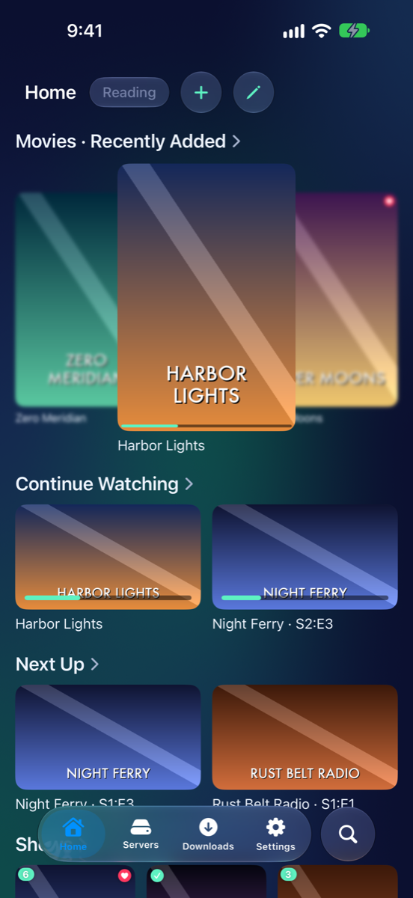

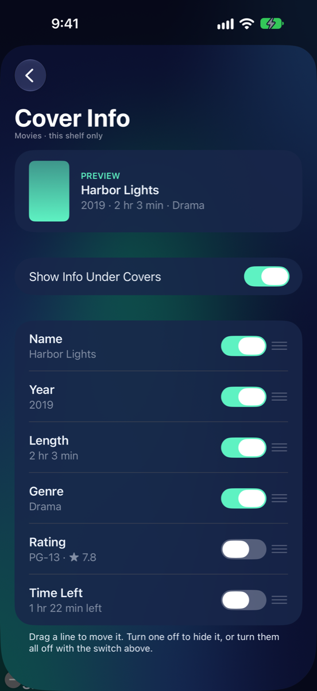

Everything in 1.341.0

**New**

- Cover Info: tap a shelf while editing Home, then Cover Info. Name, Year, Length, Genre, Rating and Time Left can be dragged into order and turned off one by one, or all at once with Show Info Under Covers. Each shelf keeps its own, and it comes back with a backup.
- Blur the Side Covers, in Settings → Home Screen, brings back the blur beside a carousel's middle cover (Carousel Blur sets how much).

**Changed**

- A carousel's side covers are sharp and dimmed instead of blurred, and their names no longer show under them.
- Under a cover: its name, then a line of details. On Continue Watching that's how long is left, and "S2 E3" for an episode.
- The progress bar on Home's covers runs along the picture's bottom edge instead of across its title.
- Home's name is a big title, with every Home in one switch beside it. Tap one to go to it, or touch and hold for Rename, New Home and the rest.

### Libraries get the whole open iPhone Duo

_Version 1.340.0 · 11 November 2026_

- On the iPhone Duo open on its side, a library or folder fills the screen: six posters across instead of four.
- Behind a card, the screen is blurred as well as dimmed, so the card is the one thing to read.
- A movie's or show's page still opens as a card down the middle.

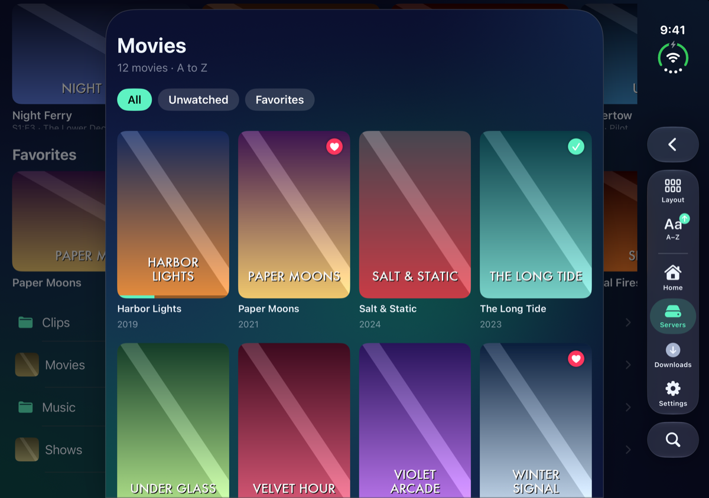

Everything in 1.340.0

**Changed**

- On the iPhone Duo open on its side (and on iPad on its side), a server, library or folder opened as a card runs from the screen's left edge to the buttons down the side, instead of a card down the middle. A movie's, show's or season's page stays down the middle. Partly folded like a book, cards still sit beside the fold.
- What's behind a card that doesn't fill the screen is blurred, and dimmed as before. On the Duo's front screen this hides Home's shelf titles above the card's top edge.

**New**

- Libraries Use the Whole Screen, in Settings → File Browsing → Cards on the iPhone Duo and iPad, turns the wide library card off.
- Blur Behind Cards, in the same place, turns the blur off.

### Movie and show libraries open as posters

_Version 1.339.0 · 11 November 2026_

- Jellyfin movie and show libraries open as a wall of posters, with the year under each name.
- All, Unwatched and Favorites sit above the posters, one tap each.
- On the iPhone Duo, a library, a show's page and a folder now fill their card instead of leaving an empty band down its right side.

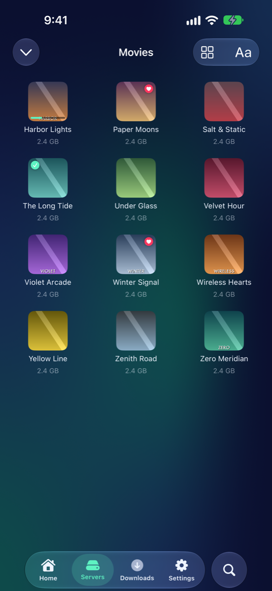

Everything in 1.339.0

**New**

- Posters, a new layout for Jellyfin movie and show libraries, and the one they open in: posters sized to fill the row (three across on an iPhone), the name and year under each, a tick on what you've watched, a heart on favorites, and a bar along a poster's foot for how far in you are.
- Above the posters: the library's name, how many it holds and their order, and three buttons, All, Unwatched and Favorites. A filter only applies in that library, and it's back to All when you leave Posters or reopen the app.
- Movie and Show Libraries in Settings → Jellyfin picks the layout these libraries open in. The layout button inside a library changes it too.

**Fixed**

- On the iPhone Duo's front screen, and open on its side, anything opened as a card (a library, a show's or movie's page, a folder, an album) left about a quarter of the card empty down its right side. It fills the card now.

### AV1 videos are lighter on the battery

_Version 1.338.2 · 10 November 2026_

- AV1 videos now play through your iPhone's own video hardware (iPhone 15 Pro and later), with half the processor work they took before.

Everything in 1.338.2

**Changed**

- AV1 videos play through the iPhone's video hardware on iPhones that have it (iPhone 15 Pro and later): on an iPhone 16 Pro Max a 1080p AV1 video went from a third of one processor core to a sixth, the same as H.264. Until now they were decoded by the app even where the hardware could do it. Older iPhones decode AV1 as before.

### VP9 videos are lighter on the battery

_Version 1.338.1 · 10 November 2026_

- VP9 videos (common in WebM files) now play through your iPhone's own video hardware, with about a third of the processor work they took before.

Everything in 1.338.1

**Changed**

- VP9 videos play through the iPhone's video hardware instead of being decoded by the app itself: on an iPhone 16 Pro Max a 1080p VP9 video went from about half of one processor core to under a fifth, the same as H.264, and uses less memory. Earlier iOS versions than 26.2 decode it as before.

### Video controls get out of the way

_Version 1.338.0 · 10 November 2026_

- While a video plays, its controls now go away on their own a few seconds after you last touch the screen.
- They stay while it's paused, while you scrub and while a menu is open. Choose how long, or Never, in Settings.

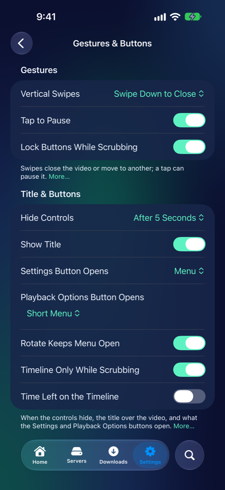

Everything in 1.338.0

**New**

- Hide Controls in Settings → Video Playback → Gestures & Buttons: the controls of a playing video go away on their own after 3, 5 or 10 seconds without a touch (5 to start with), or Never, as before. They stay while it's paused, while you scrub, while a menu or sheet is open, and with VoiceOver on.

### Sturdier playback for awkward videos

_Version 1.337.0 · 10 November 2026_

- Widescreen DVDs and recordings no longer look squeezed, and phone videos stand the right way up.
- TV recordings that don't start at zero now show the right time, and jumping around them lands where you aim.
- A damaged video skips past the bad part instead of stopping.

Everything in 1.337.0

**Fixed**

- Videos with non-square pixels (DVDs, 1440×1080 HD) now show at their proper shape, in Picture in Picture too.
- Phone videos that are marked as turned now show upright. Rotate still turns them by hand.
- TV recordings (.ts) and videos whose clock doesn't start at zero: the time and the timeline now start at 0, and the end is the end.
- Jumping around a .ts or .mpg file now lands on the moment you picked instead of up to a second later.
- A damaged stretch of video no longer stops playback. The picture comes back after it while the sound plays on.
- Formats MK Plus can't play, like Motion JPEG and DNxHD, now say so by name.
- If an SMB server stops answering in the middle of a video, the player now says so instead of showing an I/O error.

### Older video formats

_Version 1.335.0 · 9 November 2026_

- DivX, Xvid and Windows Media videos no longer play from shares and cloud storage. The player now says which format a video is when it can't play it.
- From Jellyfin, those videos still play: the server converts them.

Everything in 1.335.0

**Changed**

- DivX and Xvid, Windows Media Video (WMV) and VC-1, and old Flash videos don't play in MK Plus any more. From Jellyfin, the server converts them so they play.
- A few unusual kinds of H.264 and HEVC video that this device's video decoder can't handle, like some professional 4:2:2 recordings, don't play either, and Jellyfin converts those too.
- When a video won't play, the player says what format it is and what you can do, instead of a technical error.
- Windows Media Audio soundtracks are listed as not supported, like DTS. If the video has another soundtrack, that one plays.

### Show Me, switches and pictures in the changelog

_Version 1.331.0 · 9 November 2026_

- Changes in What's New and Settings → Changelog can take you to the setting they're about: tap Show Me.
- A new on/off setting has its switch right there, and some changes link to the guide or show a picture.
- Turn any of these off at the top of Settings → Changelog.

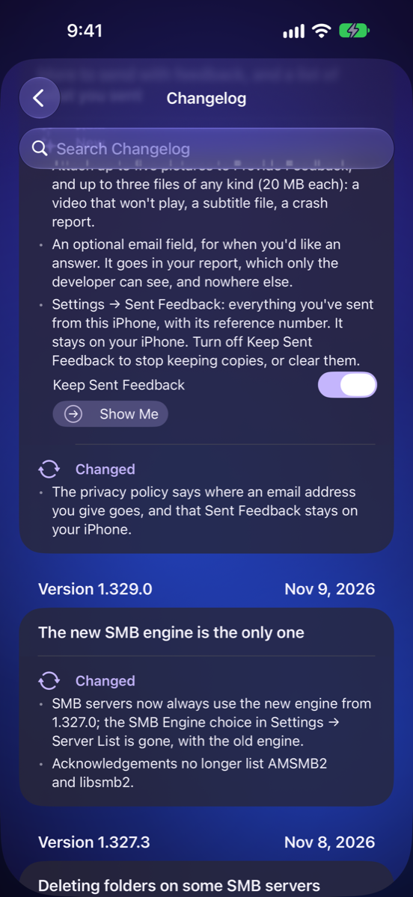

Everything in 1.331.0

**New**

- Show Me opens the setting a change is about, scrolled to it and flashing it, from Settings → Changelog and the What's New popup.
- On/off settings a change adds have their switch right under it, so you can try one straight away.
- Guide links open the guide site's page about a change in Safari.
- Pictures of a release from the guide site's What's New page show in the changelog and in What's New. They're loaded from the guide site when they're shown.
- Each of these has its own switch at the top of Settings → Changelog, under With Each Change.

**Changed**

- Searching Settings for Sent Feedback opens the page itself.
- The privacy policy says the changelog's pictures come from the guide site.

### More to send with feedback, and a list of what you sent

_Version 1.330.0 · 9 November 2026_

- Provide Feedback takes up to five pictures and three files of any kind.
- Add your email address if you'd like an answer. It's optional and stays in your report.
- Settings → Sent Feedback lists the feedback you've sent from this iPhone.

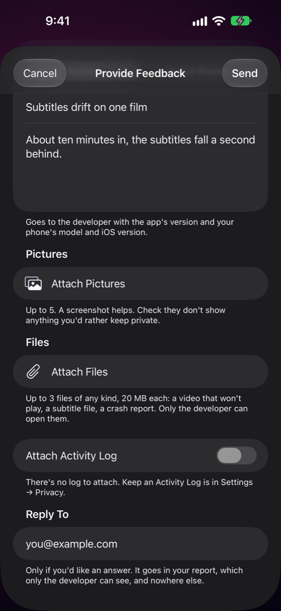

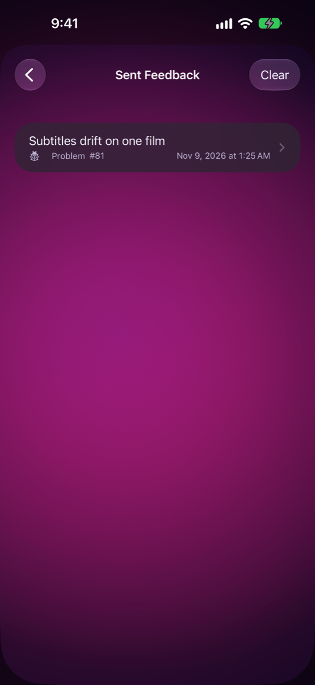

Everything in 1.330.0

**New**

- Attach up to five pictures to Provide Feedback, and up to three files of any kind (20 MB each): a video that won't play, a subtitle file, a crash report.
- An optional email field, for when you'd like an answer. It goes in your report, which only the developer can see, and nowhere else.
- Settings → Sent Feedback: everything you've sent from this iPhone, with its reference number. It stays on your iPhone. Turn off Keep Sent Feedback to stop keeping copies, or clear them.

**Changed**

- The privacy policy says where an email address you give goes, and that Sent Feedback stays on your iPhone.

### A new, faster way to reach SMB servers

_Version 1.327.0 · 8 November 2026_

- SMB servers are reached through a new engine: faster reads, and SMB 3 encryption where the server offers it.
- Copies within a server happen on the server itself, without coming down to your phone.
- If an SMB server stops working, Settings → Server List → SMB Engine → Previous brings back the old one.

Everything in 1.327.0

**New**

- Settings → Server List → SMB Engine: Standard (the new one) or Previous, for a release or two while the new one settles in.

**Changed**

- Browsing, playing, downloading, copying and backups to SMB servers go through the new engine, which reads faster and speaks SMB 3 with encryption.
- Copying a file or folder within a server is done by the server, so nothing comes down to your phone.

**Fixed**

- Stopping a copy from one server to another now stops the upload half too, and removes the part-written file.
- Writing a backup over a file that's already there replaces it instead of failing.
- A wrong SMB password brings up the sign-in again on servers where it didn't before.

### Magnify on Hold for the tab bar

_Version 1.324.0 · 8 November 2026_

- Touch the tab bar and slide along it: the bar grows, with each tab's name, and a glass bubble shows the tab under your finger bigger.
- Let go to open that tab, or slide off the bar to change your mind.
- Settings → Home Screen → Magnify on Hold turns it off.

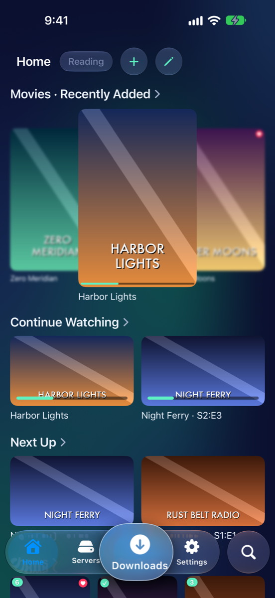

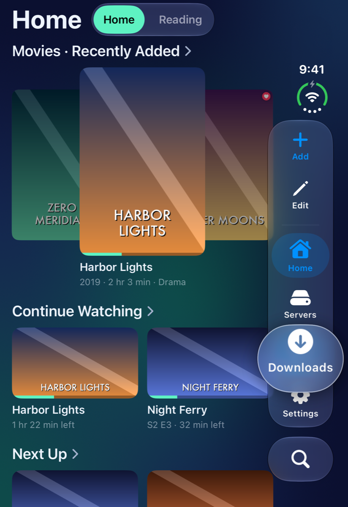

Everything in 1.324.0

**Changed**

- On Search, the bubble is now the magnified button itself, without a second ring inside it.
- With Reduce Motion on, the bubble no longer glides onto the tab you pick; it's there at once.

### VLC is gone: one fast player of MK Plus's own

_Version 1.321.0 · 7 November 2026_

- MK Plus no longer carries VLC: its own player plays everything Apple's player doesn't, and the app is about 44 MB smaller.

Everything in 1.321.0

**Changed**

- VLC's player and the VLCKit library are removed. Videos play in Apple's player or in MK Plus's own, as they have since 1.320.0.
- Settings → Acknowledgements no longer lists VLCKit and the libraries inside it.

**Fixed**

- Jellyfin and other servers behind a sign-in gateway (Cloudflare Access) play straight from the server in MK Plus's own player, as they did in VLC, instead of needing the server to convert them.

### The new video player, for everyone

_Version 1.320.0 · 7 November 2026_

- Videos Apple's player doesn't play — most .mkv files, DTS and TrueHD sound, Blu-ray subtitles — now play in MK Plus's own player, which jumps around a video on a share in about a second.
- Scrub previews, Picture in Picture and audio and subtitle choices work for those videos too.

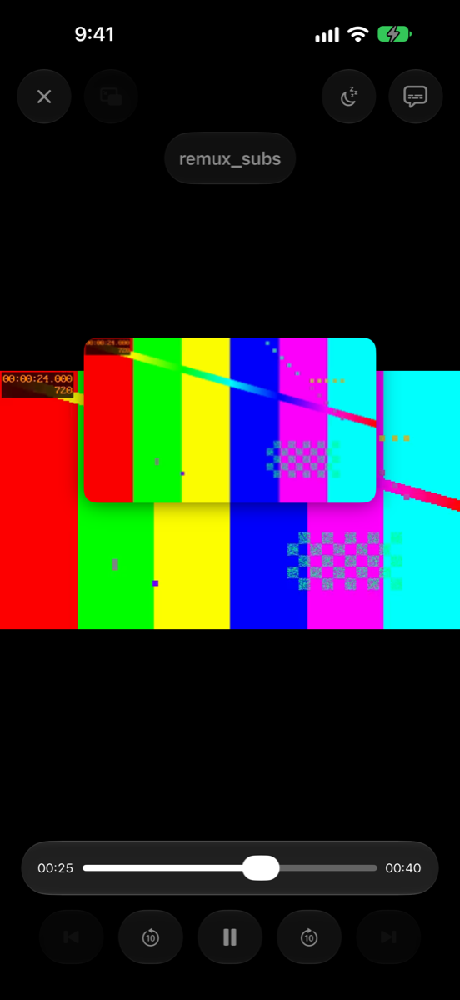

Everything in 1.320.0

**Changed**

- The new video player is no longer a beta: it plays every video that used to open in VLC, from shares, downloads, Jellyfin and cloud storage. The New Video Player (Beta) switch is gone.
- If Apple's player can't play a video, MK Plus's own player tries it; for Jellyfin, the server's conversion comes next. If nothing can, the player says so.
- Jellyfin's Streaming Quality and its switch to a lower quality when a video keeps stalling work in the new player too.
- Settings → Video Playback → Subtitles: Generate Subtitles for VLC Videos is now just Generate Subtitles.

### Hold the Servers tab to add a server

_Version 1.319.0 · 7 November 2026_

- Press and hold the Servers tab in the tab bar to add a server straight away.

Everything in 1.319.0

**New**

- Hold the Servers tab for half a second and Add Server opens, from whichever tab you're on. A tap still just opens the tab.
- Turn it off in Settings → Home Screen → Hold Servers to Add a Server.

### The new video player streams from Jellyfin

_Version 1.318.0 · 7 November 2026_

- With New Video Player (Beta) on, Jellyfin videos that used to go to the standard player now play in the new one, straight from the server.
- Your place and watched state go back to Jellyfin as you watch, for downloaded Jellyfin videos too.

Everything in 1.318.0

**New**

- New Video Player (Beta): Jellyfin videos the standard player would have streamed now play in the new player, with its scrub previews, Picture in Picture and subtitles.
- The new player tells Jellyfin where you got to and when you finish, so Continue Watching and watched marks stay right.

**Fixed**

- A downloaded Jellyfin video played in the new player now saves your place to the server, as the standard player does.
- The server's subtitle files load in the background instead of holding up the player.

### Subtitles in the new player's Picture in Picture

_Version 1.317.0 · 7 November 2026_

- Subtitles now show in the new video player's (Beta) Picture in Picture window, text and picture subtitles alike.
- They're drawn a size up so they're readable in the small window, in your caption style and Subtitle Size.

Everything in 1.317.0

**New**

- New Video Player (Beta): the subtitles you have on show in the Picture in Picture window too, whether they come from the file, a subtitle file or Generate Subtitles, in your caption style (Settings → Accessibility → Subtitles & Captioning) and Subtitle Size.

**Changed**

- In the window they're drawn bigger than on the full screen, so they can be read at that size.

### Picture in Picture in the new video player

_Version 1.315.0 · 7 November 2026_

- The new video player (Beta) can play in a floating Picture in Picture window: tap its button, or just leave the app with Picture in Picture on Leaving on.
- The window's play, pause and skip buttons work, and its bar shows how far in you are.

Everything in 1.315.0

**New**

- New Video Player (Beta): Picture in Picture. Tap the Picture in Picture button, or leave the app mid-video with Settings → Playback → Picture in Picture on Leaving on, and the video carries on in a floating window while you use other apps or browse this one.
- The window's play/pause and skip buttons control the video, and tapping its full-screen button brings the player back where it got to.

**Changed**

- Subtitles don't show in the Picture in Picture window yet; they're back as soon as you return to the full-screen player.

### The new video player plays on when locked

_Version 1.313.0 · 7 November 2026_

- With Keep Playing When Locked on, the new video player (Beta) keeps the sound going when you lock the phone or leave the app.
- Calls pause it, and unplugging headphones pauses it.

Everything in 1.313.0

**New**

- New Video Player (Beta): the sound plays on in the background with Keep Playing When Locked on, and when you come back the picture picks up where the sound is, without the sound stopping.
- A call, an alarm or another app's sound pauses it, and it carries on afterwards. Unplugging headphones or taking out AirPods pauses it.

**Changed**

- If the new player can't go on decoding a video partway through, the standard player takes over from where it got to instead of stopping.

### Scrub previews in the new video player

_Version 1.312.0 · 7 November 2026_

- With Scrub Preview Popup on, the new video player (Beta) shows a picture as you scrub, for any video.
- Scrubbing the same video again shows its pictures straight away, even next time you open it.

Everything in 1.312.0

**New**

- New Video Player (Beta): Scrub Preview Popup now works for every video it plays, not only ones from a Jellyfin server — the picture nearest your finger comes first.
- Previews are made only while you scrub or pause, so they never slow down playback, and they're kept for the next time you open the video.

**Fixed**

- Scrub previews in the standard player could show the wrong part of the picture the next time you opened a video.

### Audio and subtitles in the new video player

_Version 1.311.0 · 6 November 2026_

- The new video player (Beta) lets you pick the audio and subtitles, like VLC.
- Blu-ray and DVD picture subtitles show too, and chapters appear under the title.

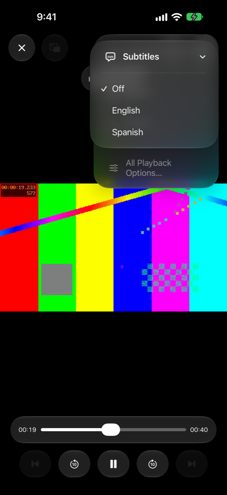

Everything in 1.311.0

**New**

- New Video Player (Beta): choose the audio track and subtitles in Playback Options. A video's own subtitles show at your Subtitle Size, above the controls when they're showing.
- Picture subtitles from Blu-rays and DVDs show where they were made to sit, and the video's default subtitles come on by themselves, as in VLC.
- Subtitle files beside a video, Auto Subtitles and generated subtitles work in the new player too, and chapter names show under the title.

### Try the new video player

_Version 1.310.0 · 6 November 2026_

- New Video Player (Beta) in Settings → Video Playback plays the videos that would open in VLC.
- It jumps around a video on your server in about a second, even a big film.

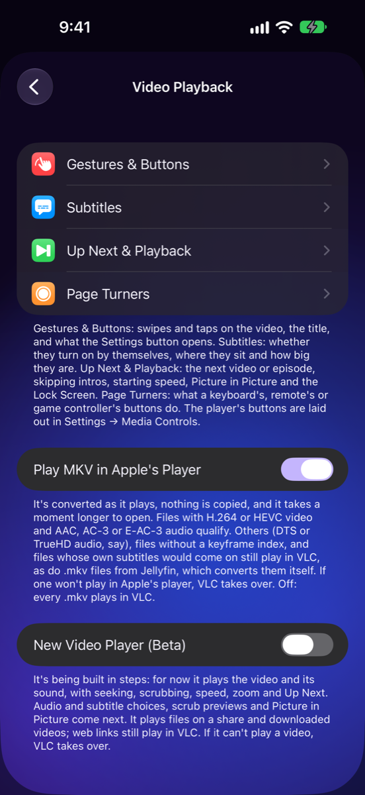

Everything in 1.310.0

**New**

- Settings → Video Playback → New Video Player (Beta), off to start with. Turn it on and videos that would play in VLC play in the new player instead, with the same buttons and gestures.
- For now it plays the picture and sound, with seeking, scrubbing, speed, zoom, rotation and Up Next. Choosing audio and subtitles, scrub previews and Picture in Picture come in the next updates.
- It plays videos on your shares and downloaded videos. Web links still play in VLC, and if it can't play a video, VLC takes over.

### Have a book read to you

_Version 1.308.0 · 6 November 2026_

- Tap the speaker in an EPUB's controls and it's read aloud from the page you're on, with the page turning along and the sentence highlighted.
- Pause, stop, or set the sleep timer to stop after a while or at the end of the chapter.
- Settings → Reading → Read Aloud sets the speed.

Everything in 1.308.0

**New**

- Read Aloud in EPUB books: the speaker button reads from the page shown, in your device's voice for the book's language.
- A bar while it reads with Pause, Stop and the sleep timer (a time, or End of Chapter).
- Settings → Reading → Read Aloud: Speed, Turn Pages to Follow and Highlight the Sentence.

### Cloudflare Access help, step by step

_Version 1.307.3 · 6 November 2026_

- Signing in to a server behind Cloudflare Access? Tap Step-by-step guide under the sign-in help for the three ways in and how to make a service token.

Everything in 1.307.3

**New**

- A Step-by-step guide link under the Cloudflare Access help in the server forms and on the Cloudflare sign-in screen.

### Step-by-step setup guides

_Version 1.307.1 · 6 November 2026_

- Adding Dropbox, Google Drive, OneDrive, Box or S3 storage? Tap Step-by-step guide under the form for numbered help, and for what to do if signing in fails.
- Settings → Setup Guide and Privacy Policy open them in Safari.

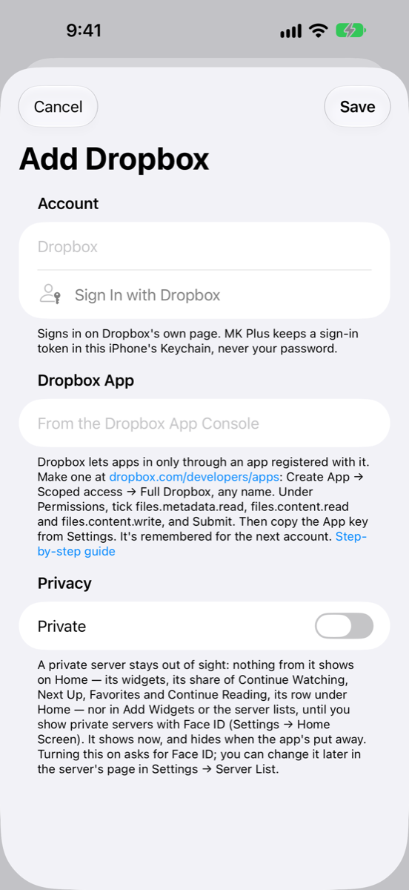

Everything in 1.307.1

**New**

- A Step-by-step guide link under the Dropbox, Google Drive, OneDrive, Box, S3 and Files folder forms, opening that service's page of the setup guide.
- Settings → Setup Guide and Settings → Privacy Policy.

### Add your Box account

_Version 1.307.0 · 5 November 2026_

- Add Server → Box: browse, play and copy from your Box files and folders.
- Big files copy up to Box in checked pieces, and a dropped piece is sent again.

Everything in 1.307.0

**New**

- Box as a server, signed in on Box's own page. Browse it, play videos and music, read books, download, rename, move, copy and delete — deleted things go to Box's trash.
- Back up to Box, and copy files of any size to it from another server.
- Box asks for an app you make in its developer console (free): the form says how, step by step.

### Add your OneDrive

_Version 1.306.0 · 5 November 2026_

- Add Server → OneDrive: browse, play and copy from your OneDrive, with a personal, work or school Microsoft account.
- Big files copy up in pieces and carry on after a dropped connection.

Everything in 1.306.0

**New**

- OneDrive as a server, signed in on Microsoft's own page. Browse it, play videos and music, read books, download, rename, move, copy and delete — deleted things go to OneDrive's recycle bin.
- Back up to a OneDrive, and copy files of any size to it from another server.
- OneDrive asks for an app you register with Microsoft (free): the form says how, step by step.
- Only your own files for now: things others shared with you, and OneNote notebooks, don't show yet.

### The music player opens again from a server or folder

_Version 1.305.2 · 5 November 2026_

- Tapping the mini player opens the full music player again when the music's playing in a server or folder opened from Home.

Everything in 1.305.2

**Fixed**

- In a server, folder or album opened from Home, tapping the mini player did nothing. It opens the full player again, with its queue.

### Cancel and Done stay put while you scroll

_Version 1.305.1 · 5 November 2026_

- Cancel, Save and Done no longer disappear while a screen scrolls.

Everything in 1.305.1

**Fixed**

- Scrolling a screen like Add Server could hide its top bar, with Cancel on it, until you scrolled back. It now stays, on every screen with a Cancel, Save or Done button.

### Copy big files up to Google Drive

_Version 1.305.0 · 5 November 2026_

- Files of any size can now be copied to Google Drive. The 100 MB limit is gone for Drive.
- If the connection drops for a moment, the copy carries on from where it was.

Everything in 1.305.0

**Changed**

- Copying to Google Drive sends big files a piece at a time, and picks up again after a short drop in the connection. Stopping a copy leaves nothing behind in Drive.

### Provide Feedback, right from the app, or with a shake

_Version 1.304.0 · 4 November 2026_

- Settings → Provide Feedback is now a short form for a problem or a feature you'd like.
- Attach an image and the Activity Log if they'd help.
- Shake your phone to open it from anywhere. You can turn that off in Settings.

### Copy the Activity Log yourself

_Version 1.303.0 · 4 November 2026_

- Turn on Settings → Privacy → Show Activity Log to read the app's log and copy or share it, to paste into a message or a bug report.

Everything in 1.303.0

**New**

- Settings → Privacy → Show Activity Log, off by default: a page to read the Activity Log, and copy or share it. Names, addresses and file names show as codes, as they do when it's attached to feedback.

### Google Docs in Google Drive

_Version 1.302.0 · 4 November 2026_

- Docs, Sheets, Slides and Drawings now show in Google Drive as PDFs, and open in the reader.
- Each one's made when you open it, so it's always the latest version.

Everything in 1.302.0

**New**

- Google Docs, Sheets, Slides and Drawings show as PDFs in a Google Drive server. Google stops at 10 MB for each one.
- Google Docs as PDFs in Settings → File Browsing leaves them out of the list if you'd rather not see them.

### Google Drive as a server

_Version 1.301.0 · 4 November 2026_

- Add your Google Drive, personal or Workspace, from Add Server: browse it, play, read, download and manage files like any other server, and back up to it.
- My Drive, Shared with me and shared drives are all there. Deleting moves things to Drive's Trash.
- It needs a Google client of your own, which takes a few minutes to set up. The form says how.

Everything in 1.301.0

**New**

- Google Drive in Add Server, signed in on Google's own page. Videos play in either player, with seeking.
- My Drive, Shared with me and Shared Drives at the top level, and shortcuts open what they point to.
- Back up the app to a folder in Google Drive, by hand or automatically.

**Changed**

- Google Docs, Sheets and Slides aren't shown yet, since there's no file to open. Files over 100 MB can't be copied up to Drive yet.

### Sign in to Jellyfin with Google or a passkey

_Version 1.300.0 · 4 November 2026_

- A Jellyfin that signs in with Google or a passkey can now be added from your phone alone: start Quick Connect and tap Approve in Safari.
- The code's filled in for you, and the sheet closes once it's approved. The server's admin needs Quick Connect turned on.

Everything in 1.300.0

**New**

- Approve in Safari beside a Quick Connect code, with your passkeys and whatever Safari's signed in to, so you don't need another device.

### Sign in to Kavita with a passkey

_Version 1.299.0 · 3 November 2026_

- A Kavita that signs in with Google or another OpenID login now opens in Safari's sign-in sheet, so your passkeys and Safari's sign-ins work.
- Copy the OPDS URL on Kavita's page and the sheet closes itself. Tap Paste in the app, and that's it, just this once.
- The page in the app is still a button away, or first if you prefer: Settings → Server List → Sign In with Safari First.

Everything in 1.299.0

**New**

- Sign in to Kavita's OpenID login in Safari's sign-in sheet, with passkeys and whatever Safari's already signed in to, then paste the OPDS URL into the app.
- Settings → Server List → Sign In with Safari First, on by default. Off, the page in the app comes first.

**Changed**

- Sign-in pages inside the app now say passkeys can't work on them, and offer Safari where it can get you back to the app.
- The app clears the OPDS URL from your clipboard as soon as you've pasted it.

### Search Jellyfin for people

_Version 1.298.0 · 2 November 2026_

- A Jellyfin search now finds actors, directors and other people.
- Tap someone to see the movies and shows they're credited on.

Everything in 1.298.0

**New**

- Jellyfin search finds people: among Everything, or on their own under Show → People.
- Opening a person lists the movies, shows, episodes and videos they're credited on.

### New servers come with widgets

_Version 1.297.0 · 2 November 2026_

- Add a server and its widgets appear on your top Home, ready to use.
- Jellyfin gets Continue Watching, Next Up and your newest movies and shows. Book catalogs get Continue Reading.
- Don't want this? Turn off Add Widgets for New Servers in Settings → Home Screen.

Everything in 1.297.0

**New**

- A server you add now puts widgets on the Home at the top of your list: its tile, plus Continue Watching, Next Up and up to three movie and show libraries for Jellyfin, or Continue Reading for a book catalog.
- Settings → Home Screen → Add Widgets for New Servers turns this off.

**Changed**

- A new server's tile goes on your top Home rather than the Home you're looking at, unless you turn the new setting off.
- A private server's widgets only go there if that Home shows private servers.

### Folder Loading page has your theme

_Version 1.296.7 · 2 November 2026_

- The Loading… page while a folder opens now has your Home's theme across the whole screen, not black.

Everything in 1.296.7

**Fixed**

- Opening a folder on a server showed a black page with the theme only behind the word Loading…. The theme now fills the page.

### Connecting page matches your theme

_Version 1.296.6 · 2 November 2026_

- The Connecting… page you see while a widget's folder opens now has your Home's theme instead of a plain background.

Everything in 1.296.6

**Fixed**

- Opening a server's folder from a themed Home showed a plain Connecting… page first. It now uses the Home's theme, as does the page that says a folder can't be opened.

### Big folders open without freezing

_Version 1.296.5 · 2 November 2026_

- Folders on a server with hundreds or thousands of files no longer freeze the app for seconds when they open or refresh.

Everything in 1.296.5

**Fixed**

- Opening a big folder on a share froze the app for several seconds (a folder of 552 items took 5-11 seconds each time it refreshed, and a bigger one would have taken far longer). The app was re-checking, for every row, whether the folder was a series of comics. It now checks once.

### Show Info is see-through

_Version 1.296.2 · 2 November 2026_

- Show Info's sheet is now semi-transparent, with your Home's theme tinted over the blur.

Everything in 1.296.2

**Changed**

- Show Info's sheet is semi-transparent: the folder shows through a blur, tinted with your Home's theme.

### Show Info keeps your theme

_Version 1.296.1 · 2 November 2026_

- Show Info's sheet keeps your Home's theme when you pull it all the way up.

Everything in 1.296.1

**Fixed**

- Show Info lost its theme (background, rows and colors) when pulled up to full height. It now keeps the Home's theme at every height.

### A bigger press-and-hold menu for files

_Version 1.296.0 · 2 November 2026_

- Press and hold a file or folder on a server for Select, Copy, Cut, Move, Rename, Show Info and Delete.
- Show Info lists a file's size, dates, type and, for pictures and videos, their resolution and more.
- Copy and Cut work without Select mode: a Paste button shows up in the folder you want them in.

Everything in 1.296.0

**New**

- Press and hold a file or folder on a server (or right-click it) for a menu: Select, Copy, Cut, Move, Rename, Show Info and Delete.
- Show Info shows the name, kind, size, where it is, when it was created and last changed, how many items a folder holds, and what's inside a picture, video or song: dimensions, resolution, length, frame rate, codecs and bitrate.
- A Paste button appears in a folder once you've copied or cut something, so you don't need Select mode.
- Settings → File Browsing → Hold Shows File Menu turns the menu off, so a press and hold starts Select mode as before.

**Changed**

- Pressing and holding a file now opens the menu instead of starting Select mode. Select is the menu's first item.

### Videos close straight away

_Version 1.295.1 · 2 November 2026_

- Closing a video VLC plays (an .avi, say) no longer hangs for a few seconds.

Everything in 1.295.1

**Fixed**

- Closing a video from a share that VLC plays took a few seconds while the player shut down. It now shuts down in the background.

### HDR and more MKV files in Apple's player

_Version 1.295.0 · 2 November 2026_

- HDR10, HLG and Dolby Vision .mkv files play in Apple's player in HDR on your iPhone.
- MKV files with FLAC or Opus audio now play there too.

Everything in 1.295.0

**New**

- HDR .mkv files (HDR10, HLG, Dolby Vision) play in Apple's player, marked as HDR. Dolby Vision profile 5 still plays in VLC.
- MKV files with FLAC or Opus audio can play in Apple's player.

**Fixed**

- An .mkv whose timeline doesn't start at zero no longer looks longer than it is, so seeking near the end works.
- An .mkv without a seek index now plays in VLC instead of being read in full over the network.

### MKV audio tracks and subtitles in Apple's player

_Version 1.294.0 · 2 November 2026_

- An .mkv playing in Apple's player now lists all its audio tracks, like a second language or a commentary, so you can switch between them.
- Its own subtitles (SRT and ASS) are in the Subtitles list and show over the picture.

Everything in 1.294.0

**New**

- Every audio track Apple's player can play is in the Audio list, by its name or language.
- The file's own text subtitles are in the Subtitles list. One the file marks as default comes on by itself.

**Changed**

- An .mkv with its own text subtitles no longer goes to VLC. Only files whose picture subtitles (Blu-ray or DVD style) would come on still do.

### MKV files play in Apple's player

_Version 1.293.0 · 2 November 2026_

- An .mkv on your share now plays in Apple's player when it can, with iOS's generated subtitles, AirPlay and Picture in Picture.
- Files it can't take (DTS or TrueHD audio, say) still play in VLC, and VLC steps in if one won't play.
- Turn it off in Settings → Video Playback → Play MKV in Apple's Player.

Everything in 1.293.0

**New**

- Tapping an .mkv on a share opens it in Apple's player when its video and audio allow. It's converted as it plays, and nothing is copied.
- Settings → Video Playback → Play MKV in Apple's Player (on). Off: every .mkv plays in VLC.

**Changed**

- An .mkv whose own subtitles would come on still plays in VLC for now, which shows them.

### Smoother scrubbing in the player

_Version 1.292.3 · 2 November 2026_

- After scrubbing with a finger on the video, the player's buttons come straight back instead of staying dimmed.
- The timeline stays where you let go instead of jumping back while the video catches up.

Everything in 1.292.3

**Fixed**

- With Lock Buttons While Scrubbing on, the buttons (the side column included) could stay dimmed and untappable after a scrub on the video.
- Dragging the timeline no longer rubber-bands: the thumb follows your finger, and after you let go it stays there until the video gets there.

### Delete a server from its own page

_Version 1.292.0 · 1 November 2026_

- A saved server's editor now has Delete Server at the bottom — tap Edit on its page in Settings → Server List, or edit it from a list.

Everything in 1.292.0

**New**

- Delete Server at the bottom of every saved server's editor (SMB, Dropbox, Files, S3, Jellyfin and OPDS catalogs). It asks first, then removes the server with its widgets on every Home and its saved sign-in.

### Easier sign-in for servers behind Cloudflare Access

_Version 1.291.0 · 1 November 2026_

- Adding a catalog behind Cloudflare Access now walks you through it: sign in to Cloudflare with Safari, then the server's own sign-in.
- A Kavita that signs in with Google (or another OpenID Connect login) opens that sign-in by itself once you're past Cloudflare — no password needed.

Everything in 1.291.0

**New**

- Add Catalog shows Sign In steps for a server behind Cloudflare Access: Cloudflare with Safari first, then the server's own sign-in. For a Kavita with OpenID Connect, its sign-in opens by itself and the catalog saves with your OPDS key.
- Settings → Server List → Guided Sign-In turns the steps off, if you'd rather sign in to each yourself.

**Fixed**

- Kavita's OpenID Connect sign-in no longer asks you to sign in to Cloudflare Access a second time partway through.
- Saving a Kavita with no password points you to its OpenID Connect sign-in instead of asking for one.

### No more buttons under the tab bar

_Version 1.290.1 · 1 November 2026_

- Settings → Home Screen's New Home is now at the end of the Homes list, instead of under the tab bar's Search on the iPhone Duo.

Everything in 1.290.1

**Fixed**

- With the floating tab bar on, Settings → Home Screen's + (New Home) sat under the bar's Search button on the iPhone Duo closed on its side. New Home is now a row at the end of the Homes list on every iPhone.

## October 2026

### Search the changelog

_Version 1.290.0 · 31 October 2026_

- Settings → Changelog has a search field: type a word to find the versions and changes that mention it.

Everything in 1.290.0

**New**

- Search in Settings → Changelog (and in the changelog opened from What's New): every word typed has to match; only the lines that mention them show, and "No Results" when nothing does.

### What's New, and a changelog in the app

_Version 1.289.0 · 31 October 2026_

- After an update, a popup like this one lists what's new.
- Settings → Changelog lists every version's changes, starting with this one.
- Downloads can show and hide private servers' downloads from the eye button at the top.
- Homes can Always Hide Private Servers, even after Face ID.

Everything in 1.289.0

**New**

- What's New: the first time you open the app after an update, a popup lists the highlights, with a button to the full changelog.
- Settings → Changelog: what changed in each version, newest first.
- Settings → What's New After Updates turns the popup off (or on again). The first popup offers it too.

**Changed**

- Recently: Downloads shows and hides private servers' downloads from the eye button at the top, as the Servers tab does (1.288.0).
- Recently: Settings → Home Screen → a Home → Always Hide Private Servers keeps private servers off that Home even after Face ID (1.287.0).

**Fixed**

- Recently: the tab bar's Downloads badge no longer counts hidden private servers' downloads (1.288.0).


